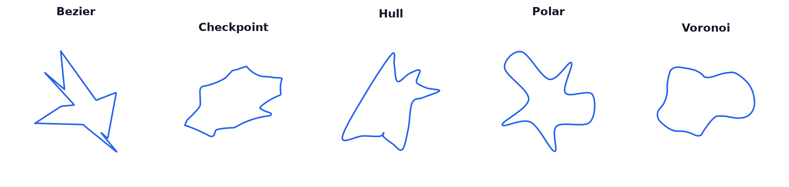

# TrackGen

**GPU-batched race tracks, gate courses, and the runtime signals to race
them — pure [NVIDIA Warp](https://github.com/NVIDIA/warp), CUDA-graph
native.**

[](https://antoinerichard.github.io/TrackGen/)
[](https://github.com/AntoineRichard/TrackGen/actions/workflows/docs.yml)


> [!NOTE]
> **Coming from 0.1?** Read [Upgrading from 0.1](https://antoinerichard.github.io/TrackGen/upgrading/from-0.1.html):
> most 0.1 code keeps running, but some results change without an error.

Given a batch of per-environment seeds, TrackGen generates `E` closed-loop
tracks (or gate sequences) in parallel — and then keeps working at sim
time: out-of-bounds collision, checkpoint progress and rewards, prop
instancing, all as Warp kernels over the same batched buffers.

```
seeds[E] ─► generator ─► resample ─► XPBD relax ─► road band ─► checks ─► Track ─► Course ─► your sim
            bezier · checkpoint · hull · polar · voronoi · repulsive     valid[E]   checkpoints · progress · collision
```



## What's in the box

| | | docs |
|---|---|---|
| **Six track generators** | Bezier, checkpoint-steering, hull, polar, Voronoi, and repulsive-growth (self-repulsive serpentines, far slower: for offline datasets) — one preset, per-env knobs | [Generators](https://antoinerichard.github.io/TrackGen/generators/overview.html) |
| **Pipelines as data** | Each generator runs a pipeline of stages described by a spec: start from a preset, swap or add stages, save and reload it | [Generating](https://antoinerichard.github.io/TrackGen/user-guide/generating.html) |
| **Relaxation & inflation** | XPBD-relaxed centerlines inflated into constant-width road bands — index-aligned outer/center/inner borders with tangent/normal frames | [How it works](https://antoinerichard.github.io/TrackGen/how-it-works/inflation.html) |
| **Gate sequences** | Batched gate courses with gate poses and collision-solved spacing | [Tutorial](https://antoinerichard.github.io/TrackGen/tutorials/gate-sequences.html) |
| **Checked results** | Every env is checked (self-crossings, thickness, truncation, ...): `valid[e]` and fail bits on every result | [Invalid envs](https://antoinerichard.github.io/TrackGen/user-guide/results.html#invalid-envs) |
| **Out-of-bounds collision** | Oriented boxes vs the drivable band — exact segment scan or baked SDF — plus disc obstacles (gate posts, cones) | [Collision](https://antoinerichard.github.io/TrackGen/utilities/collision.html) |
| **Boundary props** | Cone lines and wall pieces along any boundary, seam-free, for instanced rendering | [Props](https://antoinerichard.github.io/TrackGen/utilities/props.html) |
| **Checkpoints & progress** | Ordered goals from gates *or* subsampled centerlines; pass/lap events and `dist_to_next` rewards | [Progress](https://antoinerichard.github.io/TrackGen/utilities/progress.html) |
| **Track-frame localization** | Arc-length `s` / lateral offset `n` per env (warm-startable), centerline curvature, curvature-limited speed profiles | [Localize](https://antoinerichard.github.io/TrackGen/utilities/localize.html) |
| **The Course** | One object: `Course.track(...)` → `bind()` → `step()` / `reset(mask)` / `regenerate(mask=...)`, recordable into your CUDA graph | [Courses](https://antoinerichard.github.io/TrackGen/utilities/course.html) |
| **Plugins** | Your own generators, stages and runtime components, found through an entry point and checked by a conformance kit | [Extending](https://antoinerichard.github.io/TrackGen/contributing/writing-a-generator.html) |


## Install

Python ≥ 3.10; `numpy` and `warp-lang` ≥ 1.18 are the only runtime deps. The
`cuda` device needs an NVIDIA driver R580+ and an `sm_75`+ GPU (Warp's PyPI
wheels); the `cpu` device runs anywhere.

```bash
uv add "git+https://github.com/AntoineRichard/TrackGen.git@v0.2.0"                    # a release (recommended)
pip install "track_gen @ git+https://github.com/AntoineRichard/TrackGen.git@v0.2.0"   # or with pip
uv add "git+https://github.com/AntoineRichard/TrackGen.git@main"                      # or the latest main
```

From a checkout: `uv venv --python 3.12 && uv pip install -e ".[dev]"`.
Extras: `dev` (tests, torch, matplotlib) · `ui` (Gradio parameter explorer)
· `docs` (Sphinx). Details:
[installation](https://antoinerichard.github.io/TrackGen/getting-started/installation.html).

## Quickstart

Generate a batch of tracks from a preset:

```python
from track_gen import TrackGenerator
from track_gen.pipeline import presets

E, device = 64, "cuda:0"                     # or "cpu"
spec = presets.track(num_envs=E, device=device, half_width=0.03, n_max=512)
gen = TrackGenerator(spec, seeds=0)          # builds the pipeline, runs one generation
track = gen.generate()                       # a Track: flat [E * N_max] vec3f point fields
center = track.center.numpy().reshape(E, -1, 3)   # count[e] real points per env, then NaN
valid = track.valid.numpy()                  # [E]: 0 for an env that failed a check
```

…or let one object run the sim-time side — checkpoints, progress,
out-of-bounds checks, per-env regeneration:

<!-- snippet: setup
import warp as wp
pos = wp.zeros(E, dtype=wp.vec3f, device=device)
quat = wp.full(E, wp.quatf(0.0, 0.0, 0.0, 1.0), dtype=wp.quatf, device=device)
half_extents = wp.full(E, wp.vec2f(0.02, 0.01), dtype=wp.vec2f, device=device)
-->

```python
from track_gen.course import Course

course = Course.track(spec, checkpoint_spacing=0.6, collision="segments", seeds=42)
course.bind(position=pos, orientation=quat, half_extents=half_extents)  # your sim's [E] buffers
regen = course.inputs["regen_mask"]

res = course.step()                          # every sim step: progress events + contacts
valid = res.valid.numpy()                    # gate rewards and observations on valid
done = (res.contacts.oob.numpy() == 1) | (valid == 0)
if done.any():                               # a host read: only when an episode ended
    regen.assign(done.astype("int32"))
    course.regenerate(mask=regen, advance=True)   # new courses for those envs only
```

An env whose course failed a check (`valid[e] == 0`) reads `oob = 1` and
frozen progress: gate rewards and observations on `res.valid` and give it a
new course
([invalid envs](https://antoinerichard.github.io/TrackGen/user-guide/results.html#invalid-envs)).
On the `cpu` device (or with a generator that has a step that runs on the
host), `regenerate(mask=...)` runs a full generation even with an all-zero
mask, hence the `if`. On `cuda` it replays the course's own CUDA graph, which
skips an all-zero mask on device with CUDA 12.4 or newer (conditional nodes),
as does recording it into your own Warp capture
([RL auto-reset](https://antoinerichard.github.io/TrackGen/user-guide/rl-auto-reset.html#rl-cost)).

More: [quickstart](https://antoinerichard.github.io/TrackGen/getting-started/quickstart.html) ·
[concepts and terms](https://antoinerichard.github.io/TrackGen/getting-started/concepts.html) ·
[CUDA graphs in a sim](https://antoinerichard.github.io/TrackGen/tutorials/cuda-graph-in-a-sim.html)

## Documentation

| | |
|---|---|
| [Getting started](https://antoinerichard.github.io/TrackGen/getting-started/quickstart.html) | install, quickstart, concepts and terms, parameter explorer |
| [Upgrading from 0.1](https://antoinerichard.github.io/TrackGen/upgrading/from-0.1.html) | what changed, what to check, how to port |
| [Generating tracks and gates](https://antoinerichard.github.io/TrackGen/user-guide/generating.html) | presets, specs, params, seeds; [results](https://antoinerichard.github.io/TrackGen/user-guide/results.html); [curricula](https://antoinerichard.github.io/TrackGen/user-guide/curricula.html); [choosing a generator](https://antoinerichard.github.io/TrackGen/tutorials/choosing-a-generator.html) |
| [Generators](https://antoinerichard.github.io/TrackGen/generators/overview.html) | the six families, quality benchmarks |
| [Courses, simulators and RL](https://antoinerichard.github.io/TrackGen/utilities/course.html) | courses, [CUDA graphs in a sim](https://antoinerichard.github.io/TrackGen/tutorials/cuda-graph-in-a-sim.html), [RL auto-reset](https://antoinerichard.github.io/TrackGen/user-guide/rl-auto-reset.html), [runtime utilities](https://antoinerichard.github.io/TrackGen/utilities/overview.html) |
| [Extending TrackGen](https://antoinerichard.github.io/TrackGen/contributing/writing-a-generator.html) | generators, gate generators, stages, components, testing and packaging plugins |
| [Reference](https://antoinerichard.github.io/TrackGen/reference/api.html) | the public API, [configuration](https://antoinerichard.github.io/TrackGen/configuration/reference.html) |
| [Internals](https://antoinerichard.github.io/TrackGen/how-it-works/pipeline.html) | the pipeline, CUDA graphs, resample → XPBD → inflation |

## Development

```bash
PYTEST_DISABLE_PLUGIN_AUTOLOAD=1 python -m pytest -q -m "not slow and not benchmark and not cuda"  # fast lane (docs examples included)
PYTEST_DISABLE_PLUGIN_AUTOLOAD=1 python -m pytest -q                                              # full suite
PYTEST_DISABLE_PLUGIN_AUTOLOAD=1 python -m pytest -q tests/test_doc_snippets.py                   # docs examples only
python tests/_doc_snippets.py                                                                     # per-page docs examples report
python docs/_tools/build_ci_env.py -W --keep-going -E -b html docs docs/_build/html               # docs, as CI builds them
python docs/_tools/check_readme_anchors.py docs/_build/html README.md                             # README links into the docs
python -m sphinx -b linkcheck -q docs docs/_build/linkcheck                                        # external links
```

Contributing guides (dev setup, writing a generator, rendering the
committed figures) live in the
[docs](https://antoinerichard.github.io/TrackGen/contributing/dev-setup.html).
