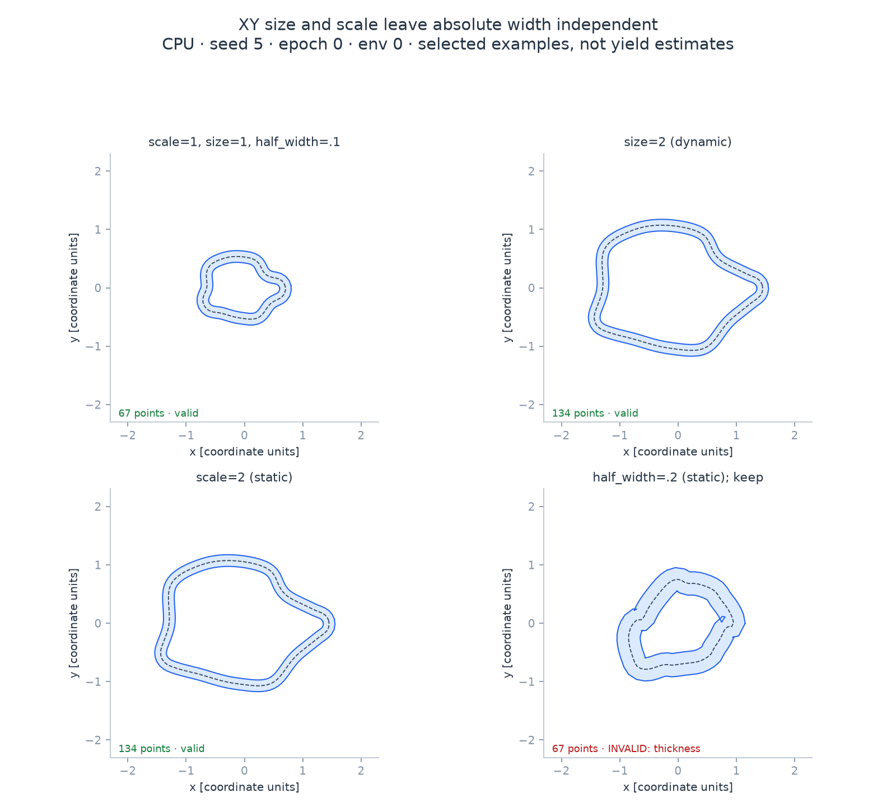
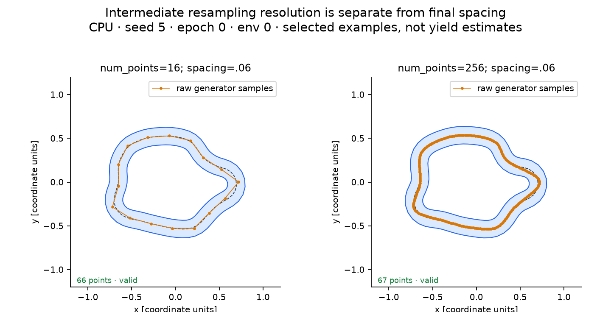
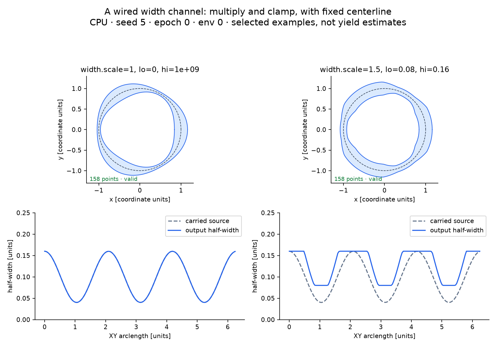
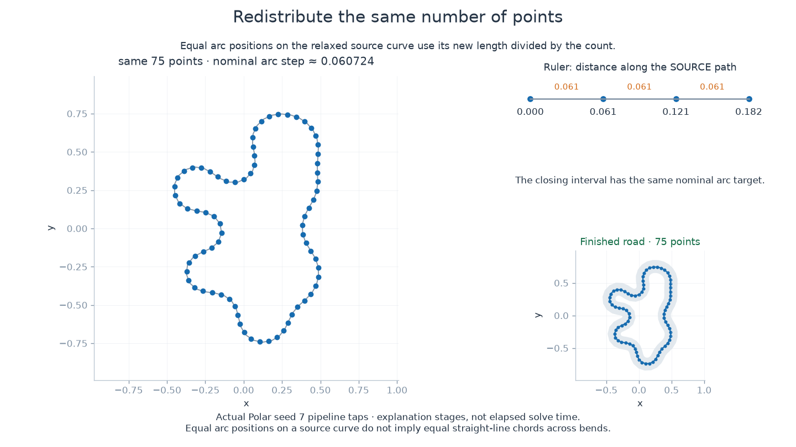
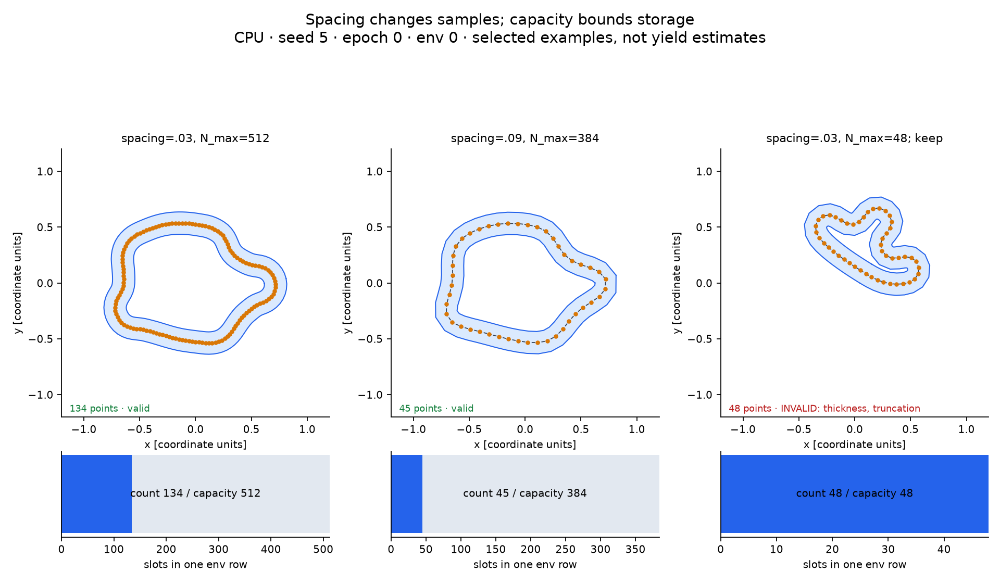

.. _course-controls:

Shape and sample a course
=========================

Choose the generator for the kind of corners you want, then set the course extent,
road width and sampling separately. Distances below use **your coordinate units**.
The figures use current CPU output at seed 5, epoch 0, env 0; these selected examples
explain controls, not the valid fraction of a batch.

         and doubled road half-width; the last candidate fails thickness validity.

   ``size`` and ``scale`` change XY coordinates. Width stays absolute. Widening the
   band changes the solver's clearance problem: the last candidate fails ``thickness``
   and is deliberately shown with ``on_invalid="keep"``.

Try it
------

.. code-block:: python

   from track_gen import TrackGenerator
   from track_gen.pipeline import presets

   gen = TrackGenerator(presets.track(
       num_envs=4, device="cpu", generator="polar",
       half_width=0.05, spacing=None, n_max=512,
   ), seeds=5)
   track = gen.generate()
   valid = track.valid.numpy() != 0
   count = track.count.numpy()
   center = track.center.numpy().reshape(4, 512, 3)
   real_loops = [center[e, :count[e]] for e in range(4) if valid[e]]

.. snippet: after

   import numpy as np
   assert real_loops and all(np.isfinite(p).all() for p in real_loops)

Extent, width and resolution
----------------------------

**Static** settings fix the built pipeline; rebuild to change them. **Dynamic**
settings have live per-env arrays under ``gen.params[stage_id]``. A frozen
``TrackGenConfig`` or ``GateGenConfig`` sets their initial values; changing a live
parameter does not mutate that config.

.. list-table:: Shared controls
   :header-rows: 1
   :widths: 24 23 53

   * - Setting and default
     - Kind / units
     - Effect and tradeoff
   * - ``scale=1``
     - Static / XY multiplier
     - Changes procedural coordinate extent. More perimeter needs more samples.
       For Repulsive it also changes the growth force balance; see :ref:`repulsive-limits`.
   * - ``size=1``
     - Dynamic / XY multiplier, ``[0.1, 10]``
     - Changes each env's extent without rebuilding. Does not scale altitude,
       road width, spacing, gate width or gate radius. Reserve capacity for its maximum.
   * - ``half_width=0.1``
     - Static / distance, ``>0``
     - Half the road's full width; used by width, relaxation, offset and validity.
   * - ``spacing=None``
     - Static / distance, ``>0``
     - Resolves to ``0.6 * half_width`` (``0.06`` at defaults). Smaller values
       increase real point counts and solver/storage cost.
   * - ``num_points=256``
     - Static / raw samples
     - Procedural centerline resolution before constant-spacing resampling.
       It does not set the final real count.
   * - ``n_max=384`` (config: ``N_max``)
     - Static / slots per env
     - Storage stride and maximum final point count. Increasing it adds headroom,
       not new shape detail to a track that already fits.

   Orange marks show raw generator samples; blue is the final band at the same
   requested ``spacing=.06``. Sparse raw sampling can change the curve before
   relaxation. The two counts are reported independently of ``num_points``.

The width stage is ``width.constant`` by default. ``width.from_channel`` instead reads
a wired float32 channel and computes ``cl.half_width = clamp(scale * src, lo, hi)``.
Its ``scale=1``, ``lo=0`` and ``hi=1e9`` are dynamic, nonnegative values (``scale``
is dimensionless; bounds are distances). This ``width.scale`` changes widths, unlike
``generator.size``. A runtime ``hi < lo`` uses ``lo`` as the upper bound; a NaN
source stays NaN and can fail validity. Later resampling interpolates the resulting
width channel. See :ref:`pipeline-carried-channels` and the
:doc:`full stage reference <reference>` for wiring.

         with width multiplied by 1.5 and clamped between .08 and .16.

   A supplied ``guide.width`` channel on a fixed circle, with its carried values
   and final half-width below. Changing ``width.scale`` and clamps leaves the XY
   centerline fixed here (external input, no relaxation). Coordinate units are
   distances; the multiplier is dimensionless.

.. _sampling-stages:

From raw samples to road beads
-------------------------------

The generator's ``num_points`` and the road's ``spacing`` control different stages.
This clip follows one actual Polar seed-7 loop through the shared track pipeline:

1. The generator supplies 256 fixed-count raw samples.
2. Constant-spacing resampling uses arc positions ``k * spacing`` on that loop.
   The closing remainder can be shorter; the count is chosen from length and capacity.
3. XPBD moves positions without changing that count.
4. Uniform redistribution places the same count at equal arc positions on the
   relaxed source polyline. Its nominal step is the new source length divided
   by the count, so it need not equal the initial spacing target exactly.

   In this example ``spacing=.06`` produces 75 road beads. The final uniform stage
   uses a nominal source-arc interval of about .060724 after relaxation.

.. raw:: html

   <video controls preload="none" style="width:100%;max-width:100%;aspect-ratio:5/3;object-fit:contain" poster="../_images/pipeline-sampling.png" aria-label="Fixed-count raw samples, target-distance samples, XPBD movement and final same-count uniform redistribution.">
     <source src="../pipeline-sampling.mp4" type="video/mp4">
     Fixed-count raw samples, target-distance samples, XPBD movement and final same-count uniform redistribution.
   </video>

:download:`Download the sampling animation <../assets/racing/pipeline-sampling.mp4>`.

Distances here are measured **along the source curve**. Straight-line chords
between adjacent output points can be shorter where they cut across bends.
Arrows show actual net XPBD movement, not interpolated solver iterations;
:doc:`/relaxation/convergence` shows the solve itself.

Spacing and capacity
---------------------

         a truncated, invalid road using a capacity of 48.

   Smaller spacing creates more real beads. The bars below show actual count and
   unused slots. With only 48 slots, the fine sample is truncated: the kept candidate
   closes across missing geometry and fails ``truncation`` and ``thickness``.

Use the longest **pre-relaxation resampled perimeter** in your intended size range:

.. code-block:: text

   N_max >= floor(max_perimeter / spacing) + 1

TrackGen flags an overflow with ``truncated=1`` and invalidates it. The default
``on_invalid="poison"`` then sets its count to zero and geometry to NaN; ``keep``
preserves the failed candidate for diagnosis. Never treat the closing chord of a
truncated candidate as a usable road. See :ref:`invalid-envs`.

An explicit spacing does not follow a later width change. Configs resolve ``None``
at construction; when replacing a config with a new width, pass ``spacing=None``
again to recouple it. Imported centerlines use their supplied coordinates: set
width, spacing and capacity for those units (:ref:`ingesting-centerlines`).

Live parameters and randomization
---------------------------------

.. code-block:: python

   gen.params["generator"].set("size", 1.5)
   larger = gen.generate()            # same seed/epoch, new live size
   drawn = TrackGenerator(presets.track(
       num_envs=4, device="cpu", n_max=512,
       randomize={"generator.size": (0.8, 1.5)},
   ), seeds=5)

``randomize`` draws dynamic float32 fields on every generation; a randomizer owns its
target and overwrites it before the stage runs. Its ``lo`` / ``hi`` bounds are live,
and draws are deterministic per seed, epoch and stage id, in ``[lo, hi)``. Static
fields and dynamic int32 fields cannot be randomized this way. In particular,
Bezier/hull track ``min_num_points`` is dynamic int32, while the native-gate version
is static. Use an explicit integer setter for track corner curricula.

For tracks and Bezier/hull native gates, size lives at ``generator.size``.
Polar/Voronoi/checkpoint native gates use ``normalize.size``. Imported ``external``
geometry has no size control. Drawn ranges must fit the target's declared bounds;
scalar setters reject out-of-range values, while raw array writes are clamped when
used. See :doc:`/user-guide/curricula` for latched ``in_effect`` values, masked
updates and utility-resolution/capacity planning.

Repair a failed candidate
-------------------------

Read ``fail_mask`` first. A capacity failure needs more capacity or less perimeter,
not more solver sweeps. A grade failure needs gentler elevation or a different
acceptance threshold. Changing validity accepts/rejects geometry; it does not repair it.

For road thickness or sharp bends, compare more relaxation sweeps, a narrower road,
or a less crowded generator configuration. Measure your current batch's valid
fraction, including the extremes of any curriculum; no fixed seed picture predicts it.

All XPBD settings below are **static**. Their visual mechanics and actual iterative
states are on :doc:`/relaxation/constraints`, :doc:`/relaxation/solver` and
:doc:`/relaxation/convergence`.

.. list-table:: Relaxation controls
   :header-rows: 1
   :widths: 39 61

   * - Setting / default
     - Effect and tradeoff
   * - ``relax_iters=50``
     - Jacobi sweep budget; more sweeps increase work and may resolve remaining constraints.
   * - ``relax_margin=0.15``
     - Fractional separation expansion: target ``2 * half_width * (1 + margin)``.
       More margin asks for more room and can distort spacing.
   * - ``relax_band=None``
     - Index-neighbor exclusion count, auto ``round(2 * half_width / L0)``.
       Widening it omits more nonlocal pairs; it is not a safe speed control.
   * - ``relax_sep_relax=1``, ``relax_spc_relax=1``, ``relax_bend_relax=1.5``
     - Dimensionless correction strengths. Strong corrections can oscillate;
       softer corrections may need more sweeps.
   * - ``relax_accel="chebyshev"``
     - Accelerates the sweeps; ``"none"`` uses plain Jacobi.
   * - ``relax_cheby_rho=0.98``, ``relax_cheby_gamma=0.9``, ``relax_cheby_start=8``
     - Spectral-radius estimate ``[0,1)``, damping ``(0,1]`` and first accelerated
       sweep ``>=1``. Tune against convergence, rather than expecting a shape trend.
   * - ``relax_sep_every=20``
     - Broadphase refresh interval ``>=1``; with no cache, separation is skipped
       between refreshes. Keep it below the sweep budget to permit refreshes.
   * - ``relax_sep_cache_slots=16``, ``relax_sep_cache_skin=0.5``
     - Candidate slots per bead (``0`` disables cache) and fractional search skin.
       More slots/skin cost memory or work and can retain more approaching pairs.
   * - ``relax_smooth_passes=5``, ``relax_smooth_spacing_iters=10``
     - Taubin smoothing and spacing-only polish budgets, both ``>=0``.
       Set both to zero to view the main solve alone.

The presets' ``relax="auto"`` selects the generator's preference: XPBD for procedural
built-ins, none for external geometry. ``relax=None`` skips it; flat configs use
``relax_enable=False``. ``relax_tol=0.02`` belongs to **validity**, not the solver:
the accepted sampled thickness threshold is ``(1 - relax_tol) * half_width``.
``turning_tol=.1`` radians, ``w_floor=.001`` distance,
``validity_border_check=False`` and ``z_valid_grade=0`` (off) are also static acceptance
controls. See :ref:`geometry-validity` for their limits.

Execution settings do not shape the road
----------------------------------------

``device="cpu"`` and ``num_envs=1`` are the config defaults; presets require both
explicitly. They select execution device and batch rows. ``generator_params=None``
uses the chosen family's defaults; a Params instance or mapping configures only that
family. Conflicting non-default flat shortcuts raise rather than silently win.

Construction allocates and warms the generator. ``seeds``, ``advance``, ``mask``,
``stream`` and ``out`` govern reproducibility, execution and storage, not a new geometry
style. Results are borrowed, reused buffers; use ``clone()`` off the hot path for a
snapshot. The :doc:`result contract </user-guide/results>` and
:doc:`generation guide </user-guide/generating>` cover layout, ownership, streams and
capture. Open topology is not supported: ``BatchSpec.closed=False`` is refused.

For shape-specific controls, choose a :doc:`generator </tutorials/choosing-a-generator>`.
For altitude, continue to :doc:`/tracks-25d`; for openings, radius and ordering, use
:doc:`/tutorials/gate-sequences`.
