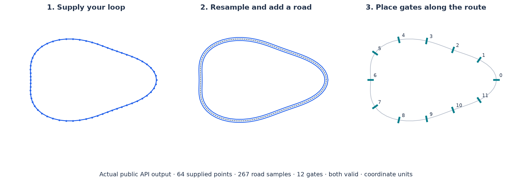

.. _importing-a-track:

Import a track or route
=======================

Use ``generator="external"`` when you already have an ordered closed centerline. The
standard pipeline resamples it, adds road borders and runs validity checks. The preset
keeps relaxation off so it preserves your route's shape; opt into XPBD if you want the
points moved to improve separation.

   Actual output from the example below. The input closes implicitly: do not repeat the
   first point at the end.

Make a road
-----------

.. code-block:: python

   import numpy as np
   from track_gen import TrackGenerator, GateGenerator
   from track_gen.pipeline import load_centerlines, presets

   t = np.linspace(0, 2 * np.pi, 64, endpoint=False)
   r = 1 + 0.12 * np.cos(3 * t)
   xy = np.column_stack((2 * r * np.cos(t), 1.25 * r * np.sin(t))).astype(np.float32)

   gen = TrackGenerator(presets.track(
       num_envs=1, device="cuda:0", generator="external",
       num_points=128, n_max=512, spacing=0.04, half_width=0.05,
   ))
   load_centerlines(gen, [xy])
   track = gen.generate()

.. snippet: after

   assert track.valid.numpy()[0] == 1
   assert track.count.numpy()[0] > len(xy)

All distances use your coordinates' units. ``num_points`` is input capacity per
environment; ``n_max`` is output capacity. For perimeter ``L``, allow at least
``floor(L / spacing) + 1`` output slots, with headroom if relaxation moves points.
Loading validates finite ordered points, counts and capacity on the host; it raises
with a useful message when the data cannot fit.

Place gates along the same route
--------------------------------

.. code-block:: python

   gate_gen = GateGenerator(presets.gates(
       num_envs=1, device="cuda:0", generator="external", source="stations",
       num_points=128, gates=12, gate_width=0.15,
   ))
   load_centerlines(gate_gen, [xy])
   gates = gate_gen.generate()

.. snippet: after

   assert gates.valid.numpy()[0] == 1
   assert gates.count.numpy()[0] == 12

Stations sample the raw supplied route here. Use ``source="relaxed_stations"`` when you
want the resampled/relaxed route instead. The visual source and spacing comparisons are
in :doc:`/tutorials/gate-sequences` and :doc:`/gates-3d`.

Bring altitude, width and attributes
------------------------------------

``generator_params={"with_z": True}`` declares supplied altitude. Pass matching ``z=``
rows to ``load_centerlines``. ``with_half_width=True`` similarly accepts
``half_width=`` rows, and ``attributes`` declares named values and interpolation policies.
Supplied channels replace the corresponding computed stages; they are not added twice.
The complete input shapes, validation rules and interpolation policies are in
:ref:`ingesting-centerlines`.

For repeated loading, pass ``envs=`` to update selected rows, then regenerate those
environments with a mask. ``load_centerlines`` allocates staging memory and waits for
uploads: use it outside CUDA capture. For a model or simulator producing loops on the
device, write ``gen.inputs["centerline.xy"]`` and the matching count/channel buffers
from your own kernels on the generation stream before enqueueing generation. Keep the
pointers stable; see :ref:`generator-runtime-params` for the ordering rules.

``external`` consumes coordinates as supplied, has no dynamic ``size`` and does not use
random seeds to change the input. To resize it, transform your input coordinates and
size output capacity accordingly.
