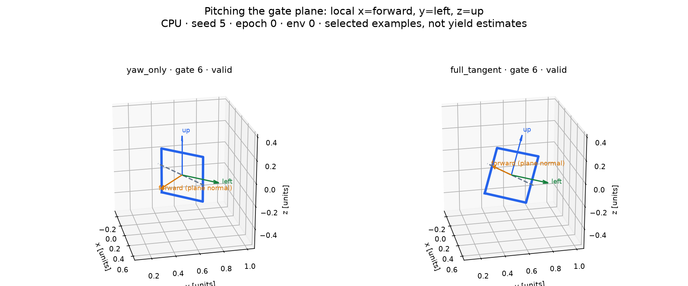
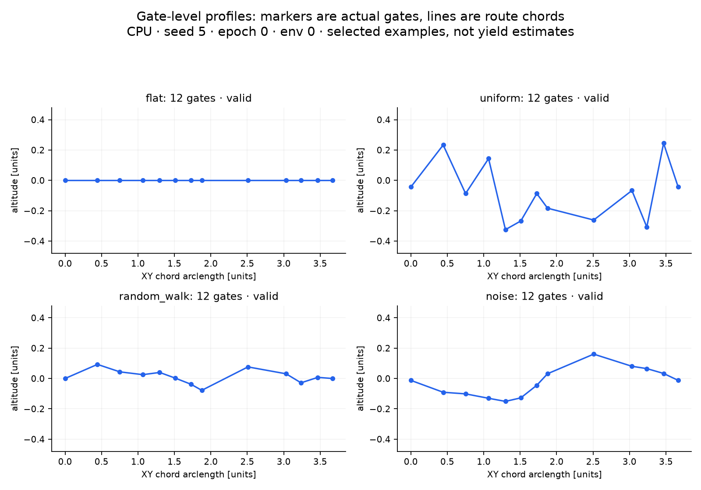
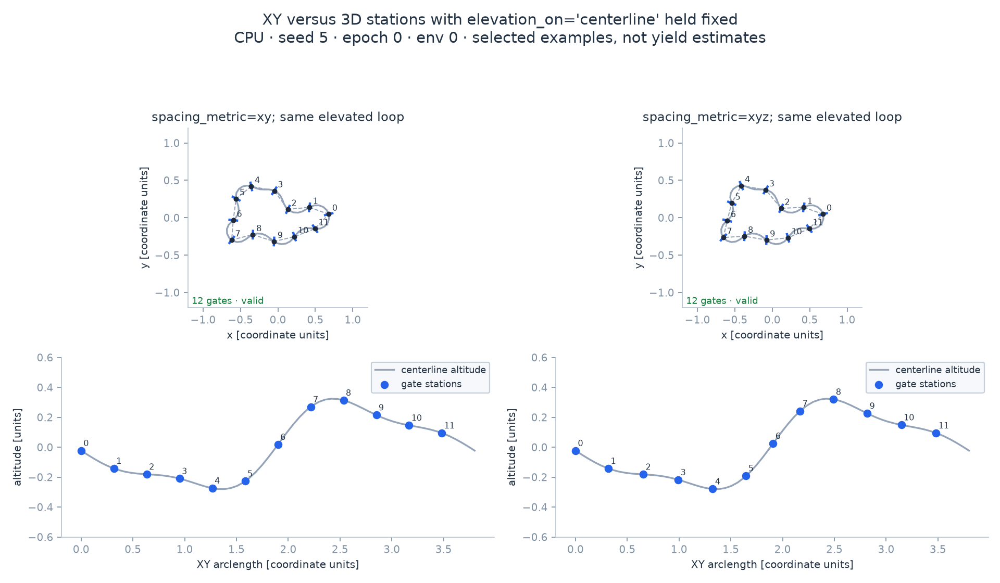

3D gate courses
================

Add altitude to ordered XY gates, then choose whether their planes stay upright or
follow the 3D flight direction. The opening, orientation and collision geometry are
three-dimensional even when the course is flat.

         showing local forward, left and up axes and the shared route tangent.

   One actual gate from seed 5, epoch 0, env 0, with the same position, tangent and
   width in both modes. Orange is the physical plane normal. Blue outlines the square
   opening; it does not depict a configured frame thickness. The left-right axis
   stays horizontal in these roll-free frames; full-tangent pitches the plane/up axis.

Try it
------

.. code-block:: python

   import numpy as np
   from track_gen import GateGenerator
   from track_gen.pipeline import presets

   E = 4
   gen = GateGenerator(presets.gates(
       num_envs=E, device="cpu", generator="polar", gate_width=0.1,
       gate_align="full_tangent",
       elevation=("noise", {"z_min": -0.3, "z_max": 0.3,
                            "z_noise_amplitude": 0.2}),
   ), seeds=5)
   gates = gen.generate()
   count = gates.count.numpy()
   valid = gates.valid.numpy() != 0
   position = gates.position.numpy().reshape(E, gen.max_gates, 3)

.. snippet: after

   assert valid.any()
   assert all(np.isfinite(position[e, :count[e]]).all() for e in range(E) if valid[e])

Altitude at gates
-----------------

The built-in pipeline runs anchors → order → optional extent normalization → XY sphere
separation → altitude → lift → tangents → frames → validity. Elevation is applied after
the centers have moved; it does not repair XY spacing or projected bar crossings.
A native gate generator that provides Z or tangent omits the corresponding computation
(:ref:`pipeline-provides`).

The :doc:`road elevation guide </tracks-25d>` shows all four profiles and their live
controls, defaults, units and clipping windows. The difference for gates is where the
knots lie:

.. list-table:: Gate altitude profiles
   :header-rows: 1
   :widths: 22 78

   * - Profile
     - Behavior on native gates or gate-level elevation
   * - ``flat`` (default)
     - Every gate has static ``z_base=0`` by default. The preset's ``z_base`` fills
       ``elevation.flat`` (a road uses its flat lift instead).
   * - ``uniform``
     - Every real gate draws an independent height in dynamic ``[z_min,z_max]``.
   * - ``random_walk``
     - Gates are the walk knots. Bridge closure and bounds shape the result;
       dynamic ``z_max_step`` scales increments by XY chord distance.
   * - ``noise``
     - Periodic harmonic altitude evaluated at gate XY-arclength fractions;
       static harmonic count, dynamic amplitude and bounds.

There is no ``z_control_points`` field in ``GateGenConfig``. Gate-level
uniform/random-walk stages use the gates themselves as knots; the shared stage
Params' knot-count field does not change that. Centerline-level elevation instead
uses the track interpolation model and its knot count.

``z_min <= z_max`` and a nonzero window are needed for varying altitude. Native gate
``size`` changes XY coordinates while leaving Z, width and radius absolute. A positive
static ``z_valid_grade`` checks realized ``abs(dz)/XY chord distance`` between every
adjacent gate, including closure; ``0`` disables it. It is an acceptance check, not
a guarantee supplied by ``z_max_step``.

         gates, with gate markers and straight route chords.

   All four gate-level profiles on identical XY centers, seed 5, epoch 0, env 0.
   Uniform and random walk make their decisions at the gates themselves, whereas
   the road profiles interpolate a separate knot model. Straight lines join
   gate heights; they do not depict the runtime Catmull-Rom spline.

.. _gates-3d-stations:

Gates on an elevated centerline
-------------------------------

         shown in plan and altitude against XY arclength with numbered gates.

   ``elevation_on="centerline"`` is fixed in both panels. Equal 3D stations move closer
   in XY on steeper portions, because altitude contributes to distance. Radius is zero
   here to keep the subsequent gate solve from moving stations. Seed 5, epoch 0, env 0.

.. code-block:: python

   station_spec = presets.gates(
       num_envs=E, device="cpu", generator="bezier",
       source="relaxed_stations", gates=12,
       elevation=("noise", {"z_min": -0.3, "z_max": 0.3,
                            "z_noise_amplitude": 0.2}),
       spacing_metric="xyz", elevation_on="centerline",
       gate_radius=0, gate_width=0.1,
   )
   stations = GateGenerator(station_spec, seeds=5).generate()

.. snippet: after

   ok = stations.valid.numpy() != 0
   assert ok.any() and (stations.count.numpy()[ok] == 12).all()

``spacing_metric="xy"`` (default) measures centerline plan-view arclength;
``"xyz"`` measures its 3D polyline arclength before gates are placed. The metric and
altitude placement are separate controls. ``elevation_on=None`` defaults to
``"gates"`` for XY and ``"centerline"`` for XYZ on relaxed stations. Switching the
metric with that default can therefore also change **where altitude is drawn**.
For a meaningful comparison, explicitly keep centerline elevation in both pipelines.

The loop must have altitude before XYZ stations are placed: a generator may provide
``raw.z``, or a non-flat elevation can run on ``source="relaxed_stations"`` before
stations. That Z is carried by index to the gates, with no gate-level elevation.
Later sphere separation can move stations away from equal arc spacing; set
``gate_radius=0`` if exact station positions must remain untouched.

Unsupported combinations raise ``ValueError``:

- XYZ spacing with native anchors or a loop lacking Z;
- centerline elevation with raw ``source="stations"``;
- XYZ spacing with gate-level elevation when the generator supplies no loop Z;
- explicit ``elevation_on`` when the generator already supplies Z;
- an order other than ``raw`` when Z is carried from the loop by index.

See :ref:`pipeline-stations-xyz` for plugin/provider details. Exported channels of an
elevation moved onto the centerline are not exported as gate attributes; stations
carry the generator's attributes. Gate-level altitude tables stay XY-based because
they are used to compute Z itself.

Gate alignment and opening
--------------------------

``gate_align="yaw_only"`` (default, static) projects the route tangent onto XY and
makes an upright, roll-free plane. ``"full_tangent"`` uses the full 3D tangent as
the plane normal, pitching the plane to face the actual route. Near-vertical or
degenerate directions use a deterministic horizontal fallback, counted in
``gen.frame_fallbacks``. The default frame has local x forward, y left, z up.
A posed provider may additionally supply roll and per-gate half-size.

``gate_width`` is the full square-opening width; ``half_size=.5*gate_width``.
``left`` and ``right`` are its center-height lateral endpoints, not the four corners.
Get a corner as ``position ± half_size*left_axis ± half_size*up_axis``, rotating local
y and z by ``orientation``. Point gates (width zero) have no traversable opening.
See :ref:`gate-width-per-env` for live width and native-gate size routing.

.. _gates-3d-runtime:

Use the frames in a simulator
-----------------------------

``Course.gates`` supplies checkpoints, progress, a closed 3D ``CourseLine`` and an
optional collision backend (:doc:`/tutorials/gate-sequences`). A gate pass uses swept
motion against the **pose forward plane**, bounded laterally and vertically by the
opening. A yaw-only gate is crossed where its upright plane stands, even when the
route tangent slopes.

``res.frame`` localizes on a periodic Catmull-Rom spline through the gate centers.
It reports true sampled 3D arclength ``s``, lateral offset ``n`` (positive right),
vertical offset ``n_up`` in its roll-free frame and the nearest segment. The spline
samples use uniform parameter steps per gate segment, not constant arclength.
Validity checks the anchors, not how far that interpolating spline bows between them.
Invalid envs have a NaN frame and segment ``-1`` (:ref:`utilities-invalid-envs`).

Two collision models are available:

- ``collision=<positive post radius>`` checks endpoint discs against an oriented XY
  agent box. This is a projected post model, independent of altitude.
- ``collision=tools.FrameCollision(radius, frame_thickness, frame_depth)`` checks an
  agent sphere against four oriented 3D square-frame members. All three sizes must
  be positive; contact reports ``hit`` and ``depth``. The opening/pose comes from the
  gates, while member thickness and depth come from this collision configuration.

A course selects one backend, or ``None`` for progress only. See
:doc:`/utilities/collision` for geometry and distance semantics.

Validity and stacked routes
----------------------------

Gate center separation and proper bar-crossing checks are **XY** checks; putting
crossing bars at different altitudes does not exempt them. Route chords may cross
in XY because gate validity does not check the route for self-intersection. That
permits an over/under flight path, while the physical gate bars still obey the
projected validity rules. Full 3D frame collision is a separate runtime query.

.. _gates-3d-migration:

Read 3D arrays and poses
------------------------

All positions are ``vec3f`` (reshape ``[E,G,3]``); orientations are ``quatf``
(``[E,G,4]``, x/y/z/w). A left-axis vector is
``wp.quat_rotate(q, wp.vec3f(0,1,0))``; the up axis rotates ``(0,0,1)``.
``forward`` is the physical plane normal; ``tangent`` is the route direction.
Bind stable ``vec3f`` agent position buffers and, for box queries, ``quatf``
orientations and ``vec2f`` half-extents. The identity quaternion is ``(0,0,0,1)``.
