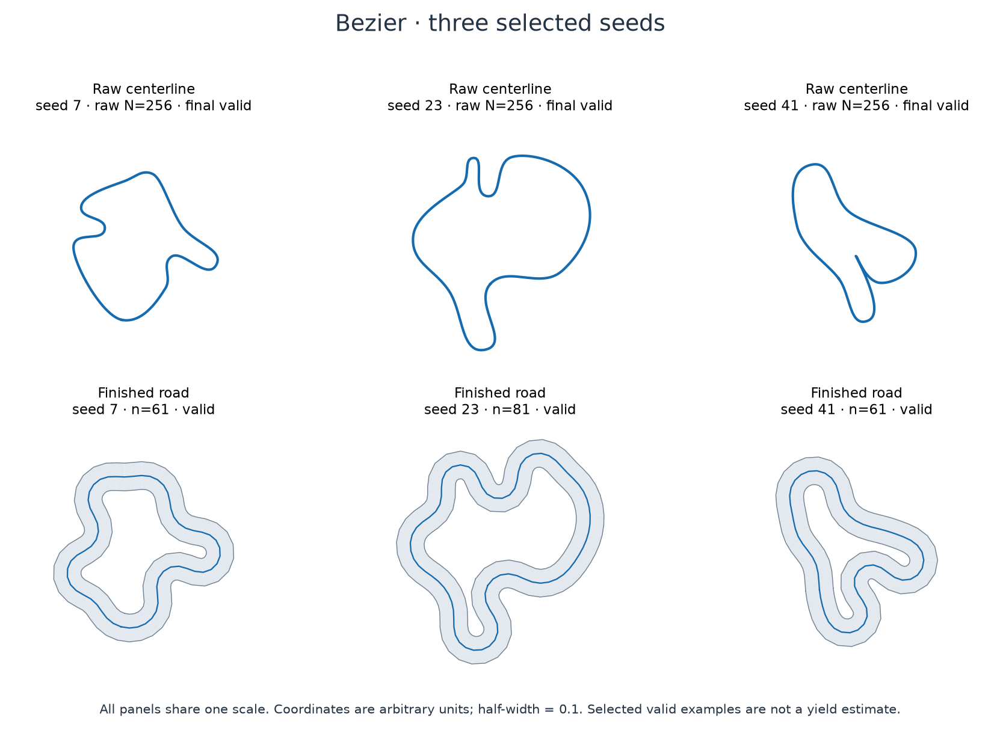
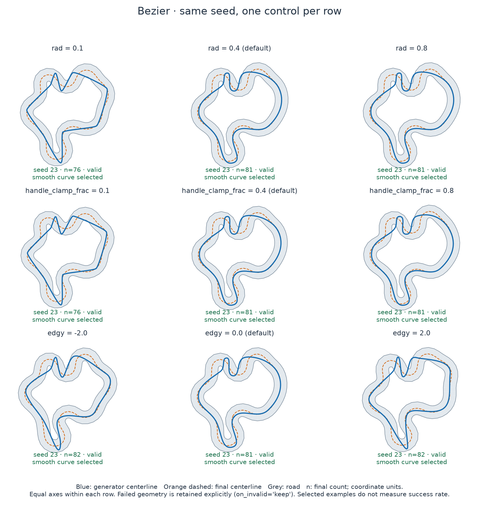
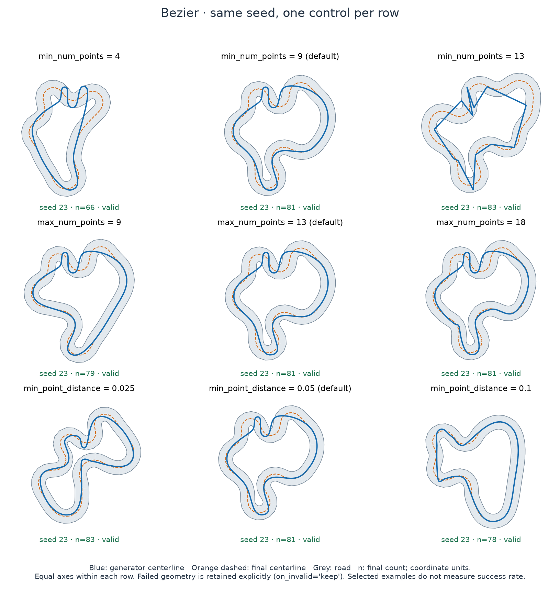
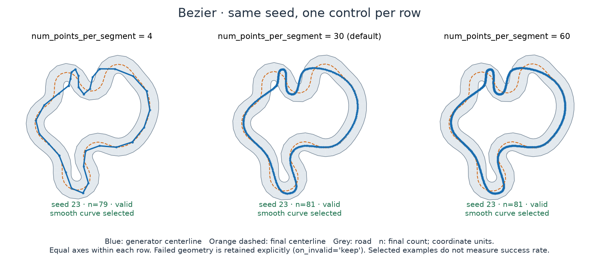
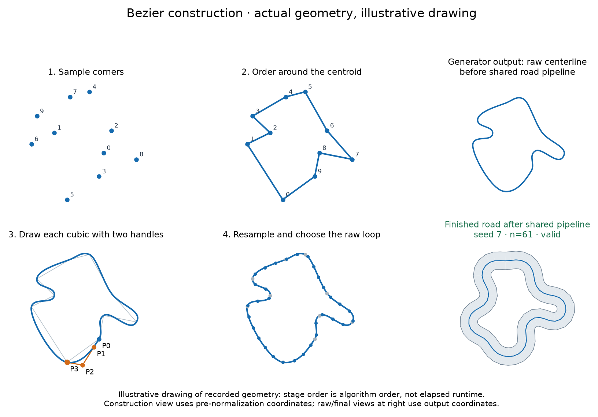

Bézier: corners and handles
===========================

Use ``bezier`` for circuits whose sampled corners are joined by cubic curves.
Corner count changes the layout; tangent direction and handle length change how the
curve enters and leaves each corner. The shared relaxation stage then makes room for
the road.

   Three selected valid seeds at default geometry, with equal axes. Blue upper panels show the generator output; lower panels show the final road. Counts exclude padding. These examples do not measure yield.

Try it
------

.. code-block:: python

   from track_gen import TrackGenerator
   from track_gen.pipeline import presets

   gen = TrackGenerator(presets.track(
       generator="bezier", num_envs=4, device="cpu"), seeds=7)
   track = gen.generate()
   print(track.count.numpy(), track.valid.numpy())

.. snippet: after

   assert track.valid.numpy().any()

Change the curve
----------------

   Each row holds the seed and other controls fixed. Blue is the raw generator centerline; orange dashed is the final centerline inside the grey road. Default values are marked. Failed examples retain their geometry explicitly.

Panels name the selected smooth curve or polygon fallback independently of final
road validity.

``rad`` requests a handle length relative to its segment chord. The actual handle
also obeys ``handle_clamp_frac`` times the shorter incident edge. A larger ``rad``
can therefore stop changing the curve when the clamp is already active. ``edgy``
rotates the blended tangent toward the incoming or outgoing edge; it is not an
angle in radians.

.. _bezier-dynamic:

Controls and defaults
~~~~~~~~~~~~~~~~~~~~~

Dynamic fields can change per environment before the next generation; static fields
require rebuilding. All distances below are in generator coordinates unless stated.

.. list-table:: Track generator controls
   :header-rows: 1
   :widths: 30 18 52

   * - Setting
     - Default / kind
     - Units, range and practical effect
   * - ``rad``
     - 0.4 / dynamic
     - Chord fraction in [0, 1]. Longer requested handles round corners, subject to the clamp.
   * - ``handle_clamp_frac``
     - 0.4 / dynamic
     - Nonnegative fraction of the shorter incident edge. Lower values shorten handles near unevenly spaced corners.
   * - ``edgy``
     - 0 / static
     - Dimensionless tangent blend: p = atan(edgy)/π + 0.5. Zero balances incoming and outgoing directions.
   * - ``min_num_points``
     - 9 / dynamic int32
     - Lower bound of the sampled corner count, from 2 through max_num_points. Integer curricula use set(); uniform randomizers do not draw integers.
   * - ``max_num_points``
     - 13 / static
     - Corner capacity and sampled upper bound; at least min_num_points. More corners also increase dense-curve work and can lengthen the loop.
   * - ``min_point_distance``
     - 0.05 / static
     - Normalized grid spacing parameter in (0, 0.5]. Grid cells are int(1/(2*d)) per side. It changes the sampled corner grid, not a final clearance guarantee.
   * - ``num_points_per_segment``
     - 30 / static
     - At least 2 dense samples per cubic segment. Controls curve discretization before the fixed num_points arc-resample.
   * - ``size``
     - 1 / dynamic
     - XY multiplier in [0.1, 10]; width, spacing and altitude stay absolute. Budget output capacity for the largest size: :ref:`tuning-size`.

.. _bezier-corner-count:

Change the anchors
~~~~~~~~~~~~~~~~~~

   Changing a count bound can leave a particular random draw unchanged. The renderer selects a declared seed with a visible effect for each row; the manifest records the search and all settings.

   Dots show the actual dense cubic samples. Increasing this count refines the curve representation; it does not increase final output capacity or set final bead spacing.

.. _bezier-style-vs-randomize:

For a curriculum, write ``gen.params["generator"].set("rad", 0.2)`` and regenerate,
or draw ``generator.rad`` with :doc:`/user-guide/curricula`. A randomizer owns the
fields it draws. Use ``min_num_points`` with ``set`` for integer corner-count changes.

When it fails
-------------

A smooth raw loop with a proper self-crossing is replaced by its angle-sorted corner
polygon before the shared tail. That fallback can introduce straights; it does not
certify that a road of the requested width fits. Final ``track.valid`` and
``track.fail_mask`` still decide which rows are usable. Narrow bends, close nonlocal
segments and insufficient ``N_max`` can fail after generation. Inspect failed rows
with explicit ``on_invalid="keep"``; the normal default poisons failed geometry.

Native ``bezier`` gates use sampled corner anchors directly. They have no ``rad``,
``edgy`` or handle-clamp controls, and their count bounds are static. To place gates
along the curved road, use station sampling instead.

How it is constructed
---------------------

1. Choose active corners from grid addresses and add independent random offsets.
   At ``min_point_distance=.05``, the grid pitch is ``.10``. Each coordinate offset
   is drawn from ``[-.5, .5)`` before ``scale`` and ``size`` are applied, so points
   can leave their selected cells. This is not a minimum pairwise-distance sampler.
2. Keep every active point and sort its angle around the centroid. Adjacent corner
   directions determine the tangents; ``rad`` and ``handle_clamp_frac`` limit the
   two handles of each cubic.
3. Evaluate the dense cubic segments and arc-resample to ``num_points`` raw points.
   If that sampled smooth loop has proper crossings, automatically replace the
   **whole loop** with an arc-resampled corner polygon. This is not a local spline
   edit or an optional switch. The clip uses default seed 97 to show a real branch.

   Grey squares are selected grid addresses; orange arrows end at the actual sampled
   corners. For a calm introduction, primary seed 112 uses four corners and
   ``min_point_distance=.25``: a 2 × 2 grid with pitch ``.50``. Its actual sampled
   points stay inside their selected cells. It is the first valid example with four
   distinct cells and within-cell points among seeds 0–2047, selected for clarity;
   the generator's offset distribution is unchanged. The movie separately shows
   default seed 97's crossing/fallback case and preserves the source geometry.

.. raw:: html

   <video controls preload="none" style="width:100%;max-width:100%;aspect-ratio:16/9;object-fit:contain" poster="../_images/generator-bezier-construction.png" aria-label="Grid addresses, random offsets, angle ordering, cubic handles, whole-loop fallback and raw resampling.">
     <source src="../generator-bezier-construction.mp4" type="video/mp4">
     Grid addresses, random offsets, angle ordering, cubic handles, whole-loop fallback and raw resampling.
   </video>

:download:`Download the animation <../assets/racing/generator-bezier-construction.mp4>`.

**Text alternative:** With ``min_num_points=max_num_points=4``,
``min_point_distance=.25`` and selected seed 112, start with the four grid
addresses, then follow each actual orange offset vector to its sampled corner.
Connect the angle-sorted corners, inspect both handles, and draw the actual dense cubic. A labelled seed-97 inset
marks the rejected smooth crossings and the selected entire polygon. Finish with
256 raw samples and the separate finished-road count.

The animation stages recorded geometry to explain construction; playback is not
elapsed runtime. Next, :ref:`watch how the shared pipeline turns raw samples into
road beads <sampling-stages>`.

Continue with :doc:`/how-it-works/pipeline`, :doc:`/configuration/tuning`,
:ref:`builtin-generator-params`, or :doc:`/tutorials/gate-sequences`.
