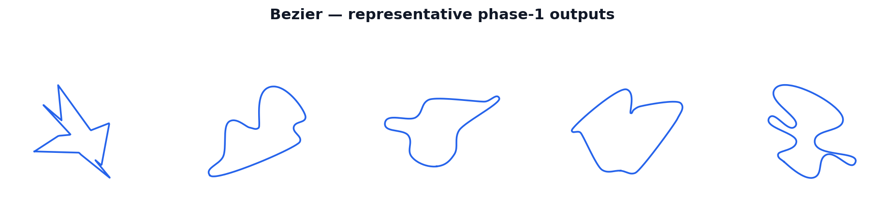

Bezier Generator
================

The ``bezier`` generator is the default and most configurable of the centerline generators.
It samples a set of random grid-jittered corner anchors, sorts them by angle around
their centroid to form a simple star-shaped polygon, and assembles a closed cubic
Bézier spline through those corners.  Handle lengths are proportional to
``rad * chord`` and adaptively clamped so that no handle overshoots a nearby corner.
Its two handle knobs (``rad``, ``handle_clamp_frac``), its corner count
(``min_num_points``) and its size (``size``) are per-:term:`env` (:term:`dynamic
<dynamic field>`) parameters:
``randomize=`` draws the ``float32`` ones and a curriculum can write all four from its own
graph (`Per-env (dynamic) parameters`_). The older per-environment style draw
(``style_sampling``) is deprecated (`Style sampling (deprecated) and its migration`_).
Any smooth curve that still self-crosses after clamping is rescued by its provably
simple corner polygon, which the downstream XPBD solver re-rounds.

   Sample tracks produced by the Bezier generator at the default configuration.

How It Works
------------

The generator runs a fixed sequence of Warp kernels in a single pass — no
host-side retry loop, no per-environment Python branching:

1. **Optional style draw (deprecated).**  When ``style_sampling=True``, a dedicated kernel
   (``_style_sample_k``) draws per-environment ``rad``, ``scale``, and
   ``handle_clamp_frac`` values from their respective ``*_range`` fields using RNG salt
   ``2741``.  A ranged ``rad`` / ``handle_clamp_frac`` is drawn straight into that
   knob's per-env parameter array, which then reports the draw
   (``gen.params["generator"]["rad"]``); a knob whose range is ``None`` is not drawn and
   reads its own per-env parameter array, like a generation without style sampling. A
   ``scale_range`` of ``None`` collapses to the scalar ``scale``.  This Python branch is
   resolved at CUDA-graph capture time; the per-environment values are device arrays
   and the captured graph remains static.

2. **Corner count.**  ``ops.sample_counts`` (salt ``6151``, offset ``0``) draws
   ``count[e]`` uniformly from ``[min_num_points, max_num_points]`` for each environment.
   The Stage launches its array-reading twin, which reads env ``e``'s ``min_num_points``
   from the per-env array and clamps it to ``[2, max_num_points]`` (`Corner count`_);
   the draw itself is unchanged.

3. **Corner positions.**  ``ops.sample_grid_points`` (salt ``9781``, offset ``0``)
   samples ``max_num_points`` grid cells from the ``ops.grid_cells(min_point_distance)``
   grid of ``num_cells × num_cells`` cells, where
   ``num_cells = int(1 / (min_point_distance * 2))``.  Each cell selection uses
   bounded duplicate rejection (up to eight retries per corner) to spread corners
   across distinct cells, then adds per-axis jitter in ``[-0.5, 0.5)``.  Coordinates are
   multiplied by ``scale`` (or by the per-environment ``scale[e]`` array in style mode),
   then by the env's ``size[e]``: ``((x * cell_size + jitter) * scale) * size[e]``
   (``ops.sample_grid_points(..., size=...)``; `Size`_). Everything downstream runs on
   the scaled corners.

4. **Prune-then-sort.**  The ``ops.angle_sort`` kernel (with the legacy count floor of 1:
   a count below 1 sorts the first corner) sorts only the first ``count[e]`` corners by
   ``atan2`` angle around the centroid of those same kept corners (not all
   ``max_num_points`` slots), writing NaN past the live count.  Sorting *after*
   pruning matters: sorting all ``max_num_points`` points and keeping a prefix would
   compute the centroid over unpruned slots, producing angular wedges around the wrong
   centroid that can close as figure-eight loops.

5. **Vertex tangents.**  ``_vertex_tangents_k`` computes each corner's tangent as a
   normalized blend of the outgoing unit edge direction ``u_out`` and the incoming unit
   edge direction ``u_in``, weighted by ``p = atan(edgy) / π + 0.5``.  At the default
   ``edgy=0``, ``p=0.5`` gives a symmetric bisector tangent.  It also records each
   corner's shorter incident edge length for the adaptive clamp (step 6).

6. **Cubic Bézier assembly.**  ``_assemble_dyn_k`` emits ``num_points_per_segment`` dense
   samples for each closed edge (corner ``i`` to corner ``(i+1) % count[e]``),
   including the wrap-around closing edge.  For each segment the handle lengths are
   computed as:

   .. math::

      h_0 = \min\!\bigl(\texttt{rad} \cdot \text{chord},\;
                         \texttt{handle\_clamp\_frac} \cdot \min_{\text{adj}}(e_0)\bigr)

   .. math::

      h_1 = \min\!\bigl(\texttt{rad} \cdot \text{chord},\;
                         \texttt{handle\_clamp\_frac} \cdot \min_{\text{adj}}(e_1)\bigr)

   where :math:`\min_{\text{adj}}(e)` is the length of the shorter incident edge at
   that corner.  The cubic control points are then:

   .. math::

      P_1 = c_0 + \hat{t}_0 \cdot h_0, \qquad
      P_2 = c_1 - \hat{t}_1 \cdot h_1

   and the segment is evaluated via the standard Bernstein basis (see Math section).
   ``rad`` and ``handle_clamp_frac`` are env ``e``'s values, read from the per-env
   arrays (step 1's draws for a ranged knob in style mode) and clamped to the declared
   bounds (`Per-env (dynamic) parameters`_; a style draw is used as drawn).  The frozen
   legacy entry point ``generate_centerline_warp`` keeps the scalar kernels
   ``_assemble_k`` and, in style mode, ``_assemble_style_k``; the arithmetic is the
   same, so both give the same bytes.

7. **Dense-to-N arc-resample.**  ``ops.arc_resample`` converts the dense
   ``max_num_points × num_points_per_segment`` loop to exactly ``num_points``
   arc-uniformly spaced samples, building cumulative arc length in ``float64`` and
   interpolating with a searchsorted lookup.

8. **Self-intersection check and fallback.**  ``ops.self_intersections`` counts
   proper crossings on the ``num_points``-point resampled loop.  For environments
   where the Bézier curve self-crosses, ``_assemble_polygon_selected_k`` emits the
   straight corner polygon in Bernstein form (equivalent to ``handle_clamp_frac=0``;
   it rounds differently from ``ops.closed_polyline``'s lerp, so bezier keeps its own
   kernel) and ``ops.arc_resample(..., active=crossers)`` overwrites only those rows.
   ``_select_vec2_k`` then writes the Bézier result for non-crossers and the polygon
   result for crossers into the output buffer.

9. **Generation flag.**  All environments are marked ``out_valid_wp=1`` unconditionally.
   The generation gate is always True; geometric validity is decided later by the
   shared post-relax inflation gate.

Math
----

**Cubic Bézier segment.**  Each corner-to-corner segment is a standard degree-3
Bézier curve parameterised by :math:`t \in [0, 1]`:

.. math::

   B(t) = (1-t)^3 P_0 + 3(1-t)^2 t\, P_1 + 3(1-t)t^2 P_2 + t^3 P_3

where :math:`P_0 = c_0` and :math:`P_3 = c_1` are the adjacent corner anchors, and
:math:`P_1`, :math:`P_2` are the interior control (handle) points constructed below.

**Vertex tangent blend.**  The tangent direction at corner :math:`i` is:

.. math::

   p = \frac{\arctan(\texttt{edgy})}{\pi} + 0.5,
   \qquad
   \hat{t}_i = \operatorname{normalize}\!\bigl(p\,\hat{u}^{\text{out}}_i
               + (1-p)\,\hat{u}^{\text{in}}_i\bigr)

where :math:`\hat{u}^{\text{out}}_i` is the unit vector from corner :math:`i` to
corner :math:`i{+}1` and :math:`\hat{u}^{\text{in}}_i` is the unit vector from corner
:math:`i{-}1` to corner :math:`i`.  At ``edgy=0``, :math:`p = 0.5` and the tangent
bisects the two edge directions symmetrically.  As ``edgy`` grows, :math:`p \to 1`
and the tangent aligns with the outgoing edge, sharpening the exit from each corner.

**Handle construction.**  For each segment from :math:`c_0` to :math:`c_1` with
chord :math:`\|c_1 - c_0\|`:

.. math::

   h_i = \min\!\bigl(\texttt{rad} \cdot \|c_1 - c_0\|,\;
                      \texttt{handle\_clamp\_frac} \cdot l_{\min,i}\bigr)

where :math:`l_{\min,i}` is the shorter of the two edges incident at corner :math:`i`.
The interior control points follow:

.. math::

   P_1 = c_0 + \hat{t}_0 \cdot h_0, \qquad
   P_2 = c_1 - \hat{t}_1 \cdot h_1

The clamp prevents :math:`h_i` from exceeding ``handle_clamp_frac`` times the
shorter adjacent edge, so a long handle cannot overshoot a nearby corner and cause
a self-crossing.

Parameters
----------

All fields are part of ``TrackGenConfig`` (see the Configuration reference for the
full list, defaults, and validation rules).

The generator-specific fields below are also the fields of ``BezierParams``, the
generator's Params class (core fields such as ``scale`` are not): set them flat or
through ``generator_params`` (see :ref:`builtin-generator-params`). Their rules are
checked when the ``TrackGenerator`` is constructed, and only for ``generator="bezier"``.

``min_num_points``
    Minimum corner-anchor count per environment.  Must be >= 2 (and ``<=
    max_num_points``). Dynamic, an ``int32`` per env (`Corner count`_).

``max_num_points``
    Maximum corner-anchor count per environment.  A wider range adds more
    per-environment shape diversity.  Also sets the buffer stride ``P``.

``num_points_per_segment``
    Dense Bézier samples emitted per corner-to-corner segment before arc-resampling.
    Must be >= 2; higher values give the arc-resampler a finer cumulative-arc-length
    grid, reducing interpolation error.

``min_point_distance``
    Minimum grid-cell spacing for corner sampling.  Controls the corner grid as
    ``num_cells = int(1 / (min_point_distance * 2))``.  Must be in ``(0, 0.5]``.

``min_angle``
    Deprecated, and not part of ``BezierParams``: ``TrackGenerator`` never reads it (only
    a corner-angle kernel the tests launch does). A non-default value emits a
    ``DeprecationWarning``; the field will be removed in 1.0.

``rad``
    Handle length as a fraction of the segment chord — the primary curviness dial.
    Only live when ``rad <= handle_clamp_frac``; if ``rad`` exceeds the clamp,
    ``handle_clamp_frac`` binds every segment and ``rad`` has no independent effect.
    Dynamic, in ``[0, 1]`` (see below).

``edgy``
    Corner-tangent blend weight.  Converted as ``p = atan(edgy) / π + 0.5``.
    At the default ``0.0``, ``p = 0.5`` gives a symmetric bisector tangent; larger
    positive values push ``p`` toward 1, making turns asymmetrically sharper
    (outgoing-edge-dominant).

``scale``
    Isotropic scale multiplier applied to sampled corner positions.  Scales all
    track coordinates; interacts with ``spacing`` and ``half_width`` through the
    coordinate range. A core field (``TrackGenConfig.scale``), static; ``size`` is its
    per-env factor.

``size``
    Per-env size multiplier of the plan view, applied right after ``scale``: at
    ``scale = 1``, ``size = s`` places exactly the corners ``scale = s`` does. Default
    ``1.0`` (unchanged output). Dynamic, in ``[0.1, 10]`` (`Size`_). The flat
    ``TrackGenConfig.size`` is its initial value.

``handle_clamp_frac``
    Adaptive handle clamp.  Each corner's handle is capped at
    ``handle_clamp_frac × (its shorter incident edge)`` to prevent overshoot past
    a nearby corner.  Set equal to ``rad`` (the default ``0.4``) so the clamp only
    trims genuine overshoot; set below ``rad`` to bind every handle regardless of
    ``rad`` (near-polygonal tracks); set very large to disable. Dynamic, ``>= 0``
    (see below).

``style_sampling``
    Opt-in per-environment Bézier style randomisation (default ``False``).  When
    ``True``, each environment draws its own ``rad``, ``scale``, and
    ``handle_clamp_frac`` from the ``*_range`` fields, so a single batch spans a
    family of styles. **Deprecated** (a ``DeprecationWarning`` when the generator is
    built; removed in 1.0): use ``randomize=`` on ``size``,
    ``rad`` and ``handle_clamp_frac`` (`Style sampling (deprecated) and its
    migration`_).

``rad_range``
    ``(lo, hi)`` range for per-environment ``rad`` when ``style_sampling=True``.
    ``None`` leaves ``rad`` to its per-env parameter array (every env at the configured
    ``rad`` unless you ``set`` or randomize it). Deprecated with ``style_sampling``:
    ``randomize={"generator.rad": (lo, hi)}``.

``scale_range``
    ``(lo, hi)`` range for per-environment ``scale`` when ``style_sampling=True``.
    ``None`` collapses to the scalar ``scale`` for all environments. Deprecated with
    ``style_sampling``: ``randomize={"generator.size": (lo / scale, hi / scale)}``.

``handle_clamp_frac_range``
    ``(lo, hi)`` range for per-environment ``handle_clamp_frac`` when
    ``style_sampling=True``.  ``None`` leaves the clamp to its per-env parameter array.
    Deprecated with ``style_sampling``: ``randomize={"generator.handle_clamp_frac": (lo,
    hi)}``.

.. _bezier-dynamic:

Per-env (dynamic) parameters
----------------------------

``rad``, ``handle_clamp_frac`` and ``size`` are **dynamic** ``float32`` fields of
``BezierParams``, and ``min_num_points`` a dynamic ``int32`` one: each is a per-env
``[E]`` array, initialised from the configured value. Draw the ``float32`` ones per env
with ``presets.track(randomize={"generator.rad": (lo, hi)})``, write any of them with
``gen.params["generator"].set("rad", value_or_array)``, or from a kernel in your own CUDA
graph (a curriculum): see :ref:`tuning-per-env`. A scalar outside the bounds raises
``ValueError`` (at construction, or from ``set``); an array value outside them (a
``set`` with an ``[E]`` array, your own kernel) is clamped to them when the kernel reads
it (``gen.params["generator"].bounds(field)`` returns them).

.. list-table::
   :header-rows: 1
   :widths: 22 9 12 22 22 13

   * - Field (``randomize=`` key)
     - Default
     - Bounds
     - Harder / more varied when
     - Effective range
     - Yield at lo / default / hi
   * - ``rad`` (``generator.rad``)
     - ``0.4``
     - ``[0, 1]``
     - lower: sharper, more polygonal corners
     - ``[0, handle_clamp_frac]``: above the clamp ``rad`` has no effect
     - 1.00 / 1.00 / 1.00
   * - ``handle_clamp_frac`` (``generator.handle_clamp_frac``)
     - ``0.4``
     - ``>= 0``
     - lower: near-polygonal (every handle bound by its shorter edge)
     - ``[0, ~rad]``; a very large value disables the clamp
     - 1.00 at ``0``, ``0.4`` and ``1e9``
   * - ``size`` (``generator.size``)
     - ``1.0``
     - ``[0.1, 10]``
     - higher: a longer course relative to the (absolute) road width
     - about ``[0.5, 2.6]`` at the default ``n_max`` (384): from about ``2.6`` the
       longest tracks of a large batch truncate (`Size`_); small sizes lose yield to
       the road width
     - 0.945 / 1.00 / 0.996 at 0.5 / 1 / 2 (0.996 at 3, 0.4% truncated)
   * - ``min_num_points`` (``set`` only: ``int32``)
     - ``9``
     - ``[2, max_num_points]``
     - higher: more corners, longer tracks (mean length 3.90 at 2, 5.53 at 13)
     - the whole range; it only narrows the count toward ``max_num_points``
       (`Corner count`_)
     - 0.94 / 1.00 / 1.00 at 2 / 9 / 13

*Yield* is the fraction of valid tracks with the default pipeline, ``E = 128``, seeds
``0..127`` (CPU), with the knob set to the value for every env (``size``: ``E = 256``,
``min_num_points``: ``E = 512``, seeds ``7919 * e + 13``).

**Mind the clamp.** Each handle is ``min(rad * chord, handle_clamp_frac *
shorter_edge)``, and the shorter incident edge is never longer than the chord, so
``rad >= handle_clamp_frac`` leaves ``rad`` inert: the defaults (``rad =
handle_clamp_frac = 0.4``) sit exactly at saturation. To vary curviness, keep the
``rad`` range at or below the clamp (``randomize={"generator.rad": (0.1, 0.4)}``); when
you draw ``handle_clamp_frac`` too, keep ``hi(rad) <= lo(handle_clamp_frac)``, or accept
that ``rad`` is inert in the envs where its draw lands at or above the clamp's. The
build warns about a ``rad`` range above the clamp (:ref:`tuning-per-env`).

Size
~~~~

``size`` multiplies the corner grid right after ``scale``, so every corner, and
everything built from the corners (handles, chords, the dense curve, the polygon
fallback), is scaled by it. At ``scale = 1``, ``size = s`` gives exactly the bytes of
``scale = s``; at ``size = 1`` the bytes are those of a pipeline without it. It scales
the **plan view only**: ``half_width``, ``spacing``, the relax tolerances, z (the
elevation window and amplitude, ``z_valid_grade``) stay absolute, so ``size`` is the
"course larger relative to the car" axis, and a larger course gets more points at the
same spacing. The per-env array is clamped to ``[0.1, 10]`` where the kernel reads it.

Size changes no buffer and no launch. The constant-spacing resample needs
``floor(size * L / spacing) + 1`` points for a raw loop of perimeter ``L`` at size 1,
into ``n_max`` slots: a track that needs more is truncated and **fails** validity
(``Track.truncated``, fail bit ``truncation``). The longest default ``bezier`` loop of
8192 envs is 8.68 (p99 7.17) at ``scale = 1``, so with the default ``n_max = 384`` and
spacing ``0.06``, truncation starts at about ``size = 2.6``. The sizing rule for a range
up to ``size_hi`` (:ref:`tuning-size`):

- ``n_max >= size_hi * L_max / spacing + 1``, with ``L_max`` about ``8.7 * scale``;
- ``num_points >= size_hi * L_max / spacing``: the raw loop keeps its ``num_points``, so
  a larger course has a coarser raw loop (median per-env largest raw segment 0.019 /
  0.038 / 0.057 at size 1 / 2 / 3, against the output spacing 0.06);
- the utilities' capacities and resolutions (checkpoint and prop rings, SDF and
  heightfield grids): :ref:`tuning-size-utilities`.

A ``generator.size`` randomizer (or a construction value) whose ``hi`` would truncate
the nominal longest loop emits a ``UserWarning`` when the pipeline is built, naming the
``n_max`` that fits. The nominal loop is the longest one above (8.68, the longest of
8192 envs: a larger batch can truncate a few envs just below it), scaled by
``(max_num_points / 13) ** 0.6`` for a larger corner capacity (the corner-count recipe
below) and taking the ``hi`` of ``style_sampling``'s ``scale_range``; a curriculum
written with ``set`` is not checked.

.. _bezier-corner-count:

Corner count
~~~~~~~~~~~~

``min_num_points`` is a dynamic ``int32`` field: write it per env with
``gen.params["generator"].set("min_num_points", k)`` (a Python ``int``, or an ``[E]``
``wp.int32`` array) or from your own kernel. ``max_num_points`` stays static: it sizes
the corner buffers. Per env, the count is drawn uniformly in ``[min_e, max_num_points]``
(``min_e`` clamped to ``[2, max_num_points]`` where the kernel reads it), from the same
single random draw, so raising ``min_e`` never lowers an env's count. The corner
positions are drawn for all ``max_num_points`` slots whatever the count, so changing the
count adds or drops corners of one fixed set.

- **The axis narrows toward ``max_num_points`` only.** ``min_num_points = 2`` with the
  default ``max_num_points = 13`` still gives counts uniform on ``2..13``: the easy end of
  a corner-count curriculum includes max-corner tracks. Build with ``max_num_points`` at
  the curriculum's highest count and accept the full range at its easy end; fewer
  corners than that at the easy end needs a smaller ``max_num_points`` (another
  generator). A dynamic upper bound is not available in 0.x.
- ``set`` takes a Python ``int`` or a NumPy integer: it refuses a scalar outside
  ``[2, max_num_points]`` (``ValueError`` naming ``max_num_points``), any ``float``
  (``9.0`` included) and a ``bool``; construction still converts a value ``int()``
  accepts (a configured ``9.0`` from YAML, a NumPy integer, ``"9"``).
- ``randomize={"generator.min_num_points": ...}`` raises ``PlanError``: ``randomize``
  draws ``float32`` fields only in 0.x (the count is already a per-env draw).
- The ``bezier`` and ``hull`` **gate** generators keep a static ``min_num_points``: it is
  their minimum gate count (``capacity()["min_gates"]``), and the gate count is not a
  per-env axis in 0.x.

**Static knobs, and why.** ``max_num_points`` (sizes the corner buffers),
``num_points_per_segment`` (sizes the dense buffer and its loops),
``min_point_distance`` (sets the corner grid on the host), ``edgy`` (turned into
``atan(edgy) / pi + 0.5`` on the host in double precision, which a kernel cannot
reproduce bit for bit), the ``style_sampling`` fields (a Python branch
and host ranges) and the core ``scale`` (per-env: ``size``).

.. _bezier-style-vs-randomize:

Style sampling (deprecated) and its migration
~~~~~~~~~~~~~~~~~~~~~~~~~~~~~~~~~~~~~~~~~~~~~

``style_sampling`` is **deprecated** and goes at 1.0: draw ``size``, ``rad`` and
``handle_clamp_frac`` with ``randomize=`` instead (`Per-env (dynamic) parameters`_).
:ref:`upgrading-style-sampling` maps each range to its ``randomize=`` entry, shows the
before and after, and covers a ``Course``. Building a ``bezier`` generator with it emits
one ``DeprecationWarning`` per build, attributed to your code.

Until it is removed, ``style_sampling`` keeps its outputs, and ``size`` composes with it
(the corners get ``scale[e] * size[e]``; combining it with a ``generator.size``
randomizer emits a ``UserWarning``). Under ``style_sampling=True`` a knob with a range is
**drawn by the style kernel**: its parameter array holds each env's draw after a
generation, ``gen.params["generator"].drawn`` maps it to the stage's own id
(``"generator"``), ``set`` on it raises ``ValueError`` (``generator.rad is drawn every
generation by the generator's style_sampling (rad_range); set rad_range=None to set
it``), and a randomizer on it is a ``PlanError``. A knob whose range is ``None`` stays an
ordinary :term:`dynamic field`: ``set`` and ``randomize=`` work on it.

What Makes It Distinct
----------------------

The Bezier generator is the **default** and most knob-rich of the six generators:

- **Widest style control.** Eight primary knobs (``min_num_points``, ``max_num_points``,
  ``num_points_per_segment``, ``min_point_distance``, ``rad``, ``edgy``, ``scale``,
  ``handle_clamp_frac``) plus the opt-in ``style_sampling`` family are all
  exclusive to the corner-Bézier representation.  No other generator exposes handle
  geometry (every built-in sampling generator, ``bezier``, ``hull``, ``polar``,
  ``voronoi`` and ``checkpoint``, has per-env shape knobs and a per-env ``size`` for
  ``randomize=``).

- **Cubic Bézier representation.** Compared to the **hull** generator (which uses a
  closed uniform Catmull-Rom spline) and the **polar** generator (also Catmull-Rom),
  the Bézier formulation gives explicit, per-corner handle control through ``rad`` and
  ``edgy``.  The hull generator adds radial midpoint displacement for pronounced lobes
  and pinches; the Bézier generator keeps the shape entirely corner-determined.

- **Star-shaped corner families.** Like the hull generator the Bézier generator samples
  Cartesian corners and angle-sorts them.  Unlike the **polar** generator, which starts
  from polar control knots and is smooth and centered by construction, and unlike the
  **voronoi** generator, which snaps anchors to a pre-sampled site field, the Bézier
  generator's shapes are anchored to sampled grid corners and are roughly star-shaped
  around the corner centroid.  Unlike the **checkpoint** generator — which steers a
  bounded-turn path through radial checkpoints and produces organically curving loops —
  the Bézier generator is purely geometric and not trajectory-based.

- **Low relaxation burden at the default config.** At the default
  ``handle_clamp_frac=0.4`` (matching ``rad=0.4``) and fat-band settings the valid
  yield is approximately 99.9 % end-to-end, and the generator produces consistently
  smooth, well-spaced centerlines before relaxation begins.

Fallback and Validity
---------------------

**Local polygon fallback.**  After arc-resampling to ``num_points``, any environment
whose Bézier centerline contains at least one proper self-crossing is redirected to its
provably simple corner polygon (straight line segments between the sorted corners).
Only the affected environments are reprocessed; non-crossing environments are
unaffected.  The XPBD bead-chain solver then re-rounds the polygon fallback through its
bending and separation corrections.

**Generation-stage validity.**  The generator writes ``out_valid_wp=1`` for every
environment unconditionally.  The generation stage does not gate on geometry.  Turning
number, track thickness, NaN presence, and width-floor checks are all evaluated later
by the shared post-relax inflation validity gate (``_validity_k`` inside
``inflate_warp``).  The final ``Track.valid`` field therefore reflects post-relax
geometric quality, not generation success.
