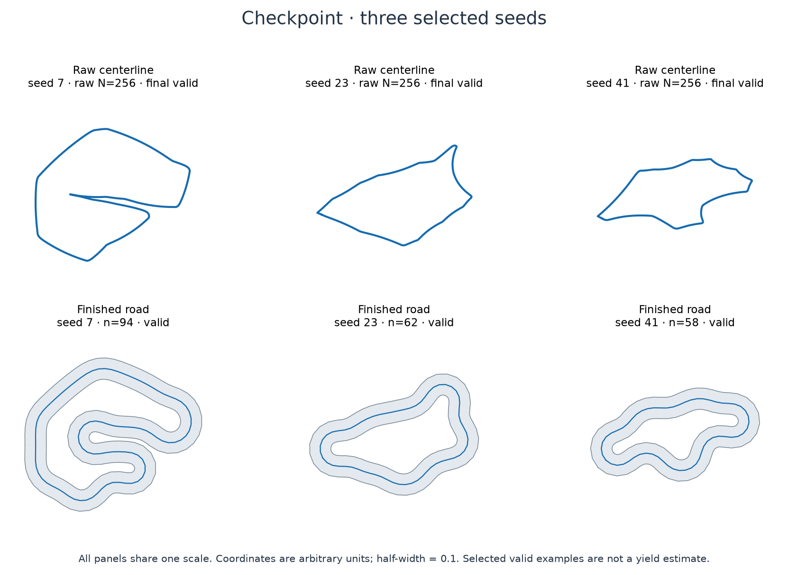
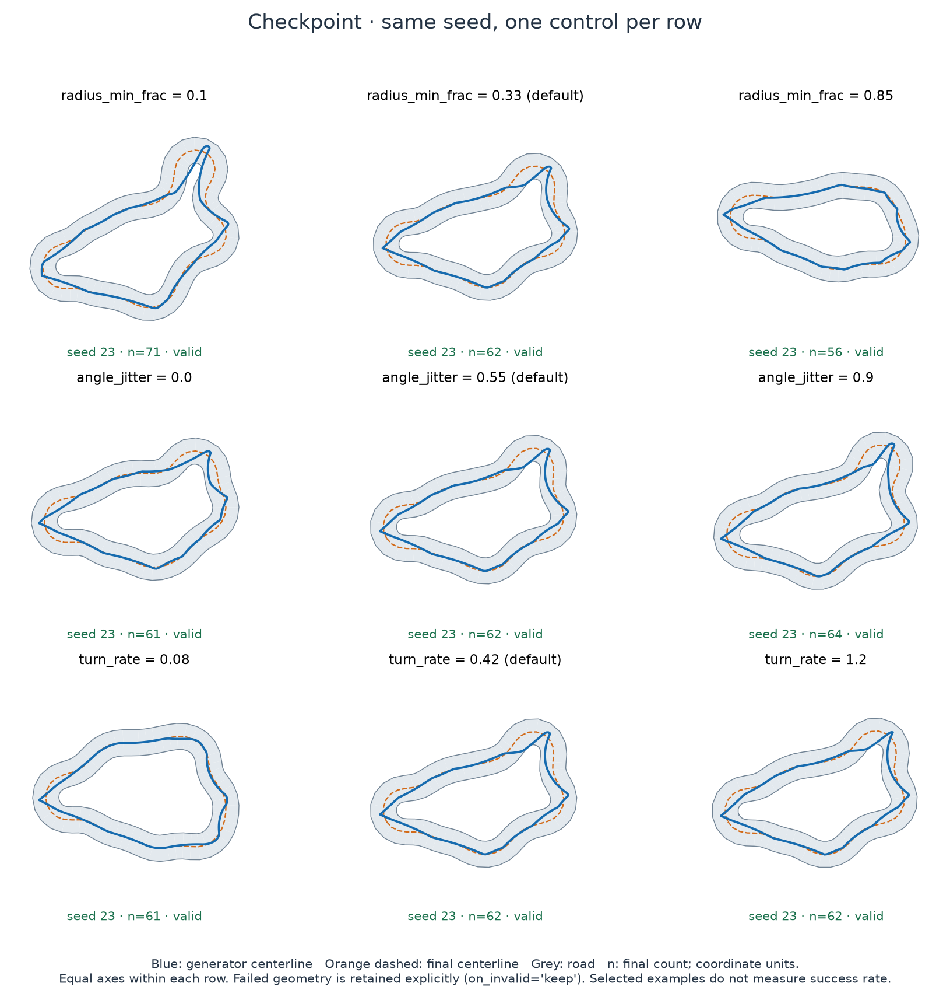
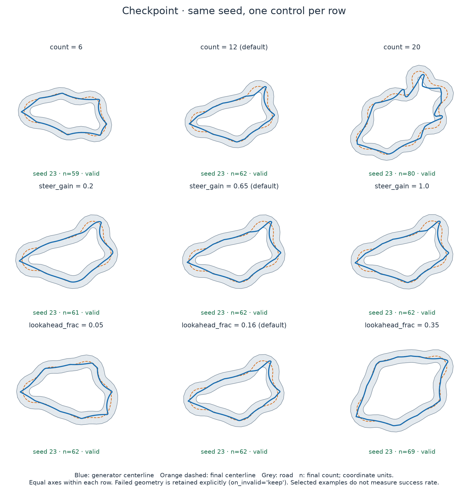
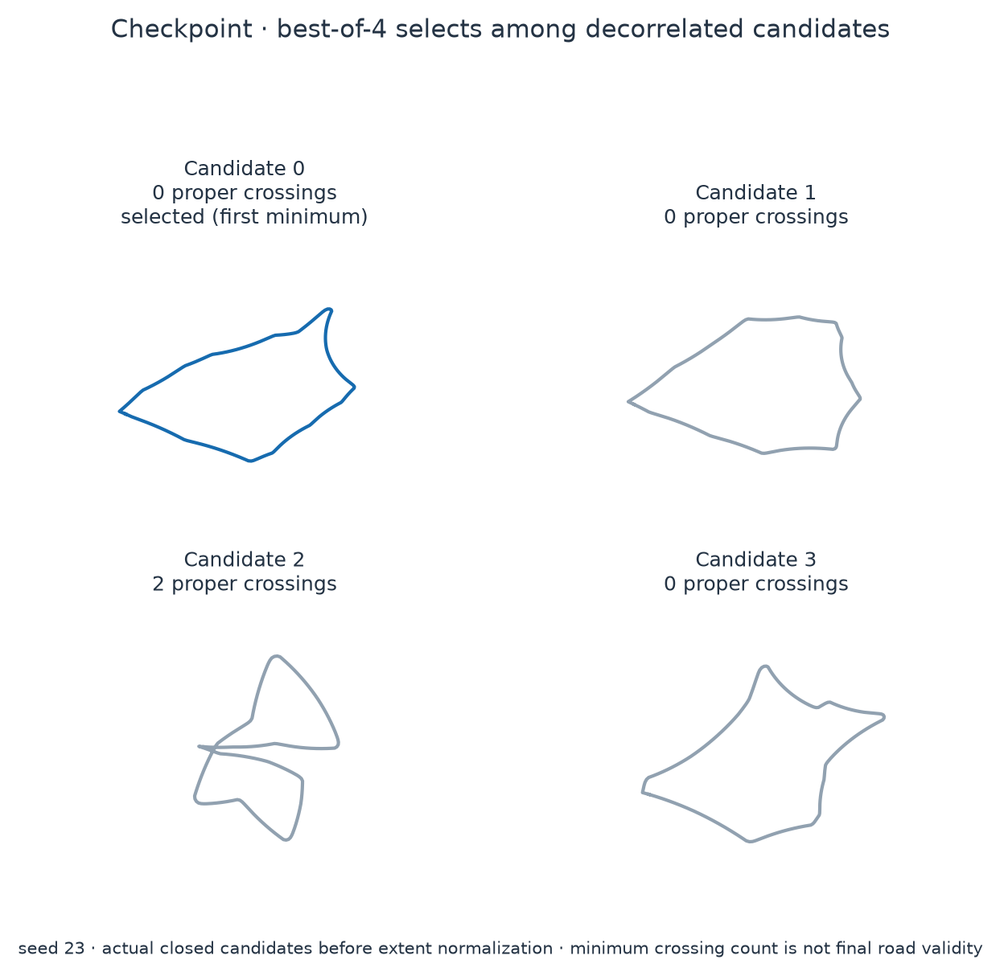
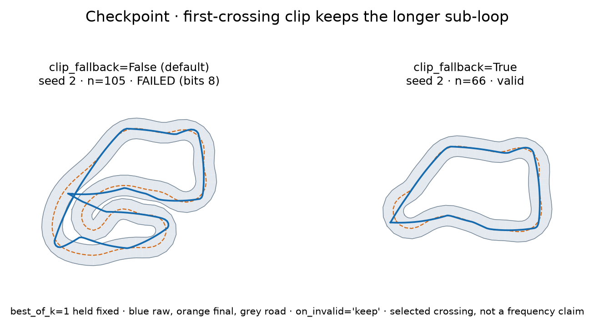
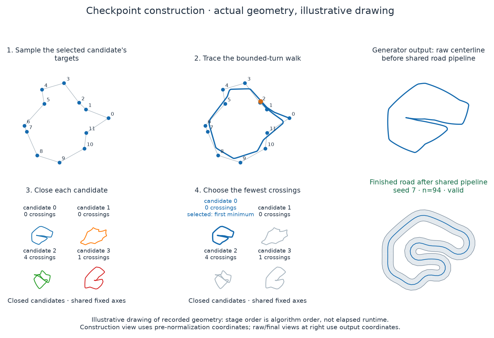

Checkpoint: steer through targets
=================================

Use ``checkpoint`` for circuits built by a bounded-turn walk through radial targets.
Steering creates the local shape; closure, candidate selection and optional clipping
turn the walk into a closed loop. Targets need not lie on the resulting road.

   Three selected valid seeds at default geometry, with equal axes. Blue upper panels show the generator output; lower panels show the final road. Counts exclude padding. These examples do not measure yield.

Try it
------

.. code-block:: python

   from track_gen import TrackGenerator
   from track_gen.pipeline import presets

   gen = TrackGenerator(presets.track(
       generator="checkpoint", num_envs=4, device="cpu"), seeds=7)
   track = gen.generate()
   print(track.count.numpy(), track.valid.numpy())

.. snippet: after

   assert track.valid.numpy().any()

Change the walk
---------------

   Blue is the selected closed generator output; orange and grey show the final centerline and road. Candidate selection can change when a setting changes, even at the same seed.

``checkpoint_turn_rate`` caps each steering step in radians; it is not a vehicle
steering limit or final curvature bound. The final loop is reconstructed during
closure and normalized afterward. A low cap can stop the walk from following a
nearby target; lookahead controls when the walk advances to the next target.

.. _checkpoint-dynamic:

Controls and defaults
~~~~~~~~~~~~~~~~~~~~~

.. list-table:: Track generator controls
   :header-rows: 1
   :widths: 30 18 52

   * - Setting
     - Default / kind
     - Units, range and practical effect
   * - ``checkpoint_count``
     - 12 / static
     - At least 3 radial targets. Changes angular slot size and the perimeter-derived walk step.
   * - ``checkpoint_radius_min_frac``
     - 0.33 / dynamic
     - Inner/outer radius ratio. Construction accepts [0, 1); runtime set/randomize accepts through 1. Larger values narrow the target annulus.
   * - ``checkpoint_angle_jitter``
     - 0.55 / dynamic
     - Fraction of an angular slot, [0, 1]. Jitters each radial checkpoint angle.
   * - ``checkpoint_turn_rate``
     - 0.42 / dynamic
     - Radians per steering step, [0, π]. Clamps proportional heading correction, before loop closure.
   * - ``checkpoint_steer_gain``
     - 0.65 / static
     - Dimensionless proportional heading gain, normally (0, 1]. Lower values react more slowly to a target.
   * - ``checkpoint_lookahead_frac``
     - 0.16 / static
     - Fraction of the outer construction radius. Advance targets inside this distance; too small can trap the walk near a missed target.
   * - ``checkpoint_best_of_k``
     - 4 / static
     - Candidate count, at least 1. Selects the closed candidate with fewest proper self-crossings; ties choose the first. Increasing K adds candidate streams while preserving existing candidates, and can change the selected candidate.
   * - ``checkpoint_clip_fallback``
     - False / static
     - If enabled, cut the selected loop at its first proper crossing and retain the longer sub-loop. Changes topology; does not remove every possible crossing.
   * - ``size``
     - 1 / dynamic
     - XY multiplier, [0.1, 10], after extent normalization. Absolute width/spacing need enough capacity: :ref:`tuning-size`.

   Only the named control changes within a row; the manifest records the full configuration. Final road validity is shown for every panel.

   Candidate comparison before extent normalization. Crossing count is a selection score, distinct from final road validity; the first minimum wins.

When it fails
-------------

Closure adds a heading drift and distributes the positional gap. This produces a
closed candidate but does not prove it has no crossings or tight pinches. Best-of-K
can select a crossing candidate when every candidate crosses. ``track.valid`` remains
the final contract after relaxation and inflation.

   The seed search is recorded. Best-of-K is held at 1 to expose a crossing; clip is the only difference. Failed geometry uses on_invalid="keep" and is explicitly labeled.

Use clipping when dropping the smaller lobe is acceptable; inspect the resulting
layout because it discards part of the selected route. Try less angular disorder or
a different steering/lookahead regime when preserving the route matters. Check
``fail_mask`` before increasing solver iterations.

Native checkpoint gates use the sampled radial targets directly. They have radius,
angular jitter and checkpoint-count controls, but no turn-rate, steering, best-of-K
or clipping controls. To follow the steered road, use track stations.

How it is constructed
---------------------

Each candidate samples radial checkpoints, starts at checkpoint 0 pointing toward
1, and walks for ``num_points`` bounded-turn steps. Step length is the checkpoint
polygon perimeter divided by ``num_points``. Closure adds a constant drift to wrapped
heading increments, reconstructs unit-length edges, subtracts their mean to close the
positional gap, integrates and recenters. Candidate selection, optional first-crossing
clipping and extent normalization precede the common road pipeline. Heading-based
closure is a construction step; it is not an exact simplicity guarantee.

   Four steps explain radial targets, the actual open walk, closed candidates and
   crossing-score selection. The raw generator centerline and finished road at right use
   output coordinates; construction panels use their original coordinates.

.. raw:: html

   <video controls preload="none" style="width:100%;max-width:100%" poster="../generator-checkpoint-construction-poster.png" aria-label="Progressive drawing of radial targets, the actual open walk, closed candidates and crossing-score selection, from actual checkpoint geometry.">
     <source src="../generator-checkpoint-construction.mp4" type="video/mp4">
     Progressive drawing of radial targets, the actual open walk, closed candidates and crossing-score selection, from actual checkpoint geometry.
   </video>

:download:`Download the animation <../assets/racing/generator-checkpoint-construction.mp4>`.

**Text alternative:** The drawing follows the selected candidate's actual open walk, with an
orange dot marking its advancing end. It then reveals the separately closed candidates in
enlarged views with shared fixed axes and their proper-crossing scores; the first minimum is
selected. The normalized raw centerline and finished road remain visible at right.

The geometry comes from recorded construction buffers. Prefix drawing explains
algorithm order. Playback timing is illustrative, with no position morph
between stages or claim of measured runtime or iterative solver states. The view
stays fixed within each coordinate system.

Continue with :doc:`/how-it-works/pipeline`, :doc:`/configuration/tuning`,
:ref:`builtin-generator-params`, or :doc:`/tutorials/gate-sequences`.
