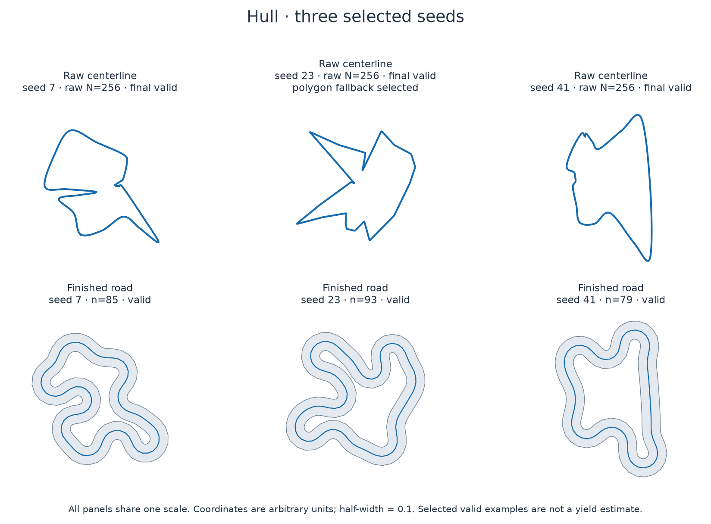
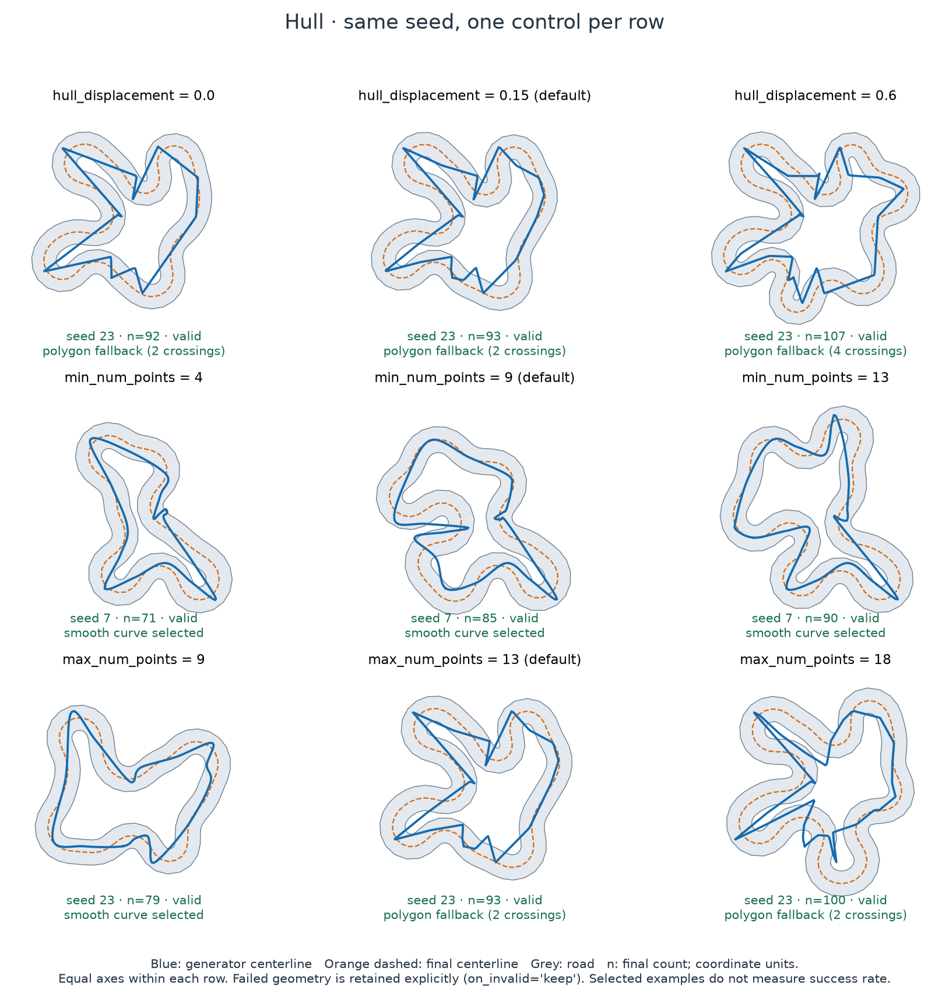
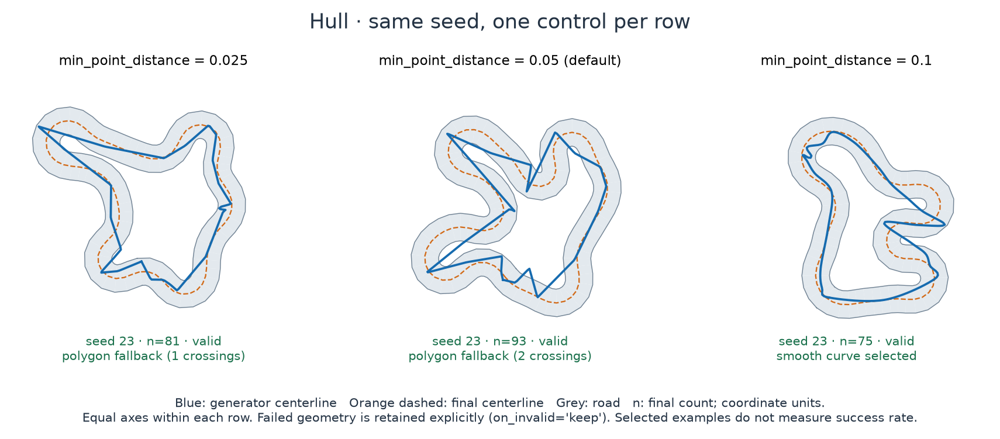
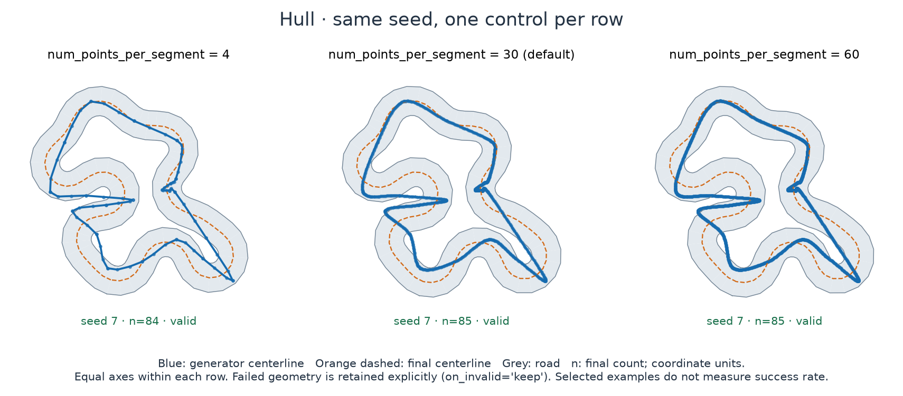
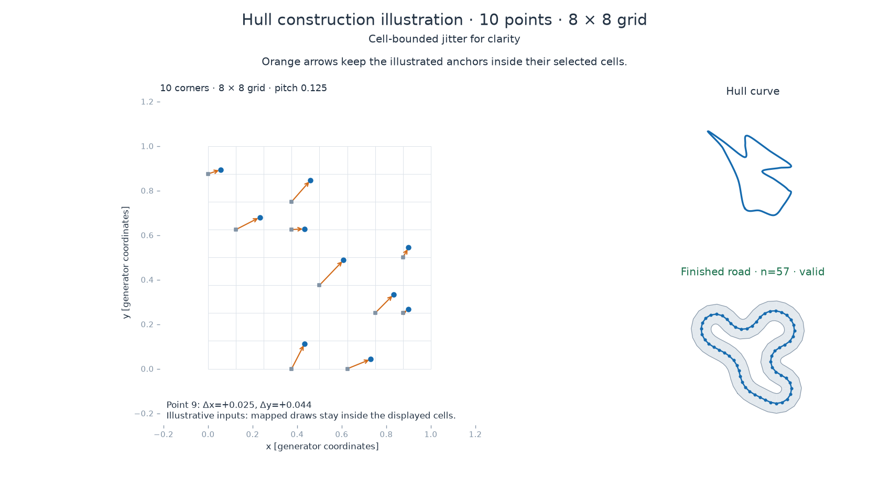

Hull: midpoint lobes
====================

Use ``hull`` for loops with displaced midpoint lobes, pinches and varied straights.
The name refers to a hull-like base loop: the implementation sorts sampled points by
angle rather than computing a geometric convex hull.

   Three selected valid seeds at default geometry, with equal axes. Blue upper panels show the generator output; lower panels show the final road. Counts exclude padding. These examples do not measure yield.

Try it
------

.. code-block:: python

   from track_gen import TrackGenerator
   from track_gen.pipeline import presets

   gen = TrackGenerator(presets.track(
       generator="hull", num_envs=4, device="cpu"), seeds=7)
   track = gen.generate()
   print(track.count.numpy(), track.valid.numpy())

.. snippet: after

   assert track.valid.numpy().any()

Change the shape
----------------

   The displacement row changes midpoint positions; count rows change the anchor cycle. Blue raw centerlines and orange final centerlines show what the shared road pipeline changes.

Panels name the selected smooth curve or polygon fallback. Final road validity is
reported separately; a valid panel can still show a generator fallback.

``hull_displacement=0`` keeps inserted midpoints on the base edges. Increasing it
moves each midpoint inward or outward along its centroid-relative radial direction.
This is one displacement layer; it is not recursive terrain subdivision.

.. _hull-dynamic:

Controls and defaults
~~~~~~~~~~~~~~~~~~~~~

.. list-table:: Track generator controls
   :header-rows: 1
   :widths: 30 18 52

   * - Setting
     - Default / kind
     - Units, range and practical effect
   * - ``hull_displacement``
     - 0.15 / dynamic
     - Radial midpoint-displacement fraction in [0, 1]. Larger displacement permits deeper lobes and pinches; it can also produce harder road-clearance problems.
   * - ``min_num_points``
     - 9 / dynamic int32
     - Lower sampled anchor-count bound in [2, max_num_points]. Change with set(); uniform randomizers draw float32 fields only.
   * - ``max_num_points``
     - 13 / static
     - Upper anchor-count bound and capacity, at least min_num_points. There are twice as many vertices after midpoint insertion.
   * - ``min_point_distance``
     - 0.05 / static
     - Controls grid pitch ``2*d`` in normalized coordinates; int(1/(2*d)) addresses per side. It is not a minimum pairwise distance. Changes anchor placement, not final road clearance.
   * - ``num_points_per_segment``
     - 30 / static
     - At least 2 dense Catmull–Rom samples per augmented segment; trades sampling work for discretization accuracy.
   * - ``size``
     - 1 / dynamic
     - XY multiplier in [0.1, 10], with absolute road width and spacing. See :ref:`tuning-size` for capacity.

   Grid spacing changes the available anchor positions; the random seed is held fixed.

   Dots are actual dense samples. Final bead spacing and N_max belong to the shared pipeline, independently of this sampling count.

When it fails
-------------

If the smoothed raw loop has a proper self-crossing, the generator uses the augmented
polygon through the anchors and displaced midpoints. That polygon may still have
close approaches or sharp turns. Final validity is decided after resampling,
relaxation and inflation. Reduce displacement, allow more geometric space relative
to width, or inspect ``fail_mask`` and output capacity before changing solver budgets.
Failed panels are labeled and use explicit ``on_invalid="keep"``.

Native ``hull`` gates use the initial sampled anchors, before midpoint displacement
and smoothing. Their count bounds are static and they have no displacement control.
Use track stations when gates should follow the finished lobes.

How it is constructed
---------------------

1. Sample grid addresses and independent offsets, using the same point-selection
   rule as Bézier. Offsets can cross cell boundaries; ``min_point_distance`` sets
   grid pitch rather than a minimum distance between sampled points.
2. Keep **every** active anchor and sort around its centroid. There is no convex
   hull computation and no discarded interior-point set.
3. Insert one midpoint per edge and displace it inward or outward along its
   centroid-relative radius. The original anchors stay in place. Join this
   augmented cycle with a periodic Catmull–Rom curve.
4. Arc-resample to ``num_points`` and check proper crossings. A crossing automatically
   selects the **entire augmented polygon**, including displaced midpoints, instead
   of the smooth loop. The movie shows the actual default seed-23 branch; it does
   not illustrate a local spline repair or an optional toggle.

   The large view explains point selection. The movie then separates angle ordering,
   midpoint displacement, spline evaluation and the actual whole-loop fallback.

.. raw:: html

   <video controls preload="none" style="width:100%;max-width:100%;aspect-ratio:7/4;object-fit:contain" poster="../_images/generator-hull-construction.png" aria-label="Grid selection, offsets, angle ordering, midpoint displacement, Catmull-Rom and whole-loop fallback.">
     <source src="../generator-hull-construction.mp4" type="video/mp4">
     Grid selection, offsets, angle ordering, midpoint displacement, Catmull-Rom and whole-loop fallback.
   </video>

:download:`Download the animation <../assets/racing/generator-hull-construction.mp4>`.

**Text alternative:** Grey grid addresses lead to the sampled blue points through
orange offset vectors. Every active point enters the angle-sorted cycle. Orange
arrows then show the inserted midpoints' actual displacements. A seed-23 inset
marks crossings of the rejected smooth candidate and shows the entire selected
augmented polygon. Raw and finished-road counts remain distinct.

The drawings use observed buffers, including the rejected spline before the
fallback overwrites it. Timing is explanatory. Continue with the
:ref:`shared sampling and relaxation stages <sampling-stages>`.

Continue with :doc:`/how-it-works/pipeline`, :doc:`/configuration/tuning`,
:ref:`builtin-generator-params`, or :doc:`/tutorials/gate-sequences`.
