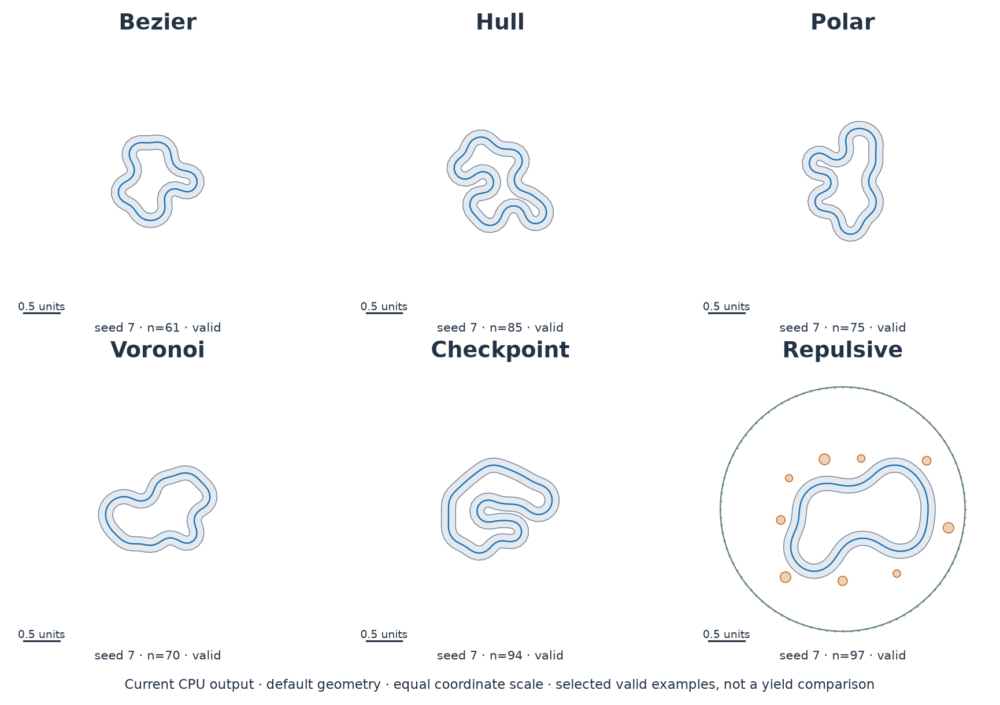

.. _generators-overview:

Choose a generator
==================

TrackGen ships six procedural road families. Start with a shape below, then open its
guide to see raw centerlines, finished roads, same-seed controls and construction.
All six feed the shared resample → relax → width/offset → validity pipeline.

   Current CPU output at default geometry and equal coordinate scale. Each is a
   selected valid example, not a family success-rate or quality ranking. The blue
   line is the final road centerline.

.. list-table:: Find a useful starting family
   :header-rows: 1
   :widths: 18 42 40

   * - Guide
     - What constructs the shape
     - Start here for
   * - :doc:`bezier`
     - Sampled corners joined by cubic handles
     - Corner-count and tangent/handle control
   * - :doc:`hull`
     - Angle-sorted anchors plus displaced midpoints
     - Inward/outward lobes and pinches
   * - :doc:`polar`
     - Jittered radial knots and a periodic spline
     - Direct control of radial and angular disorder
   * - :doc:`voronoi`
     - Sites selected against an angular/radial target cycle
     - Different site layouts and irregular anchor cycles
   * - :doc:`checkpoint`
     - Bounded-turn walks, closure and candidate selection
     - Continuously steered target-following layouts
   * - :doc:`repulsive`
     - Iterative self-repelling curve growth among obstacles
     - Folded loops when iterative generation fits the reset budget

:doc:`/tutorials/choosing-a-generator` connects these choices to gates, curricula and
simulator reset cadence. If you already have the geometry, use ``external``:
:ref:`ingesting-centerlines`.

Try a family
------------

.. code-block:: python

   from track_gen import TrackGenerator
   from track_gen.pipeline import presets

   gen = TrackGenerator(presets.track(
       generator="hull", num_envs=4, device="cpu"), seeds=7)
   track = gen.generate()
   print(track.count.numpy(), track.valid.numpy())

.. snippet: after

   assert track.valid.numpy().any()

Use ``device="cuda:0"`` for a CUDA batch. A seed/configuration is reproducible on a
given device; equality across CPU and CUDA is not promised. ``generate()`` reuses
result storage. Check validity and real counts before consuming a row, and clone
results you need to retain: :doc:`/user-guide/results`.

Roads and gate courses
----------------------

``bezier``, ``hull``, ``polar``, ``voronoi`` and ``checkpoint`` also have **native gate
anchors**. Those gates use sampled corners, knots, selected sites or radial targets;
they are not automatically stations on the track's spline or steered road. Native
track/gate controls differ, as each family guide explains.

Every track generator, including ``repulsive`` and ``external``, can supply
``source="stations"`` gates along its source centerline. Use
``source="relaxed_stations"`` when stations should follow the relaxed centerline.
See :doc:`/tutorials/gate-sequences` for spacing, elevation and ordering.

.. _generators-per-env:

Per-environment controls
------------------------

Dynamic float32 controls can be set per env or drawn by a uniform randomizer. Dynamic
integer controls use ``set``; counts and capacities that are static require rebuilding.

.. list-table:: Dynamic track-generator fields
   :header-rows: 1
   :widths: 18 62 20

   * - Family
     - Generator fields
     - Details
   * - Bezier
     - rad, handle_clamp_frac, size; min_num_points (int32)
     - :ref:`bezier-dynamic`
   * - Hull
     - hull_displacement, size; min_num_points (int32)
     - :ref:`hull-dynamic`
   * - Polar
     - polar_radial_jitter, polar_angular_jitter, size
     - :ref:`polar-dynamic`
   * - Voronoi
     - voronoi_radial_variation, voronoi_angular_jitter, size
     - :ref:`voronoi-dynamic`
   * - Checkpoint
     - checkpoint_radius_min_frac, checkpoint_angle_jitter, checkpoint_turn_rate, size
     - :ref:`checkpoint-dynamic`
   * - Repulsive
     - size (applied after growth)
     - :ref:`repulsive-dynamic`
   * - External
     - none; upload geometry directly
     - :ref:`ingesting-centerlines`

``size`` scales the XY layout while width, spacing and altitude stay absolute.
A longer loop needs more output slots; budget ``N_max`` for the largest size:
:ref:`tuning-size`. Native polar/voronoi/checkpoint gates instead use
``normalize.size``. Native Bezier/Hull gate count bounds are static.

For randomization, ownership and masked regeneration, follow
:doc:`/user-guide/curricula`. Every field's schema and defaults are in
:ref:`builtin-generator-params`; shared stages are in :doc:`/configuration/reference`.

Validity and generation cost
----------------------------

Procedural generators write a raw closed loop and ``gen.valid=1``. Final road
validity is checked after the shared pipeline. A generator-local fallback is not a
road-clearance certificate. Count, padding, poison defaults and ``fail_mask`` are
part of the :doc:`/user-guide/results` contract.

Sampling/steering families use bounded sampling and geometry work. ``repulsive``
additionally runs an iterative growth solve with quadratic self-pair work at each
active resolution. Measure its construction, capture and steady regeneration costs
separately. Use :doc:`benchmarks` to measure current configurations on your target
machine; the selected pictures here make no numeric throughput or yield claims.

Extend the catalogue with :doc:`/contributing/writing-a-generator` or import an
existing centerline with :ref:`ingesting-centerlines`. Available registered names
come from ``track_gen.plugin.registry.available("generator")``.

.. toctree::
   :maxdepth: 1
   :hidden:

   bezier
   hull
   polar
   voronoi
   checkpoint
   repulsive
   benchmarks
