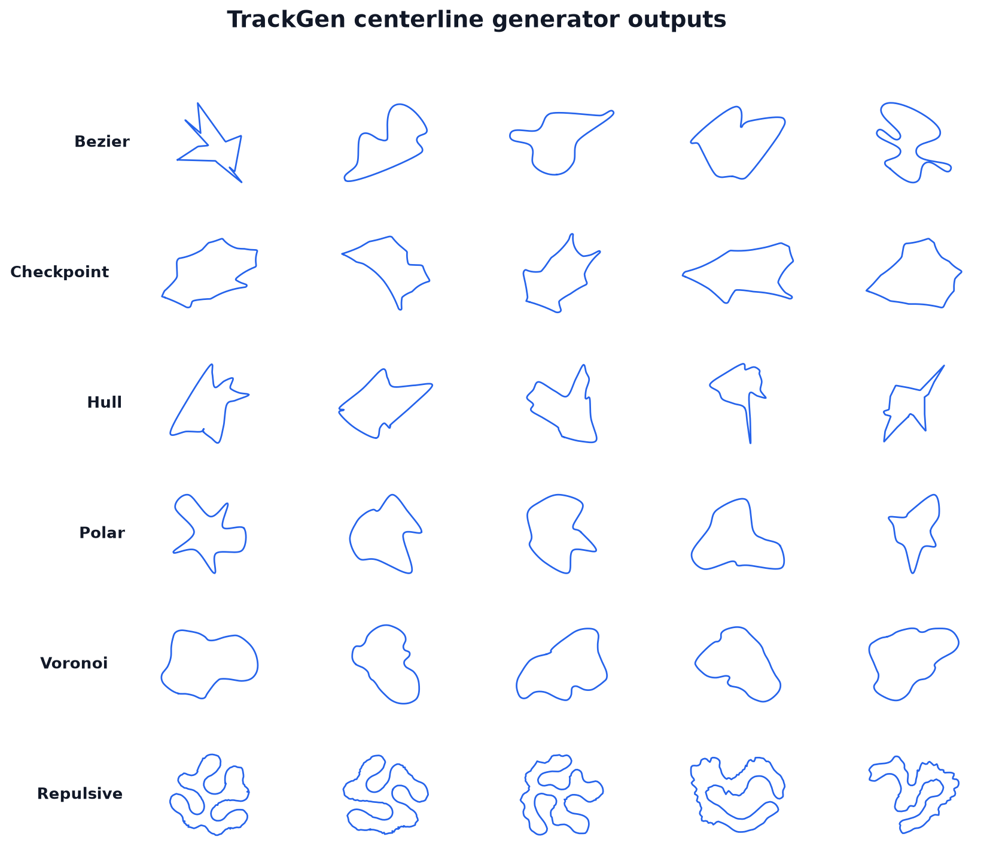

.. _generators-overview:

Generators Overview
===================

This is the catalogue of the built-in centerline generators: what each family builds,
its per-env knobs, the contract they share and what they cost. To pick one for a task,
read the decision guide, :ref:`choosing-a-generator`.

``track_gen`` ships six procedural centerline generators, plus the ``external``
ingestion generator, which turns centerlines you load (a dataset, a learned model) into
tracks and does not depend on the :term:`seed` (:ref:`ingesting-centerlines`). Select
one by name, ``presets.track(generator="hull")`` (or ``TrackGenConfig.generator``). Each
is the ``generator`` :term:`stage` of the pipeline: it writes one closed centerline per
:term:`env`, then the shared resample → XPBD relax → inflate → validity stages take over
(:doc:`/how-it-works/pipeline-stages`).

   Sample tracks from the six generators (one row per generator).

The Six Generators
-------------------

bezier
~~~~~~

Samples random grid-jittered corners, sorts them by angle around their centroid,
and assembles a closed cubic Bézier spline.  Handle lengths are proportional to
``rad * chord`` and clamped by ``handle_clamp_frac`` so handles cannot overshoot
nearby corners.  ``rad``, ``handle_clamp_frac``, ``size`` and the corner count are
per-env knobs (below); the older, deprecated ``style_sampling`` draws per-environment
``rad``, ``scale``, and ``handle_clamp_frac`` from configured ranges (``randomize=``
replaces it).  Self-crossing smooth curves fall back
to their provably simple corner polygon, which XPBD re-rounds.
See :doc:`bezier` for the full deep dive.

hull
~~~~

Angle-sorts a set of randomly sampled points around their centroid — a static
stand-in for a convex hull — then interleaves each adjacent pair of sorted vertices
with one radially displaced midpoint.  The augmented loop is smoothed by a closed
uniform Catmull-Rom spline.  ``hull_displacement`` controls how strongly midpoints
are pushed outward (lobes) or inward (pinches and straights).  Catmull-Rom
self-crossers fall back to an arc-resampled straight augmented polygon.
See :doc:`hull` for the full deep dive.

polar
~~~~~

Builds ``polar_num_knots`` control knots in polar coordinates: each knot starts at
an evenly spaced angle, receives bounded angular and radial jitter, and the resulting
sequence is smoothed by a closed uniform Catmull-Rom spline.  The output is
bounding-box normalized to the shared target extent.  Because the shape is smooth
and centered by construction, polar carries a low relaxation burden and has no
generator-local fallback.
See :doc:`polar` for the full deep dive.

voronoi
~~~~~~~

Draws a fixed site field under one of four layouts (``ring``, ``void_ring``,
``clustered``, ``mixed``) and selects ``voronoi_control_points`` anchor sites by
snapping angular sector targets — jittered by ``voronoi_angular_jitter`` with radius
modulated by ``voronoi_radial_variation`` — to the nearest unused site.  The anchor
cycle is rounded by one Chaikin subdivision and a closed Catmull-Rom pass, then
arc-resampled.  Self-crossing smooth loops fall back to the selected anchor polygon.
The ``void_ring`` default produces the highest compactness of the five generators.
See :doc:`voronoi` for the full deep dive.

checkpoint
~~~~~~~~~~

Steers a bounded-turn path through ``checkpoint_count`` radial checkpoints drawn at
uniformly spaced angles with bounded jitter, producing an organic, continuously
undulating loop unlike the star-shaped families.  A fixed ``num_points``-step walk
with heading gain ``checkpoint_steer_gain`` and per-step turn clamp
``checkpoint_turn_rate`` replaces CarRacing's unbounded retry loop.  An additive
heading-ramp closure ensures the net turning number is exactly one (no inner loops)
while preserving the steered local curvature.  Best-of-K selection (default K=4)
keeps the least-self-intersecting of K decorrelated candidates per environment;
an optional single-crossing clip fallback is available but off by default.
See :doc:`checkpoint` for the full deep dive.

repulsive
~~~~~~~~~

Grows each centerline from a small seed circle under a hard ratcheting length constraint,
using a tangent-point energy and a Sobolev-preconditioned flow to keep the curve
self-avoiding while it is confined to a disc domain seeded with random obstacles —
coarse-to-fine (``N = 64 → 128 → 256``) with an area-based stall-stop.  It is the only
generator built from iterative physical simulation rather than a single deterministic
sampling + smoothing pass, and produces the foldiest, most serpentine circuits of the six.
Its growth loop runs a fixed iteration schedule in which each env stops changing once it
converges, independently of the rest of the batch, so it is recorded into CUDA graphs
like the others; its own graph skips the iterations left once every env has frozen. A
generation still costs far more than any other generator's (`Cost`_): prefer a slow
regeneration cadence or staggered per-env slices over calling ``generate()`` every step.
See :doc:`repulsive` for the full deep dive.

Families at a glance
--------------------

.. list-table::
   :header-rows: 1
   :widths: 15 40 45

   * - Generator
     - Representation
     - Shape character
   * - ``bezier``
     - sampled grid corners, angle-sorted, closed cubic Bézier; corner-polygon fallback
     - star-shaped corner families, smooth cubic curves; the most knobs
   * - ``hull``
     - angle-sorted points, displaced midpoints, closed Catmull-Rom; augmented-polygon
       fallback
     - radial lobes, pinches and straights
   * - ``polar``
     - jittered polar knots, periodic Catmull-Rom; no fallback
     - smooth, centered by construction, a low relaxation burden
   * - ``voronoi``
     - site field, angular anchor cycle, Chaikin + Catmull-Rom; anchor-polygon fallback
     - compact and feature-rich (the highest compactness of the sampling families)
   * - ``checkpoint``
     - radial checkpoints, bounded-turn steering, heading-ramp closure; best-of-K
     - organic, continuously curving loops (CarRacing-style)
   * - ``repulsive``
     - seed circle grown by a tangent-point flow among obstacles (iterative)
     - dense, foldy serpentines (the lowest compactness by far)

The measured shape metrics (compactness, length, chicanes, curvature, yield) are in
:doc:`benchmarks`; :ref:`choosing-a-generator` turns them into a recommendation.

.. _generators-per-env:

Per-env shape knobs
-------------------

Each of the five sampling generators has shape knobs that are **dynamic** (a
:term:`dynamic field`): per-env
``[E]`` arrays that ``randomize=`` draws at every generation and that a curriculum can
write from its own CUDA graph, without rebuilding anything. Every built-in generator but
``external`` also has a per-env ``size`` (the plan view's scale, applied after
``scale``), and ``bezier`` / ``hull`` a per-env corner count (``min_num_points``, an
``int32`` you write: ``randomize=`` draws ``float32`` fields only). The elevation
profiles have dynamic knobs too (``z_min``, ``z_max``, ``z_max_step``,
``z_noise_amplitude``).

.. list-table::
   :header-rows: 1
   :widths: 16 46 38

   * - Generator
     - Dynamic knobs (``randomize=`` key ``"generator.<knob>"``)
     - Details
   * - ``bezier``
     - ``rad``, ``handle_clamp_frac``, ``size``; ``min_num_points`` (``int32``,
       ``set`` only); the gate generator: ``size``
     - :ref:`bezier-dynamic`
   * - ``hull``
     - ``hull_displacement``, ``size``; ``min_num_points`` (``int32``, ``set`` only);
       the gate generator: ``size``
     - :ref:`hull-dynamic`
   * - ``polar``
     - ``polar_radial_jitter``, ``polar_angular_jitter`` (also the gate generator),
       ``size`` (gates: ``normalize.size``)
     - :ref:`polar-dynamic`
   * - ``voronoi``
     - ``voronoi_radial_variation``, ``voronoi_angular_jitter`` (also the gate
       generator), ``size`` (gates: ``normalize.size``)
     - :ref:`voronoi-dynamic`
   * - ``checkpoint``
     - ``checkpoint_radius_min_frac``, ``checkpoint_angle_jitter`` (also the gate
       generator), ``checkpoint_turn_rate``, ``size`` (gates: ``normalize.size``)
     - :ref:`checkpoint-dynamic`
   * - ``repulsive``
     - ``size`` (its output's scale; the other knobs feed a host schedule)
     - :ref:`repulsive-dynamic`
   * - ``external``
     - none: it ingests your geometry as given (scale ``centerline.xy`` yourself)
     - :ref:`ingesting-centerlines`

.. code-block:: python

   from track_gen import TrackGenerator
   from track_gen.pipeline import presets

   device = "cuda:0"  # or "cpu"
   spec = presets.track(num_envs=64, device=device, generator="polar",
                        randomize={"generator.polar_radial_jitter": (0.3, 0.85)})
   gen = TrackGenerator(spec)          # each env draws its own jitter every generation

Everything that sizes a buffer or fixes a launch (``max_num_points``, knot and
checkpoint counts, ``half_width``, ``spacing``, ``n_max``), ``edgy``, the core ``scale``
and the ``repulsive`` growth knobs stay static: build a new generator to change them.
``size`` scales the plan view only (road width, spacing and z stay absolute), so a larger
course needs more points: size ``n_max`` for the largest size (:ref:`tuning-size`).
Each generator page lists its knobs' bounds, effective range and measured yield;
:ref:`curricula` covers randomization and curricula (:ref:`tuning-per-env` the knobs'
effects).

Generator contract
------------------

Every built-in generator is a ``Stage`` of kind ``generator``
(:ref:`generator-stage-contract`), and a plugin generator is written the same way
(:ref:`writing-a-generator`). The contract, in short:

- the stage writes one closed centerline per env into ``raw.xy`` (its raw capacity,
  ``num_points`` for the built-ins) and a per-env flag into ``gen.valid``; it allocates
  everything it needs once, when the pipeline is built;
- its launches depend only on the configuration and the :term:`seed`, never on data read
  back from the device: no host-side retry loop, no host branch on generated data, no
  per-env Python branching. That keeps it recordable in a CUDA graph, an iterative
  stage with an early stop included (``repulsive``, :ref:`cuda-graph-bounded`); a stage
  that must read data back runs on the host, eagerly, while the rest of the pipeline
  replays (:ref:`cuda-graph-host`);
- the built-ins set ``gen.valid = 1`` for every env: final geometric validity (turning
  number, thickness, NaNs, ``N_max`` truncation) is decided later by the shared validity
  stage, after relaxation (:ref:`pipeline-fail-bits`).

Plugins may also use the original two-callable ``GeneratorSpec`` ABI
(``alloc_scratch(config)`` and ``generate(seeds_wp, config, out_centerline,
out_valid_wp, scratch)``): :ref:`plugin-abis` documents it.

Cost
----

The cost of one ``TrackGenerator.generate()`` call per generator, measured on CUDA at
``num_envs = 4096`` with the default configuration (``half_width = 0.1``,
``num_points = 256``, ``relax_iters = 50``): the full call, centerline generation plus
the shared resample → XPBD relax → inflate stages, so only the generator differs across
rows. ``gen_ms_per_call`` is the mean of five ``generate()`` calls after two warm ones
(replays of the generator's own CUDA graph; construction already ran one eager warm-up
pass). ``yield`` is the fraction of valid envs.

.. csv-table:: Generation cost on CUDA, ``E = 4096`` (ms per ``generate()``)
   :file: ../_data/cost-cuda-e4096.csv
   :header-rows: 1

``repulsive`` has its own table: its cost depends on how soon the batch converges, and
it is measured at two batch sizes.

.. csv-table:: ``repulsive`` generation cost on CUDA (ms per ``generate()``)
   :file: ../_data/cost-repulsive-cuda.csv
   :header-rows: 1

Machine of the CUDA tables:

.. include:: ../_data/machine-cuda.txt

The first call after a fresh install or a kernel-source change also pays Warp's one-time
kernel compilation, shared by every generator; later processes load the compiled modules
from Warp's on-disk kernel cache. CPU timings (``E = 512``) are in the ``gen_ms_per_call``
column of :doc:`benchmarks`.

Every number above is written by a command, never by hand (``docs/_data/README.md``
lists them all):

.. code-block:: bash

   python -m benchmarks.compare_generators --E 4096 --seed 0 --cuda \
       | python docs/_tools/md_table_to_csv.py --columns generator,yield,gen_ms_per_call \
       > docs/_data/cost-cuda-e4096.csv
   python -m benchmarks.compare_generators --E 64 --seed 0 --cuda --generators repulsive \
       | python docs/_tools/md_table_to_csv.py --columns generator,gen_ms_per_call \
           --add-column E=64 > docs/_data/cost-repulsive-cuda.csv
   python -m benchmarks.compare_generators --E 8192 --seed 0 --cuda --generators repulsive \
       | python docs/_tools/md_table_to_csv.py --columns generator,gen_ms_per_call \
           --add-column E=8192 --no-header >> docs/_data/cost-repulsive-cuda.csv

.. toctree::
   :maxdepth: 1
   :hidden:

   bezier
   hull
   polar
   voronoi
   checkpoint
   repulsive
   benchmarks
