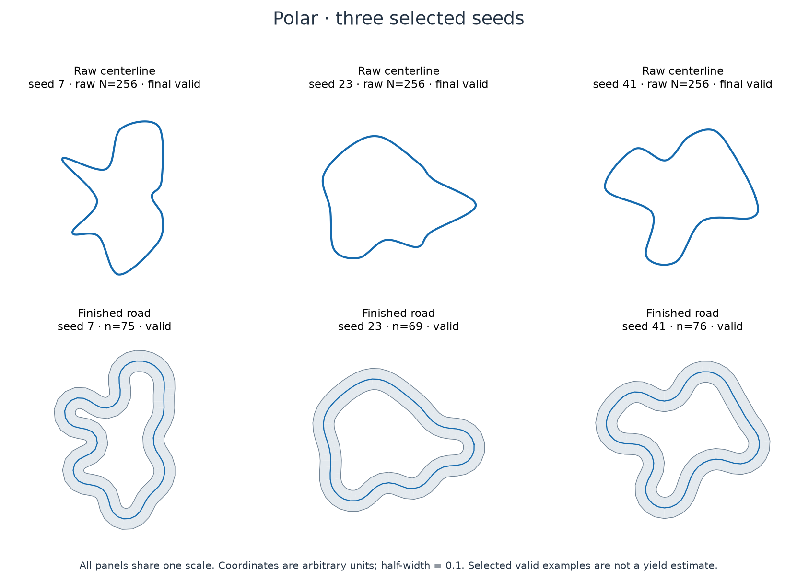
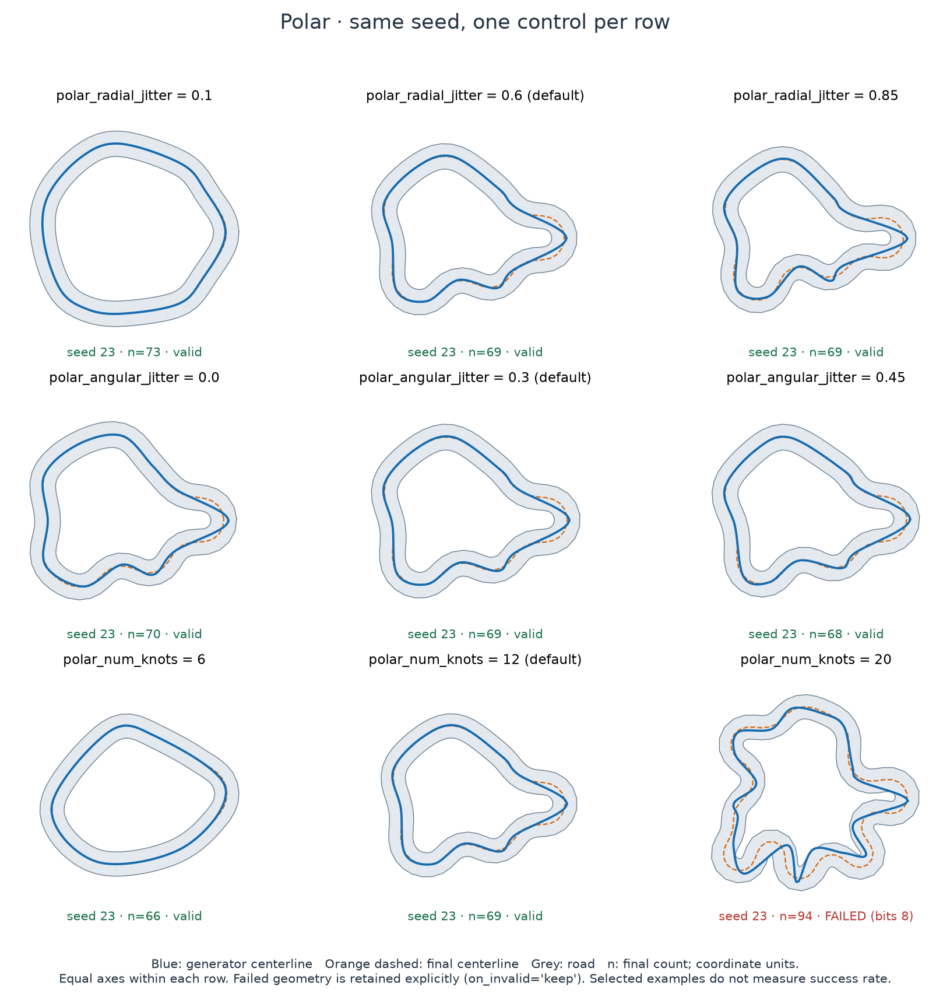
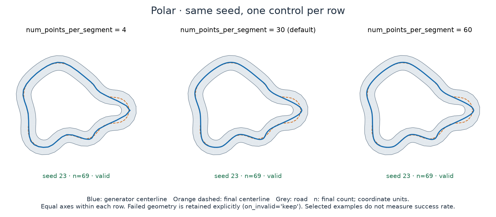
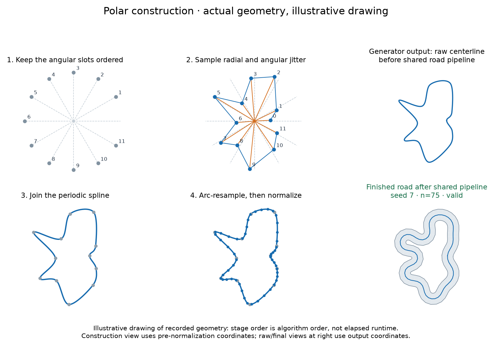

Polar: radial knots
===================

Use ``polar`` for a loop built around a ring of angularly ordered control knots.
Radial jitter changes how far each knot sits from the origin; angular jitter changes
its location inside its angular slot. A periodic cubic curve rounds the knot cycle.

   Three selected valid seeds at default geometry, with equal axes. Blue upper panels show the generator output; lower panels show the final road. Counts exclude padding. These examples do not measure yield.

Try it
------

.. code-block:: python

   from track_gen import TrackGenerator
   from track_gen.pipeline import presets

   gen = TrackGenerator(presets.track(
       generator="polar", num_envs=4, device="cpu",
       generator_params={"polar_radial_jitter": 0.6}), seeds=7)
   track = gen.generate()
   print(track.count.numpy(), track.valid.numpy())

.. snippet: after

   assert track.valid.numpy().any()

Change the knots
----------------

   The default is the middle panel in each row. Blue is the generator curve after extent normalization; orange and grey show its final centerline and road. All panels in a row share axes.

Angular jitter is a fraction of ``2π / polar_num_knots``, not radians. Changing
knot count changes this angular unit as well as the number of random knots. The
raw curve is normalized by its longest bounding-box side, so a radial change is a
shape change rather than a simple change in overall course size.

.. _polar-dynamic:

Controls and defaults
~~~~~~~~~~~~~~~~~~~~~

.. list-table:: Track generator controls
   :header-rows: 1
   :widths: 30 18 52

   * - Setting
     - Default / kind
     - Units, range and practical effect
   * - ``polar_radial_jitter``
     - 0.60 / dynamic
     - Fraction of base radius, [0, 0.85]. Each knot radius is base_radius * (1 + U(-j, j)).
   * - ``polar_angular_jitter``
     - 0.30 / dynamic
     - Fraction of one angular slot, [0, 0.45]. Moves knots around the ring without changing their assigned index order.
   * - ``polar_num_knots``
     - 12 / static
     - Knot count, clamped to at least 4. More knots give finer angular structure and more dense segments.
   * - ``num_points_per_segment``
     - 30 / static
     - At least 2 dense samples per spline segment. A discretization control, independent of final bead spacing.
   * - ``size``
     - 1 / dynamic
     - XY extent multiplier, [0.1, 10]. Width, spacing and z are absolute; see :ref:`tuning-size`.

   The same knot draw is resampled from different dense spline resolutions. Small changes can survive the shared pipeline; a large dense count is not itself a road-quality guarantee.

When it fails
-------------

``polar`` has no generator-local crossing fallback. Large radial excursions can make
a tight bend or bring separated parts of the curve close together. The shared
relaxation and validity stages handle the finite-width road; a visually smooth loop
still needs ``track.valid``. Reduce jitter or change the width-to-size ratio if
clearance is the problem. Increase ``N_max`` if a longer loop is truncated.

Native ``polar`` gates are the control knots, not stations on the cubic curve. Their
knot count equals the gate count; they share the two jitter controls. Native gate
size belongs to ``normalize.size`` rather than the generator stage.

How it is constructed
---------------------

1. Start with ``K`` regular angular slots on the radius-1 reference ring.
2. Draw each radius independently as ``1 + U[-radial_jitter, +radial_jitter]``.
3. Add an independent angular offset to that knot:
   ``theta_i = (2*pi/K) * (i + U[-angular_jitter, +angular_jitter])``.
   Angular jitter is a **fraction of one slot**, not radians. At the defaults,
   12 slots are 30 degrees apart, radii range from .4 to 1.6 and angular offsets
   reach 9 degrees in either direction.
4. Evaluate periodic Catmull–Rom segments and arc-resample to ``num_points``.
   Recenter the bounding box and normalize its longest side to the output extent.
   This generator has no local polygon-fallback branch.

   The reference ring is radius 1. Radial and angular changes are shown separately;
   grey dense parameter samples and blue arc samples make resampling visible.

.. raw:: html

   <video controls preload="none" style="width:100%;max-width:100%;aspect-ratio:30/19;object-fit:contain" poster="../generator-polar-construction-poster.png" aria-label="Polar angular slots, independent radii, angular jitter, spline, actual arc samples and normalization.">
     <source src="../generator-polar-construction.mp4" type="video/mp4">
     Polar angular slots, independent radii, angular jitter, spline, actual arc samples and normalization.
   </video>

:download:`Download the animation <../assets/racing/generator-polar-construction.mp4>`.

**Text alternative:** Dashed rays and the unit ring establish regular slots. Move
out to the sampled radii, then use arcs to show the actual independent angular
changes. Draw the periodic spline and compare its dense parameter samples with
256 actual arc samples. Before/after panels explain normalization; the finished
seed-7 road has 75 beads after the shared tail.

The radius-only reference uses the canonical sampler with angular jitter suppressed,
keeping the same random draws. It explains the components of the sample, rather
than claiming a literal intermediate kernel state or elapsed runtime. Continue
with the :ref:`shared spacing, XPBD and final redistribution <sampling-stages>`.

Continue with :doc:`/how-it-works/pipeline`, :doc:`/configuration/tuning`,
:ref:`builtin-generator-params`, or :doc:`/tutorials/gate-sequences`.
