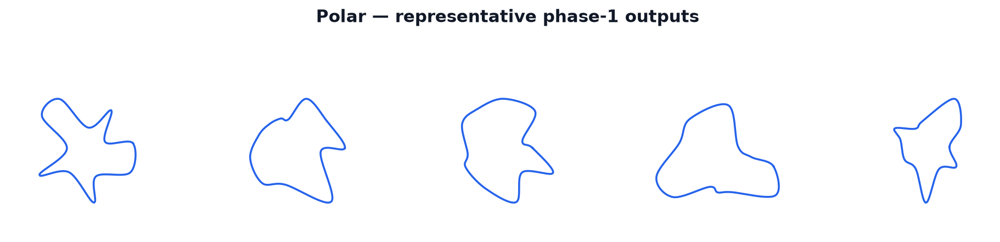

Polar Generator
===============

The **polar** generator produces smooth, closed, radially symmetric track
centerlines by placing a fixed number of control knots in polar coordinates,
fitting a periodic cubic spline through them, and normalizing the result to a
shared coordinate extent. Because the representation starts in polar form, the
loop is smooth and centered by construction — no post-generation sorting,
centroid correction, or polygon fallback is required. It writes one closed centerline per
:term:`env` at every :term:`generation`, and its jitters and size are per-env
:term:`dynamic fields <dynamic field>` (`Per-env (dynamic) parameters`_).

   Representative centerlines produced by the polar generator.

How It Works
------------

1. **Control knot sampling.** The kernel ``_polar_controls_dyn_k`` draws
   ``K = polar_num_knots`` control knots using ``ops.rng.init`` with the fixed
   ``generator.polar/controls`` salt (:ref:`ops-rng-keying`). It first reads env ``e``'s
   ``radial_jitter`` and ``angular_jitter`` from the per-env parameter arrays and clamps
   them to their bounds, ``[0, 0.85]`` and ``[0, 0.45]``. For each knot index
   ``i`` in ``0 … K-1``:

   - The nominal angle is ``2π i / K``.
   - A bounded angular offset ``angle_delta`` is drawn from
     ``(-angular_jitter, +angular_jitter)`` and added: because the jitter fraction
     is at most ``0.45``, below ``0.5``, the fixed index order remains the sorted
     angular order without a runtime sort.
   - A radial offset ``radial_delta`` is drawn from
     ``(-radial_jitter, +radial_jitter)`` and applied relative to
     ``base_radius = 1.0``. The radius is clamped to at least ``0.1 *
     base_radius`` so knots never collapse to the origin.

2. **Closed Catmull-Rom spline.** ``_polar_spline_dense_k`` evaluates a closed
   uniform Catmull-Rom spline through the ``K`` knots, producing
   ``K * num_points_per_segment`` dense samples per environment. Samples are
   endpoint-excluded within each segment; the arc resampler closes the final
   segment back to the first knot. The values equal
   ``ops.closed_catmull_rom(ctx, controls, K, num_points_per_segment, dense)``; polar
   keeps its one-thread-per-environment kernel because on CUDA the loop structure
   decides which multiply-adds become FMAs.

3. **Arc-length resampling.** ``ops.arc_resample`` converts the dense periodic spline
   to exactly ``num_points`` arc-uniformly spaced points.

4. **Bounding-box normalization.** ``ops.normalize_extent`` centers each
   environment's loop by its bounding-box centroid and isotropically rescales
   so the longest bounding-box dimension equals ``scale * 1.44``, times the env's
   ``size[e]`` (``ops.normalize_extent(..., size=...)``; `Per-env (dynamic)
   parameters`_). The ``1.44``
   constant matches the Bézier baseline's typical per-environment longest
   bounding-box extent at ``scale = 1.0``, ensuring that ``half_width``,
   constant spacing, and XPBD relaxation see comparable coordinate ranges
   across all generators.

5. **Validity flag.** The generator writes ``out_valid_wp = 1`` for every
   environment. It has no local polygon fallback; any rare bad geometry is
   handled by the shared post-relax validity gate.

Math
----

**Knot polar coordinates.** For knot index :math:`i \in \{0, \ldots, K-1\}`:

.. math::

   \theta_i = \frac{2\pi i}{K} + \epsilon_i^{(\theta)},
   \qquad |\epsilon_i^{(\theta)}| < \frac{2\pi\,\alpha}{K},\quad \alpha = \texttt{polar\_angular\_jitter} < 0.5

.. math::

   r_i = R_\text{base} \cdot \max\!\bigl(1 + \epsilon_i^{(r)},\; 0.1\bigr),
   \qquad |\epsilon_i^{(r)}| \leq \delta_r

where :math:`\alpha` is the dimensionless ``polar_angular_jitter`` fraction (bounded
to ``[0, 0.45]``, strictly below ``0.5`` so the fixed index order remains the sorted angular
order without a runtime sort), :math:`\delta_r` is ``polar_radial_jitter``, and
:math:`R_\text{base} = 1.0` (a pre-normalization working radius). The Cartesian knot position is:

.. math::

   \mathbf{p}_i = \bigl(r_i \cos\theta_i,\; r_i \sin\theta_i\bigr)

**Closed uniform Catmull-Rom spline.** The dense spline is evaluated as:

.. math::

   \mathbf{C}(u) = \tfrac{1}{2}
   \begin{bmatrix} 1 & u & u^2 & u^3 \end{bmatrix}
   \begin{bmatrix}
     0 &  2 &  0 &  0 \\
    -1 &  0 &  1 &  0 \\
     2 & -5 &  4 & -1 \\
    -1 &  3 & -3 &  1
   \end{bmatrix}
   \begin{bmatrix} \mathbf{p}_{i-1} \\ \mathbf{p}_i \\ \mathbf{p}_{i+1} \\ \mathbf{p}_{i+2} \end{bmatrix}

for :math:`u \in [0, 1)` within segment :math:`i`, with indices taken modulo
:math:`K` for the closed (periodic) loop. This is equivalent to the
scalar form implemented in ``ops.funcs.catmull_rom``:

.. math::

   \mathbf{C}(u) = \tfrac{1}{2}\bigl[
     2\mathbf{p}_i
     + (-\mathbf{p}_{i-1} + \mathbf{p}_{i+1})\,u
     + (2\mathbf{p}_{i-1} - 5\mathbf{p}_i + 4\mathbf{p}_{i+1} - \mathbf{p}_{i+2})\,u^2
     + (-\mathbf{p}_{i-1} + 3\mathbf{p}_i - 3\mathbf{p}_{i+1} + \mathbf{p}_{i+2})\,u^3
   \bigr]

**Normalization.** After arc-length resampling to :math:`N` points, each
environment is centered by its bounding-box midpoint and isotropically scaled so
that:

.. math::

   \max(\Delta x,\, \Delta y) = \texttt{scale} \times 1.44 \times \texttt{size}[e]

where :math:`\Delta x = x_\max - x_\min` and :math:`\Delta y = y_\max - y_\min`
(``size[e] = 1`` by default).

Parameters
----------

The following ``TrackGenConfig`` fields are owned and consumed directly by the
polar generator. For the full field listing and defaults see the configuration
reference (``docs/configuration/``).

The generator-specific fields below are also the fields of ``PolarParams``, the
generator's Params class (core fields such as ``scale`` are not): set them flat or
through ``generator_params`` (see :ref:`builtin-generator-params`). Their rules are
checked when the ``TrackGenerator`` is constructed, and only for ``generator="polar"``.

``polar_num_knots``
   Number of polar control knots :math:`K`. More knots allow higher-frequency
   radial variation; fewer produce rounder, more elliptical shapes. Minimum
   enforced to 4. Default: ``12``.

``polar_radial_jitter``
   Maximum fractional radial perturbation :math:`\delta_r` applied to each
   knot. At ``0.0`` all knots sit on ``base_radius`` and the spline is a
   near-circle. At the default (``0.60``) the generator produces substantial
   radial variety without collapsing radii. Dynamic, in ``[0, 0.85]``: a value
   outside raises ``ValueError`` at construction (:ref:`upgrading-bounds`).

``polar_angular_jitter``
   Maximum angular offset as a fraction of one knot cell
   (:math:`2\pi / K`). Kept strictly below ``0.5`` so the fixed knot indices remain
   in sorted angular order without a runtime sort: dynamic, in ``[0, 0.45]``, and a
   value outside raises ``ValueError`` at construction. Default:
   ``0.30``.

``scale``
   Global coordinate scale shared across all generators. The polar generator
   normalizes its longest bounding-box axis to ``scale * 1.44``. Larger values
   produce physically larger tracks. A core field, static.

``size``
   Per-env size multiplier: env ``e``'s longest bounding-box side becomes
   ``f32(scale * 1.44) * size[e]``. Default ``1.0``. Dynamic, in ``[0.1, 10]`` (below).

``num_points_per_segment``
   Number of dense Catmull-Rom samples emitted per control-knot segment before
   arc-length resampling. Shared with the bezier, hull and voronoi generators.
   Higher values improve arc-length accuracy at the cost of scratch buffer size.

.. _polar-dynamic:

Per-env (dynamic) parameters
----------------------------

``polar_radial_jitter``, ``polar_angular_jitter`` and ``size`` are **dynamic** fields of
``PolarParams`` (the two jitters also of ``PolarGateParams``: the polar gate generator
draws its knots with the same kernel): per-env ``[E]`` ``float32`` arrays, initialised
from the configured values. Draw them per env with ``presets.track(generator="polar",
randomize={"generator.polar_radial_jitter": (lo, hi)})`` (``presets.gates`` takes the
same keys), write them with ``gen.params["generator"].set(...)`` or from your own graph
(a curriculum): see :ref:`tuning-per-env`.

**Bounds.** The jitters' declared bounds are ``[0, 0.85]`` and ``[0, 0.45]``, the
ranges the kernel clamps them to. A scalar outside them raises ``ValueError`` (at
construction, or from ``set``); setting the bound itself (``0.85``) gives what the clamp
of a larger value gives (:ref:`upgrading-bounds`). An array value outside them (an
``[E]`` ``set``, your own kernel) is clamped when the kernel reads it.

.. list-table::
   :header-rows: 1
   :widths: 26 9 11 21 20 13

   * - Field (``randomize=`` key)
     - Default
     - Bounds
     - Harder / more varied when
     - Effective range
     - Yield at lo / default / hi
   * - ``polar_radial_jitter`` (``generator.polar_radial_jitter``)
     - ``0.60``
     - ``[0, 0.85]``
     - higher: more eccentric shapes, deeper inlets
     - the whole range (the bound keeps every radius positive)
     - 1.00 / 1.00 / 0.98
   * - ``polar_angular_jitter`` (``generator.polar_angular_jitter``)
     - ``0.30``
     - ``[0, 0.45]``
     - higher: more irregular knot spacing
     - the whole range (the bound keeps the knots in angular order)
     - 1.00 / 1.00 / 1.00
   * - ``size`` (``generator.size``)
     - ``1.0``
     - ``[0.1, 10]``
     - higher: a longer course relative to the (absolute) road width
     - about ``[0.5, 3.7]`` at the default ``n_max`` (384): from about ``3.7`` the
       longest tracks of a large batch truncate; small sizes lose yield to the road
       width
     - 0.96 / 1.00 / 1.00 at 0.5 / 1 / 2 (1.00 at 3)

*Yield* is the fraction of valid tracks with the default pipeline, ``E = 128``, seeds
``0..127`` (CPU), with the knob set to the value for every env (``size``: ``E = 256``,
seeds ``7919 * e + 13``).

**Size** scales the normalization target: env ``e``'s loop is centred and scaled so its
longest bounding-box side is ``f32(scale * 1.44) * size[e]``, within one ``float32``
rounding of ``scale = s`` at ``size = s`` (at ``size = 1`` the bytes are unchanged). It
scales the plan view only (road width, spacing and z stay absolute), so a larger course
needs more points: the longest default ``polar`` loop of 8192 envs is 6.24 (p99 5.67)
at ``scale = 1``, and with the default ``n_max = 384`` and spacing ``0.06`` truncation
(a failed env) starts at about ``size = 3.7``. Size ``n_max`` and ``num_points`` for the
largest size with the rule of :ref:`tuning-size`. On **gates**, the polar gate
generator has no ``size``: its anchors are re-normalized by the gate pipeline's
``normalize.extent`` stage, whose ``size`` is the key (``presets.gates(generator="polar",
randomize={"normalize.size": (lo, hi)})``; ``generator.size`` raises with that hint).

**Static knobs, and why.** ``polar_num_knots`` (sizes the knot and dense buffers and
the launch dimensions), ``num_points_per_segment`` (sizes the dense buffer) and the core
``scale`` (a host product with the target extent; per-env: ``size``).

What Makes It Distinct
----------------------

The polar generator is the only one of the six that works entirely in polar
coordinates from the start:

- **No Cartesian corner sampling or sorting.** Bézier and hull generators both
  sample random Cartesian corners and sort them by angle around their centroid.
  The polar generator places knots directly at evenly spaced angles, so the
  loop is smooth and centered by construction and requires no centroid
  correction.

- **Smooth output, low XPBD burden.** Because every knot is already in
  angular order and the spline is closed and uniformly parameterized, the
  pre-relax geometry is consistently smooth with no tendency toward figure-eight
  crossings. This translates to a low XPBD displacement (the
  ``xpbd_displacement`` column of :doc:`benchmarks`).

- **No local fallback, fastest hot path.** Bézier detects self-crossings and
  falls back to a corner polygon; hull and voronoi fall back to their anchor
  polygons. Polar skips all self-intersection detection and all fallback
  kernels — the hot path is control sampling, spline evaluation, arc resample,
  and normalization only.

- **Pure radial shape vocabulary.** The shape family is parameterized by radial
  perturbations around the origin rather than by corner placement, handle
  lengths, site layouts, or a steering walk. This makes it a strong contrast
  generator for curriculum or benchmark diversity: it produces tracks that are
  systematically different in shape character from the corner-family (bézier,
  hull) and path-family (checkpoint) generators.

- **No Fourier collapse.** An earlier Fourier radial function path was abandoned
  because it tended toward high-compactness near-circles. The random per-knot
  radial approach explicitly avoids this by drawing independent radial
  perturbations per knot.

Fallback and Validity
---------------------

The polar generator has **no local fallback**. It does not run
``ops.self_intersections`` and does not maintain a backup polygon buffer.
Every environment receives ``out_valid_wp = 1`` at generation time regardless
of geometry.

Final geometric validity — turning number, minimum thickness, NaN checks — is
decided by the shared post-relax inflation validity gate, which is common to all
six generators. Any rare degenerate polar loop (e.g., from extreme jitter
settings) is caught and flagged there, not inside the generator.

This design is intentional: the polar parameterization rarely produces
self-crossing geometry at default settings, so the cost of a local fallback
path is not justified. The XPBD relaxation stage further smooths out mild
overlap before the validity gate.
