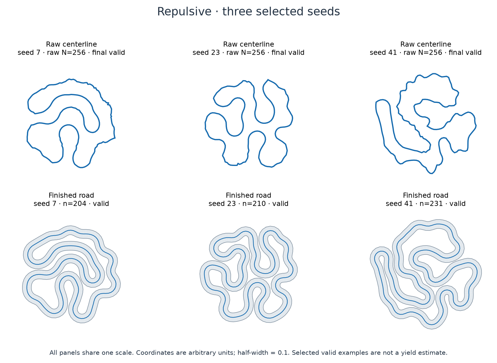
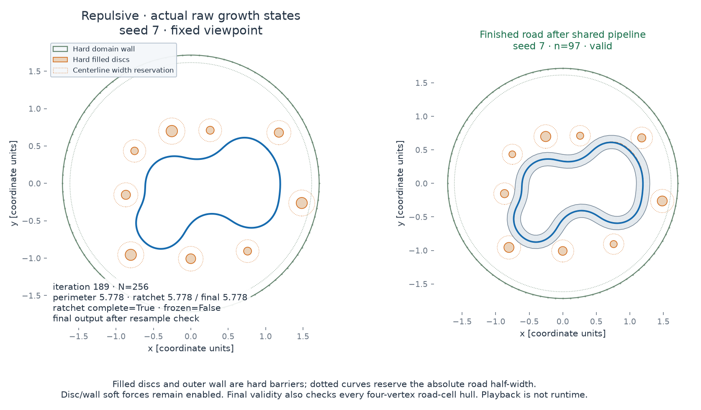
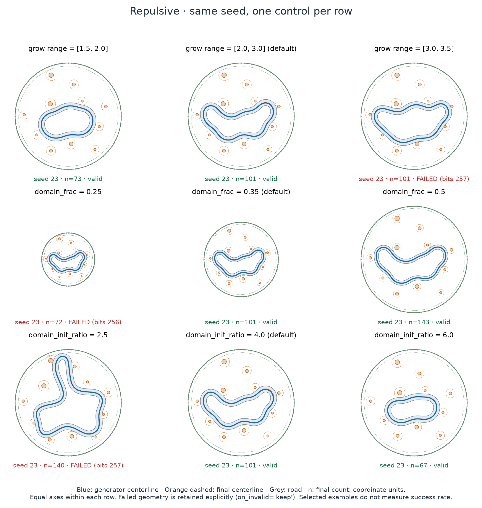
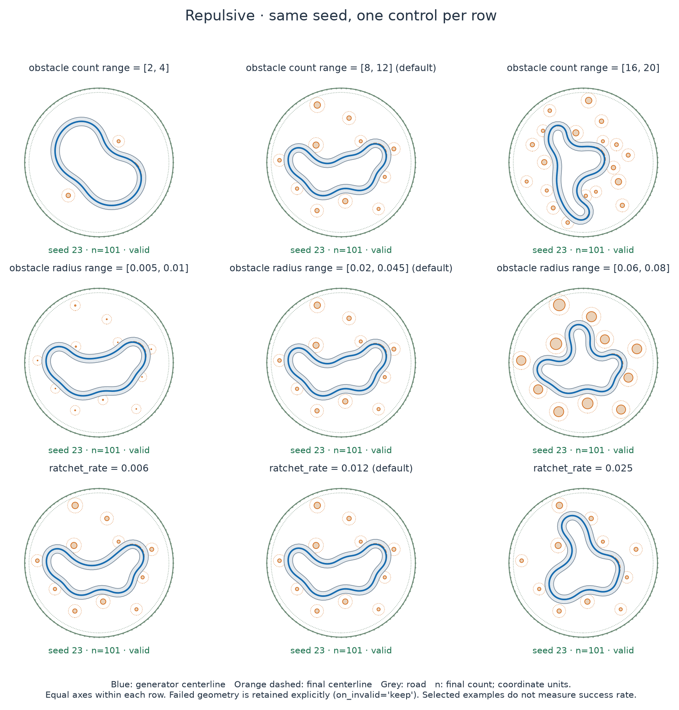
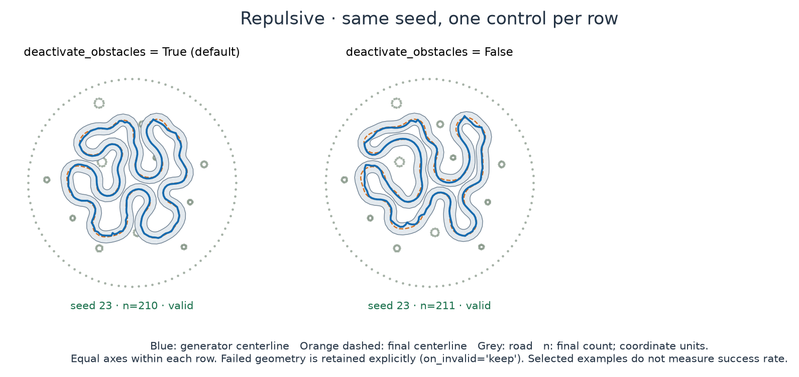
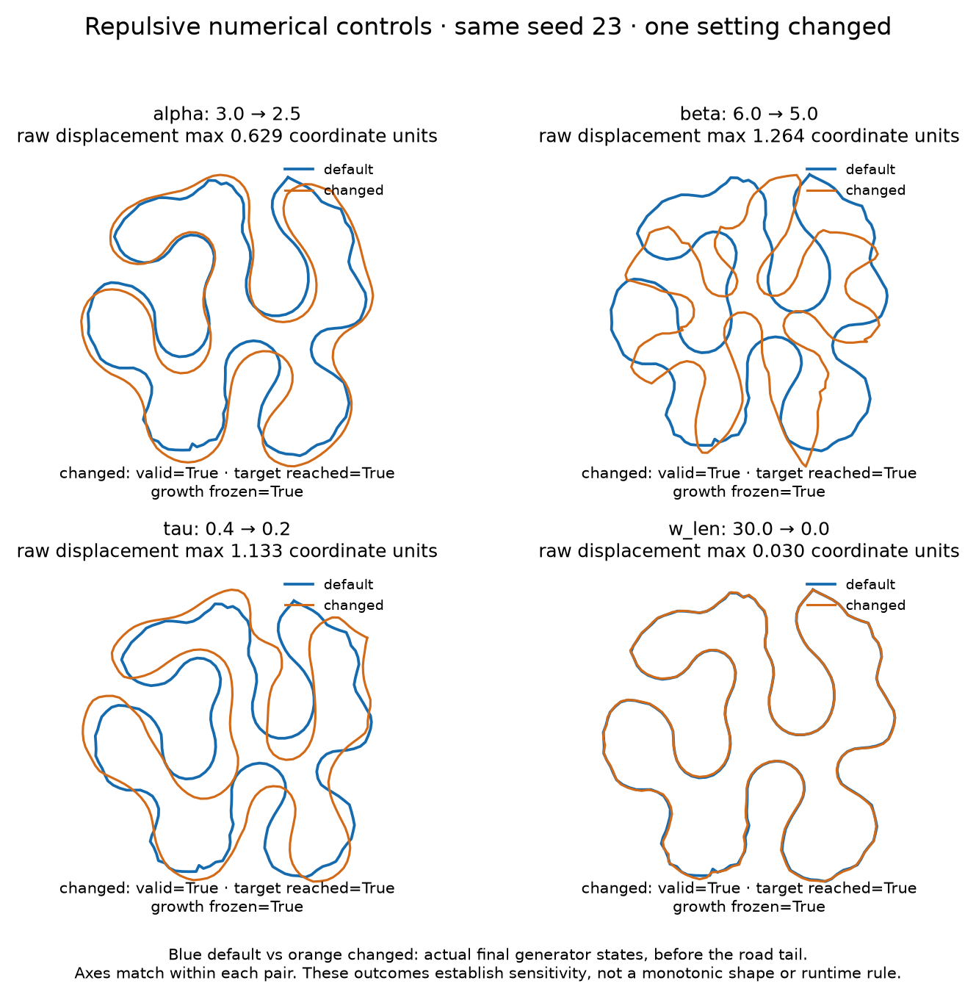

Repulsive: grow a folded loop
=============================

Use ``repulsive`` when you want a circuit grown into folds around seeded obstacles.
It repeatedly updates a curve under self-repulsion and a hard target-length ratchet.
This is an iterative optimizer: use small trial batches and measure regeneration
cost at your actual device, batch size and cadence.

   Three selected valid seeds at default geometry, with equal axes. Blue upper panels show the generator output; lower panels show the final road. Counts exclude padding. These examples do not measure yield.

Try it
------

.. code-block:: python

   from track_gen import TrackGenerator
   from track_gen.pipeline import presets

   gen = TrackGenerator(presets.track(
       generator="repulsive", num_envs=1, device="cpu"), seeds=7)
   track = gen.generate()
   print(track.count.numpy(), track.valid.numpy())

.. snippet: after

   assert track.valid.numpy().any()

Watch actual growth
-------------------

   Actual recorded growth states, with the sampled wall and obstacle rings. This is the final generator curve, before the shared road pipeline. The examples above show the finished road.

.. raw:: html

   <video controls preload="none" style="width:100%;max-width:100%" poster="../_images/generator-repulsive-growth.png" aria-label="Actual repulsive-growth states from a fixed seed and viewpoint, labeled by iteration and resolution.">
     <source src="../generator-repulsive-growth.mp4" type="video/mp4">
     Actual repulsive-growth states from a fixed seed and viewpoint, labeled by iteration and resolution.
   </video>

:download:`Download the animation <../assets/racing/generator-repulsive-growth.mp4>`.

The clip records the initial circle and intermediate CPU states from the unmodified
growth loop. It samples every four iterations and retains resolution transitions.
Playback time is not runtime. The final recorded generator output is checked for
exact equality with an ordinary generation from the same seed/configuration.
Reaching target length, freezing the growth state and passing final road validity
are separate events.

Change the growth domain
------------------------

   Green dots are actual sampled wall/obstacle rings; blue is the raw grown loop. Grey and orange show the final road and centerline. Equal axes within each row preserve scale differences.

A domain setting changes the geometry in which the flow runs. It can change both
the layout and its physical size. For a pure multiplier of the completed raw curve,
use the dynamic ``size`` control instead.

.. _repulsive-dynamic:

Controls and defaults
~~~~~~~~~~~~~~~~~~~~~

Only ``size`` is dynamic; all growth controls below are static. Rebuild to change
the physical system, resolution schedule or stopping policy. The growth/obstacle
rows in the figures change both bounds of the named range together.

.. list-table:: Track generator controls
   :header-rows: 1
   :widths: 30 18 52

   * - Setting
     - Default / kind
     - Units, range and practical effect
   * - ``repulsive_grow_mult_min`` / ``repulsive_grow_mult_max``
     - 4.5 / 5.5; static
     - Target perimeter multiplier bounds: min ≥ 1, max > 1 and max ≥ min. The target is grow_mult * 2π * initial_radius.
   * - ``repulsive_domain_frac``
     - 0.35 / static
     - Positive fraction of the reference length 4.9029 * scale; sets the domain radius.
   * - ``repulsive_domain_init_ratio``
     - 4 / static
     - Domain radius divided by initial-circle radius, greater than 1. Changes initial perimeter and therefore the drawn final target.
   * - ``repulsive_obstacle_count_min`` / ``repulsive_obstacle_count_max``
     - 8 / 12; static
     - Inner-disc count bounds: min ≥ 1 and max ≥ min. More discs change the constrained flow and increase obstacle work.
   * - ``repulsive_obstacle_radius_min_frac`` / ``repulsive_obstacle_radius_max_frac``
     - 0.02 / 0.045; static
     - Positive, ordered fractions of domain radius. Changes sampled inner-disc sizes, not road width.
   * - ``repulsive_ratchet_rate``
     - 0.012 / static
     - Positive per-iteration growth factor. Larger values reach target in fewer ratchet steps but can change fold formation.
   * - ``repulsive_deactivate_obstacles``
     - True / static
     - After an env reaches target, omit inner-disc repulsion during settling. The wall remains active; obstacles are generator scaffolding, not exported simulator colliders.
   * - ``size``
     - 1 / dynamic
     - Output XY multiplier, [0.1, 10], applied after growth. Does not change growth states or stopping; width and spacing remain absolute.

   These selected outcomes show sensitivity, not monotonic promises about fold count, validity or runtime.

   The domain wall stays active in both cases. Toggling deactivation changes only the settle-stage obstacle forces after reaching target.

Growth mechanics and schedule
-----------------------------

The flow combines tangent-point self-repulsion, inverse-power obstacle repulsion and
an active secondary length regularizer. It preconditions the gradient with a
fractional Sobolev filter, projects out the length direction, takes a normalized
barycenter-pinned step, and hard-rescales to the current ratcheted target perimeter.
The hard ratchet/rescale enforces length; ``repulsive_w_len`` still affects the
computed gradient and is not inert.

The algorithm draws on Yu, Schumacher and Crane's
`Repulsive Curves <https://arxiv.org/abs/2006.07859>`_ and the
race-track construction of Henrich and Kötter, extended in
`From Generation to Gameplay: Authoring Race Tracks With Repulsive Curves
<https://doi.org/10.1109/TG.2025.3561107>`_. The coarse-to-fine schedule,
hard length enforcement and final road pipeline described here are TrackGen's
implementation choices.

.. list-table:: Numerical controls (all static)
   :header-rows: 1
   :widths: 35 18 47

   * - Setting
     - Default
     - Meaning and tradeoff
   * - ``repulsive_alpha`` / ``repulsive_beta``
     - 3 / 6
     - Positive tangent-point energy exponents. Obstacle inverse power is beta − alpha. Changing them also changes the Sobolev filter; do not expect a simple shape trend.
   * - ``repulsive_tau``
     - 0.4
     - Dimensionless normalized step size. Larger steps can change convergence or destabilize the flow; no scalar interval is enforced.
   * - ``repulsive_w_len``
     - 30
     - Dimensionless secondary length-regularizer weight. The hard length constraint remains; this is a live force contribution, with no scalar interval enforced.
   * - ``repulsive_stages``
     - (64, 128, 256)
     - Strictly increasing positive multiples of 4. Last must equal track num_points. Arc-resampling at transitions gives finer degrees of freedom; pair work grows quadratically with active resolution.
   * - ``repulsive_settle_iters``
     - 40
     - Additional iteration budget, at least 1. Adds to the bound after the ratchet schedule; not an exact number of post-target steps for every env.
   * - ``repulsive_resample_every``
     - 25
     - Iteration interval, at least 1, for arc-length reparameterization of unfrozen curves. Controls sample regularity during flow.
   * - ``repulsive_stall_window``
     - 16
     - Iterations between final-resolution stall checks, at least 1. Determines when an env can freeze and when loop windows can be skipped.
   * - ``repulsive_stall_area_tol``
     - 0.05
     - Relative area-change tolerance; meaningful nonnegative values compare change with the preceding check. Larger values can freeze shapes earlier. This is not road-clearance tolerance.

   One numerical setting changes in each pair. Raw-curve displacement, final road
   validity, target-reaching and freeze status are measured on the current CPU
   implementation. The outcomes show sensitivity, not a monotonic quality rule.

The iteration bound is ``ceil(1.6 * n_ratchet) + repulsive_settle_iters``, where
``n_ratchet = ceil(log(grow_mult_max) / log1p(ratchet_rate))``. Resolution transitions
are scheduled from configuration, not a host read of evolving device geometry. An
env freezes only after reaching target at the final resolution and satisfying the
area-change check. Later updates preserve its curve. The final generator copy is
arc-resampled once more before the shared pipeline.

On eager CPU calls the loop can stop when all envs freeze. Supported conditional
CUDA captures can skip remaining windows on device; eager CUDA and unconditional
captures execute the full bound while frozen envs remain unchanged. Construction
warms one generation; CUDA graph recording is another one-time cost. See
:ref:`cuda-graph-bounded` for capture compatibility and :doc:`/reference/exec` for
the execution contract. Measure amortized cost, not only the first call.

When it fails
-------------

There is no generator-local crossing fallback. Self-repulsion is not an exact
finite-width collision proof. The shared road pipeline can reject a grown curve
for tight bends, close nonlocal approaches, nonfinite output or truncation. Inspect
``track.fail_mask`` and use explicit ``on_invalid="keep"`` for diagnostic plots.
The chosen control examples label failed outcomes; they are not estimated failure
rates.

Long folded loops need substantial capacity. A useful initial capacity budget is
``N_max > perimeter / spacing`` plus headroom for variation. At the default growth
bounds the largest target is approximately 14.83 * scale before ``size``; a size
increase can exhaust default capacity without changing the growth physics. See
:ref:`tuning-size`. ``repulsive`` has no native gate generator; use stations along
its centerline, or relaxed stations when gates should follow the relaxed road.

Continue with :doc:`/configuration/tuning`, :doc:`/relaxation/overview`,
:ref:`builtin-generator-params` and :doc:`benchmarks`.
