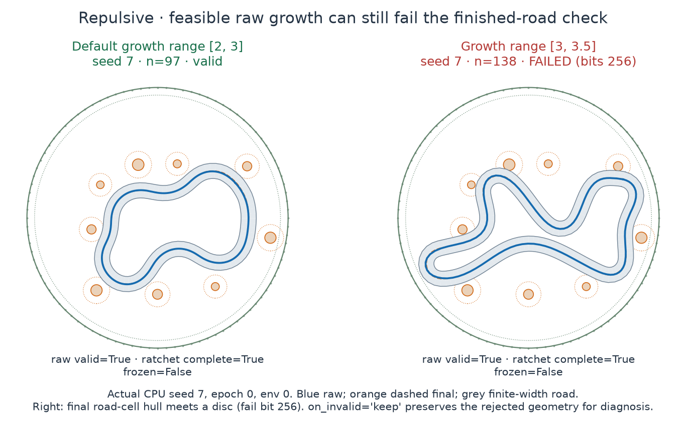

Repulsive: grow a folded loop
=============================

Use ``repulsive`` for a circuit grown from a small circle into folds among sampled
disc obstacles. The curve approaches a target perimeter while every accepted
update stays inside the circular wall and clears the discs. The **finished road,
including its full width**, must also pass these checks after resampling,
relaxation and inflation. A disc in the closed loop's central hole is allowed.

This is a bounded iterative optimizer. Try small batches, inspect validity and
measure regeneration cost at your device, batch size and reset cadence.

.. figure:: ../assets/racing/generator-repulsive-examples.png
   :alt: Three repulsive raw centerlines above the corresponding finished roads,
         with their sampled discs and circular wall.
   :align: center

   Selected valid CPU examples at default geometry and equal axes. Blue upper
   panels show raw generator centerlines; lower panels show the finished roads.
   Counts exclude padding. The selected seeds do not measure yield.

Try it
------

.. code-block:: python

   from track_gen import TrackGenerator
   from track_gen.pipeline import presets

   gen = TrackGenerator(presets.track(
       generator="repulsive", num_envs=1, device="cpu"), seeds=7)
   track = gen.generate()
   print(track.count.numpy(), track.valid.numpy(), track.fail_mask.numpy())

.. snippet: after

   assert track.valid.numpy().any()

Watch actual growth
-------------------

.. figure:: ../assets/racing/generator-repulsive-growth.png
   :alt: Recorded CPU growth with iteration, resolution, target and freeze labels.
   :align: center

   Actual optimizer states before the shared road pipeline. Disc and wall forces
   remain active through growth and settling; the filled disc regions and wall
   also constrain accepted motion. Compare the finished roads above when judging
   the delivered centerline and width.

.. raw:: html

   <video controls preload="none" style="width:100%;max-width:100%" poster="../_images/generator-repulsive-growth.png" aria-label="Actual repulsive-growth states from a fixed seed and viewpoint, labeled by iteration and resolution.">
     <source src="../generator-repulsive-growth.mp4" type="video/mp4">
     Actual repulsive-growth states from a fixed seed and viewpoint, labeled by iteration and resolution.
   </video>

:download:`Download the animation <../assets/racing/generator-repulsive-growth.mp4>`.

The clip records the initial circle and intermediate CPU states from the actual
growth loop. Playback time is not runtime. Its final recorded raw curve is checked
for exact equality with an ordinary generation from the same seed/configuration.
Target attainment, optional freezing and final road validity are separate labels.
A feasible curve can reach its target and finish valid at the iteration budget
while remaining unfrozen; validity does not promise an energy minimum.

Change the growth domain
------------------------

.. figure:: ../assets/racing/generator-repulsive-controls.png
   :alt: Same-seed target-growth bounds, domain size and initial-radius comparisons.
   :align: center

   The sampled wall and discs constrain the blue raw loop. Grey and orange show
   the finished road and centerline. Equal axes within each row preserve scale
   differences. Every panel labels its own validity.

Domain and growth settings change the space available to the curve and the target
it must reach. Larger targets or wider roads can make a request infeasible.
``size`` also affects the raw problem because the road width stays absolute:
see `Size and width reservation`_.

.. _repulsive-dynamic:

Controls and defaults
~~~~~~~~~~~~~~~~~~~~~

Only ``size`` is dynamic; all growth controls below are static. Rebuild to change
the domain, resolution schedule or stopping policy. Paired range controls in the
figures change both bounds together. Distances are in plan-view coordinates.

.. list-table:: Track generator controls
   :header-rows: 1
   :widths: 30 18 52

   * - Setting
     - Default / kind
     - Units, range and practical effect
   * - ``repulsive_grow_mult_min`` / ``repulsive_grow_mult_max``
     - 2 / 3; static
     - Target-perimeter multiplier bounds: min ≥ 1, max > 1 and max ≥ min. The target is grow_mult * 2π * r_init. A larger target can fail within the bounded solve.
   * - ``repulsive_domain_frac``
     - 0.35 / static
     - Positive fraction of the reference length: r_dom = domain_frac * 4.9029 * scale. Sets the unscaled circular domain radius.
   * - ``repulsive_domain_init_ratio``
     - 4 / static
     - r_dom / r_init, greater than 1. Changes initial perimeter and therefore the sampled final target.
   * - ``repulsive_obstacle_count_min`` / ``repulsive_obstacle_count_max``
     - 8 / 12; static
     - Inclusive disc-count bounds: min ≥ 1 and max ≥ min. More discs change the feasible space, force field and obstacle work. A disc slot with an empty placement band is unused.
   * - ``repulsive_obstacle_radius_min_frac`` / ``repulsive_obstacle_radius_max_frac``
     - 0.02 / 0.045; static
     - Positive ordered fractions of r_dom. Change sampled filled-disc sizes; road width is separate.
   * - ``repulsive_ratchet_rate``
     - 0.012 / static
     - Positive per-iteration growth factor for the target. The actual curve advances through accepted feasible expansions.
   * - ``size``
     - 1 / dynamic
     - Plan-view multiplier in [0.1, 10], also used for unscaled width reservation and obstacle placement. Width, spacing and altitude stay absolute.

.. figure:: ../assets/racing/generator-repulsive-controls-more.png
   :alt: Same-seed disc-count bounds, disc-radius bounds and ratchet-rate comparisons.
   :align: center

   Selected outcomes show sensitivity, not monotonic promises about fold count,
   validity or runtime. Disc and wall constraints remain active in every panel.

Size and width reservation
~~~~~~~~~~~~~~~~~~~~~~~~~~

The raw curve, analytic discs and wall use the same effective per-env ``size``.
Where constant half-width is known, growth reserves ``half_width / size`` in
unscaled coordinates. The reservation changes disc placement, barrier forces and
feasible motion. Changing size can therefore change the raw layout and shape;
it does not just multiply a fixed curve's XY coordinates. Constant-width
reservation is a planning hint: the actual final band check remains authoritative,
including with variable width or a custom tail.

Set ``generator.size`` with ``randomize=`` or
``gen.params["generator"].set("size", ...)`` (:ref:`tuning-size`). Scalar values
are checked on the host. Array writes are clamped to ``[0.1, 10]`` at use; the
same effective value sizes the geometry, reservation and barrier check. NaN does
not become a valid size and produces an invalid result. ``in_effect("size")``
reports the latched array, so account for this clamp when writing out-of-range
arrays (:ref:`pipeline-in-effect`).

.. figure:: ../assets/racing/generator-repulsive-controls-obstacles.png
   :alt: Same-seed size changes with fixed absolute road width and corresponding
         disc placement and width reservations.
   :align: center

   The road width stays fixed as size changes. The unscaled reservation and
   sampled layout change with it. For this selected seed, size 0.5 is rejected;
   sizes 1 and 2 pass. The labels keep raw and final failures visible.

.. _repulsive-limits:

When it fails
-------------

There is no generator-local retry or fallback. Raw validity requires a finite,
feasible curve that reaches its sampled target within numerical length tolerance.
A missed target or infeasible geometry fails even if a curve can be drawn.
The shared tail can also turn a successful raw curve into a rejected road.
Inspect ``track.valid`` and ``track.fail_mask`` before using its geometry; use
explicit ``on_invalid="keep"`` for diagnostic plots (:ref:`invalid-envs`).

         with separate raw-target and finished-road diagnostics.
   :align: center

   The aggressive example reaches its raw target, then fails the final disc
   check (mask 256). Failed geometry is retained explicitly for inspection.
   Raw success alone is insufficient; these selected cases are not failure-rate
   estimates.

Repulsive adds two entries to ``track.fail_bits``: ``repulsive_disc`` at bit 8
(mask ``256``) and ``repulsive_wall`` at bit 9 (mask ``512``). They test the actual
post-tail band. A failed raw generation also sets the ordinary generator bit 0.
Other checks still reject tight bends, close sampled approaches, nonfinite output,
width-floor failures or truncation. Poison/keep behavior is shared with the other
generators; a rejected row stays invalid under either policy.

The final barrier check uses double-precision predicates on each road cell's
four-vertex **convex hull**. This contains the occupied ruled strip, including
folded cells, and either triangle-strip diagonal. It can conservatively reject a
disc in an unused part of a concave cell's hull. Cells are checked separately,
so the global central loop hole remains allowed. Keeping every band vertex inside
the circular wall contains each whole hull because that domain is convex.
See :ref:`geometry-validity` for the generic sampled checks and their limits.

Longer or larger loops need more output slots. For a largest effective size
``size_hi``, use ``L_max = grow_mult_max * 2π * r_init`` and start with
``n_max >= ceil(size_hi * L_max / spacing) + 1``; allow headroom for your pipeline
(:ref:`tuning-size`). Increasing capacity does not make an infeasible target
reachable. Explicit aggressive tuning may fail after smoothing or resampling;
no universal success or convergence guarantee applies.

``repulsive`` has no native gate generator. Use stations along its centerline,
or relaxed stations when gates should follow the relaxed road
(:doc:`/tutorials/gate-sequences`). Sampled discs are private generation constraints;
the Track result does not export simulator obstacle objects.

Growth mechanics and schedule
-----------------------------

The flow combines an edge-tangent energy, curve-length-weighted sampled-ring
potentials and always-active analytic vertex/segment log barriers. Sampled force
points steer the curve; hard analytic certificates decide whether a transition is
allowed. Gradient gathers use full endpoint derivatives without atomics.

Each iteration projects a Sobolev-preconditioned shape direction to remove its
first-order total-length change. Bounded Armijo backtracking retracts each trial
to the current perimeter and accepts descent only when the full swept edges
clear the discs and wall. A separate guarded expansion approaches the ratcheted
target. Rejected proposals retain the last feasible state. Refinement inserts
vertices on existing edges, preserving the polygon; periodic and final
same-resolution resampling are guarded proposals too. The periodic proposal also
checks shape energy. Energy reductions, perimeter/retraction arithmetic and metric
operations use double precision; stored coordinates remain ``float32``.

The construction draws on Yu, Schumacher and Crane's
`Repulsive Curves <https://arxiv.org/abs/2006.07859>`_ and the race-track work of
Henrich and Kötter, extended in
`From Generation to Gameplay: Authoring Race Tracks With Repulsive Curves
<https://doi.org/10.1109/TG.2025.3561107>`_. The fixed metric, total-length
constraint, coarse-to-fine schedule and final road pipeline are TrackGen's choices.

.. list-table:: Numerical controls (all static)
   :header-rows: 1
   :widths: 35 18 47

   * - Setting
     - Default
     - Meaning and tradeoff
   * - ``repulsive_alpha`` / ``repulsive_beta``
     - 3 / 6
     - Supported exponents satisfy alpha > 1 and alpha + 2 ≤ beta < 2*alpha + 1. Obstacle inverse power is beta − alpha. Changing them also changes the Sobolev order; there is no simple monotonic shape rule.
   * - ``repulsive_tau``
     - 0.4
     - Positive dimensionless step parameter. Backtracking and a trust cap bound actual displacement; a smaller tau does not establish stationarity.
   * - ``repulsive_stages``
     - (64, 128, 256)
     - Strictly increasing positive multiples of 4; last equals num_points. Refinement retains old vertices and edges. Pair work grows quadratically with active resolution.
   * - ``repulsive_settle_iters``
     - 40
     - Additional budget, at least 1. Adds to the bound; it is not an exact count of post-target steps for every env.
   * - ``repulsive_resample_every``
     - 25
     - Iteration interval, at least 1, for guarded arc-length reparameterization of unfrozen curves.
   * - ``repulsive_stall_window``
     - 16
     - Iterations between final-resolution freeze checks, at least 1. Also sets the loop-window cadence.
   * - ``repulsive_stall_area_tol``
     - 0.05
     - Tolerance for relative area change and normalized motion/projected stationarity in the freeze check. It is not road-clearance tolerance.

.. figure:: ../assets/racing/generator-repulsive-numerics.png
   :alt: Same-seed sensitivity to supported alpha/beta, step and resampling settings.
   :align: center

   Comparisons change alpha 3 → 3.5, beta 6 → 6.5, tau 0.4 → 0.2 or the
   resampling interval 25 → 10, one setting per pair. Raw displacement, target
   attainment, freeze state and final road validity describe the selected CPU
   outcome, without implying a quality ranking.

The bound is ``ceil(1.6 * n_ratchet) + repulsive_settle_iters``, where
``n_ratchet = ceil(log(grow_mult_max) / log1p(ratchet_rate))``. Refinement and
resampling schedules depend on configuration and iteration count, not host reads
of device geometry. Freeze checks begin at final resolution. An env can freeze
only after actual target attainment, small area change, small movement and small
projected stationarity. The stationarity measure is independent of tau; a
rejected or quantized no-op alone cannot establish convergence. Freeze is
absorbing. A finite feasible target-reaching budget result can remain valid
without freezing or reaching optimizer equilibrium.

On eager CPU calls the loop can stop when all envs freeze. Supported conditional
CUDA captures can skip remaining windows on device; eager CUDA and unconditional
captures execute the full bound while frozen envs remain unchanged. Construction
warms one generation; CUDA graph recording has its own one-time cost. See
:ref:`cuda-graph-bounded` and :doc:`/reference/exec` for the execution contract.

The generator passes analytic barrier metadata through internal stage ports.
The planner requires ``validity.default`` to read the final band, refuses later
geometry changes and ensures lifted borders are the checked geometry. This adds
no public result fields and cannot be omitted from a custom Repulsive road pipeline.

Energy and metric
~~~~~~~~~~~~~~~~~~

For ordered disjoint edges ``I=(a,b)``, ``J=(c,d)`` and unit tangent
``T_I=(b-a)/|I|``, endpoint trapezoidal quadrature gives

.. math::

   E_{\mathrm{TP}} = \sum_{I,J\,\mathrm{disjoint}}
      \frac{|I|\,|J|}{4}
      \sum_{u\in\{a,b\}}\sum_{v\in\{c,d\}}
      \frac{|(v-u)\times T_I|^{\alpha}}
           {(\lVert v-u\rVert^2+\varepsilon^2)^{\beta/2}}.

Pairs sharing an endpoint are excluded, including at loop closure. Derivatives
include both edge lengths and the owner tangent. The ring potential uses inverse
power ``beta-alpha`` with arc-length masses and curve dual weights; analytic log
barriers add vertex/wall and segment/disc gap terms. Energy alone does not replace
the swept-transition or final-band certificates.

The circulant inverse metric has nonzero response
``1 / (lambda_k**s + eps_reg)`` for normalized ring-Laplacian eigenvalues,
``s=(beta-1)/alpha`` and zero translation mode. Construction checks positivity
and accuracy of the stored double metric; unsupported resolution/order
combinations are rejected rather than clipped. The projected residual metric
norm is evaluated with a roundoff bound so a large removed length-normal
component cannot falsely supply a negative norm or evidence of stationarity.

Continue with :doc:`/configuration/tuning`, :doc:`/relaxation/overview`,
:ref:`builtin-generator-params` and :doc:`benchmarks`.
