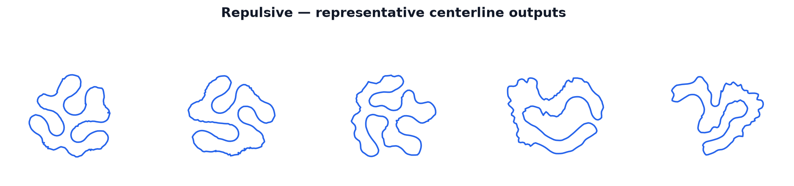

Repulsive Generator
====================

The ``repulsive`` generator grows each environment's closed centerline from a small seed
circle under a **hard ratcheting length constraint**, while a tangent-point (TP) energy
keeps the curve self-avoiding as it is confined to a disc domain seeded with per-env random
disc obstacles.  Growth runs coarse-to-fine (``N = 64 → 128 → 256``) with an area-based
stall-stop, then hands the grown loop to the unmodified standard tail (constant-spacing
resample → XPBD relax → inflate → validity).  The result is dense, paper-quality serpentine
circuits threading between the obstacles — a visibly different shape family from the other
five generators, all of which assemble a curve from a fixed set of sampled/steered control
points in a single deterministic pass.

The method follows Henrich and Kötter, *Generating Race Tracks With Repulsive Curves*
(IEEE, document 10645670), extended in the journal version *From Generation to Gameplay:
Authoring Race Tracks With Repulsive Curves* (IEEE Transactions on Games, 2025,
`doi:10.1109/TG.2025.3561107 <https://doi.org/10.1109/TG.2025.3561107>`__ — see
:doc:`/related-work/state-of-the-art` for a fuller discussion), which itself builds on
Yu, Schumacher, and Crane, *Repulsive Curves* (SIGGRAPH 2021 / arXiv 2020).

.. warning::

   ``repulsive`` is an **iterative optimizer**: a generation costs far more than any other
   generator's (`Cost`_).  Its growth loop follows a fixed host schedule (stage
   transitions, resample and stall-check cadences depend only on the iteration counter)
   and converged :term:`envs <env>` are frozen on device, so it is recorded into CUDA
   graphs like the other generators.  It is an iterative stage (``BOUNDED``,
   :ref:`cuda-graph-bounded`): the loop may stop once every env has frozen,
   in its own graph on device and in eager ``cpu`` calls, while eager ``cuda`` calls and
   captures without conditional nodes run the full budget (see `Early exit and
   capture`_).  Constructing the ``TrackGenerator`` runs one full eager pass (the warm-up),
   and on CUDA the **first** ``generate()`` additionally records its graph before the
   first replay (recording it into your own graph costs the same, once).  If you use
   ``repulsive`` in a training loop, prefer a **slow regeneration cadence** (regenerate a
   batch every N steps, not every step) or **staggered per-env slices** (regenerate a
   fraction of environments per step) rather than calling ``generate()`` every frame.

   Sample tracks produced by the ``repulsive`` generator across several seeds.

How It Works
------------

1. **Seed-driven obstacle layout.**
   ``_sample_obstacles_k`` draws, per environment, a domain-wall ring at radius ``r_dom``
   (``n_wall = 96`` points, weight 1.0) plus ``k ~ randi[repulsive_obstacle_count_min,
   repulsive_obstacle_count_max]`` inner-disc obstacle rings (``n_disc = 12`` points each,
   weight 0.25), one per ``2π/k`` angular wedge with a per-env random phase.  Each disc's
   radius is drawn from ``[repulsive_obstacle_radius_min_frac, repulsive_obstacle_radius_max_frac]
   · r_dom``, and its center radius from an analytic band that clears the seed circle by
   ``0.05·r_dom`` — no rejection loop, deterministic per ``(seed, env)``.

2. **Seed the target length and the initial circle.**
   A per-env target-perimeter multiplier ``grow_mult ~ U(repulsive_grow_mult_min,
   repulsive_grow_mult_max)`` sets ``L_final = grow_mult · 2π·r_init``.  ``_init_circle_k``
   writes the radius-``r_init`` circle into the coarsest stage's buffer prefix.

3. **Coarse-to-fine ratcheted growth.**
   Each iteration: the target length ``L_target`` ratchets toward ``L_final`` by
   ``repulsive_ratchet_rate``; the gradient of the total energy (tangent-point self-repulsion
   + inverse-power obstacle repulsion + a small length regularizer) is evaluated by
   hand-written analytic adjoint kernels — a per-vertex gather with no atomics; the gradient
   is preconditioned by a
   fractional-Sobolev filter (FFT-free — a precomputed circulant convolution) and projected
   to be orthogonal to the length direction; a normalized, barycenter-pinned step is applied;
   and the curve is hard-rescaled back to ``L_target``.  Growth starts at ``N=64`` and
   subdivides to 128 then 256 (arc-length resample) as the mean edge length doubles — the
   coarse start forces the ratcheted length into low-frequency folds rather than
   high-frequency wiggle.

4. **Deactivation + stall-stop.**
   Once an env's length reaches ``L_final``, its inner-disc obstacles are zeroed out (when
   ``repulsive_deactivate_obstacles``, the wall stays live) so the settle phase can close the
   halos left around each disc.  Every ``repulsive_stall_window`` iterations, an env freezes
   once it is past target length **and** its enclosed area (shoelace, reparameterization-
   invariant) has stopped changing by more than ``repulsive_stall_area_tol``.  The freeze is
   decided on device and is permanent: every later kernel, including the periodic resample,
   skips a frozen env.  Once every env of the batch has frozen, the rest of the loop may be
   skipped (see `Early exit and capture`_): a frozen env's curve no longer changes, so
   where the loop stops changes no output.

5. **Hand off to the standard tail.**
   The final ``N=256`` closed loop is periodically arc-length reparameterized and copied into
   the shared ``out_centerline`` buffer with ``out_valid_wp = 1`` for every env — the same
   contract as every other generator.  The untouched pipeline (constant-spacing resample at
   ``0.6·half_width`` → XPBD relax → inflate → validity) then runs; feeding it a curve at the
   tail's calibrated spacing (rather than the raw ``N=256`` growth resolution) is what lifts
   post-tail yield to the target band.

Early exit and capture
----------------------

``repulsive`` is a ``Stage`` generator with ``capture = CaptureClass.BOUNDED``
(``registry.describe("generator", "repulsive").capture``): its growth loop is a
``ctx.bounded_loop`` (see :ref:`cuda-graph-bounded`). The schedule is computed on the
host from the config:

- ``n_iters = ceil(1.6 · n_ratchet) + repulsive_settle_iters``, with ``n_ratchet =
  ceil(log(repulsive_grow_mult_max) / log1p(repulsive_ratchet_rate))``: 143 and **269**
  at the defaults. This is the bound.
- The stall checks run at the iterations ``it`` with ``(it + 1) % W == 0`` once the last
  stage (``N = 256``) has started, ``W = repulsive_stall_window``. Right after freezing
  the stalled envs, each check writes the loop's flag on device:
  ``active = any env not frozen``.
- ``first_check = W · ceil((s + 1) / W)``, ``s`` being the iteration of the last stage
  transition (117 at the defaults), and ``check_every = W``: the loop is checked before
  the iterations 128, 144, ..., 256, **9 windows** at the defaults (the last one 13
  iterations long). Every window starts right after a stall check, and no window holds a
  stage transition.

When the check before a window finds every env frozen, the rest of the loop can be
skipped: a frozen env is never written again (``_step_k``, ``_rescale_k`` and
``_copy_unfrozen_k`` return early for it), so the remaining iterations would change only
scratch. Whether the loop does stop depends on where the generation runs:

.. list-table::
   :header-rows: 1
   :widths: 46 54

   * - Call
     - Growth loop
   * - Eager on ``cpu`` (every ``generate()``, ``enqueue()``)
     - Stops at the first window whose check finds every env frozen (a host poll of
       the flag).
   * - Eager on ``cuda`` (``enqueue()`` outside a capture, ``policy="eager"``)
     - Runs all 269 iterations, with no host sync; frozen envs return early in every
       kernel, so the extra iterations cost launch overhead.
   * - The generator's own graph, a ``wp.ScopedCapture`` or a capture registered with
       ``registered(conditional=True)``, with CUDA 12.4+ conditional nodes
     - One conditional node per window: a replay skips the windows after the batch has
       frozen, on device.
   * - Any other capture (a plain ``torch.cuda.graph``, ``registered()`` without
       ``conditional=True``, older drivers, a recording inside
       ``track_gen.exec.unconditional()``)
     - Unrolled: every window is recorded and runs on each replay.

The first check cannot freeze an env at ``repulsive_stall_area_tol < 1`` (the area
change is measured against 0), so the earliest stop is before iteration 144. The output
is the same in every case, byte for byte: an env's track depends only on its own
:term:`seed` (env ``e`` is identical at ``E=8`` and inside ``E=64``), and
the next generation starts from scratch it re-initialises.

The default pipeline records about 4.25k graph nodes with every window unrolled (the
generator about 4.1k of them); with conditional windows,
about 2.1k top-level nodes and the 9 conditional nodes that hold the windows. Such a graph
cannot be used as a CUDA child graph, and recording a conditional window into your Warp
capture fails while a side stream that joined it has not been joined back (each
``wp.capture_if`` ends and resumes the capture). Record inside
``track_gen.exec.unconditional()`` to get the unrolled graph instead (see
:doc:`/how-it-works/cuda-graph`). Under ``torch.cuda.graph``, windows become conditional
nodes only inside ``registered(conditional=True)``, never in a hand-made
``external=True`` registration of torch's capture. The loop
itself is ``generate_repulsive_warp(seeds_wp, config, out_centerline, out_valid_wp,
scratch, ctx=None)``, still importable from ``track_gen._src.warp_generate_repulsive``;
the registered ``Stage`` calls it.

Cost
----

One ``TrackGenerator.generate()`` call on CUDA, measured at two batch sizes with the
default configuration (the mean of five calls after two warm ones, each a replay of the
generator's own graph):

.. csv-table:: ``repulsive`` generation cost on CUDA (ms per ``generate()``)
   :file: ../_data/cost-repulsive-cuda.csv
   :header-rows: 1

Machine:

.. include:: ../_data/machine-cuda.txt

Compare with the sampling generators in :ref:`the catalogue's cost table
<generators-overview>`. Constructing the ``TrackGenerator`` runs one full eager pass
(the warm-up), and on CUDA the first ``generate()`` also records the graph. The commands
that write the table are in ``docs/_data/README.md``.

Math
----

**Tangent-point energy** (dense, ``O(N²)`` pairs per env, constant ``±2`` circular
exclusion):

.. math::

   E_{\mathrm{TP}} = \sum_{i} \sum_{|i-j| \bmod N > 2}
       \frac{|w_{ij}|^{\alpha}}{(\lVert x_j - x_i \rVert^2 + \varepsilon^2)^{\beta/2}}\;
       w_i\, w_j,

where ``wᵢⱼ`` is the tangent-point wedge term (the signed distance of ``xⱼ`` from the
tangent line at ``xᵢ``), ``wᵢ``/``wⱼ`` are lumped-edge quadrature weights, and ``α =
repulsive_alpha``, ``β = repulsive_beta``.

**Obstacle energy** (inverse power ``p = β − α``):

.. math::

   E_{\mathrm{obs}} = \sum_i \sum_{m} m_w \cdot \lVert x_i - o_m \rVert^{-p},

summed over live obstacle-ring points ``o_m`` with mass/weight ``m_w`` (wall 1.0, inner
discs 0.25, zero once deactivated).

**Sobolev-preconditioned, length-orthogonal step.** The raw gradient ``g = ∇(E_TP + E_obs +
E_len)`` is preconditioned by the fractional-Sobolev inverse ``A⁻¹`` (a circular convolution
against a precomputed circulant row — the real-space form of ``1/(λₖˢ + ε)`` on the ring
Laplacian spectrum), then projected to remove the length-increasing component before a
normalized, barycenter-pinned step and a hard rescale back to the ratcheted target length —
the same TP-Sobolev flow as Yu/Schumacher/Crane, adapted with a **hard** length constraint
(ratchet + rescale) in place of their soft penalty, which the spike found necessary: the
obstacle-energy gradient outweighs a soft length penalty by 10³–10⁵×, so only a hard
constraint reliably grows the curve to target length.

Parameters
----------

The following ``TrackGenConfig`` fields are owned by the ``repulsive`` generator.  All other
fields (``num_points``, ``scale``, ``half_width``, etc.) are shared pipeline parameters
described in the configuration reference.

The generator-specific fields below are also the fields of ``RepulsiveParams``, the
generator's Params class (core fields such as ``scale`` are not): set them flat or
through ``generator_params`` (see :ref:`builtin-generator-params`). Their rules are
checked when the ``TrackGenerator`` is constructed, and only for
``generator="repulsive"``.

``repulsive_grow_mult_min`` / ``repulsive_grow_mult_max`` (default 4.5 / 5.5)
   Bounds of the per-env target-perimeter multiplier draw ``U(min, max)``; the grown loop's
   target perimeter is ``grow_mult · 2π·r_init``.  Higher → denser mazes at some yield cost.

``repulsive_domain_frac`` (default 0.35)
   Confinement-disc radius as a fraction of the world-scale reference length (``r_dom =
   repulsive_domain_frac · scale_ref · config.scale``).  Tighter → richer folds.

``repulsive_domain_init_ratio`` (default 4.0)
   Ratio ``r_dom / r_init`` of the domain radius to the initial seed-circle radius.

``repulsive_obstacle_count_min`` / ``repulsive_obstacle_count_max`` (default 8 / 12)
   Bounds of the per-env inner-disc obstacle count ``k ~ randi[min, max]`` (~9.9/env at
   defaults).

``repulsive_obstacle_radius_min_frac`` / ``repulsive_obstacle_radius_max_frac``
   (default 0.02 / 0.045)
   Inner-disc radius as a fraction of ``r_dom``.

``repulsive_ratchet_rate`` (default 0.012)
   Per-iteration length-growth factor of the hard ratchet.  ``<= 0.013`` holds full yield
   with folds; ``>= 0.016`` collapses the folds (a physical limit of fold formation, not a
   stall artifact).

``repulsive_alpha`` / ``repulsive_beta`` (default 3.0 / 6.0)
   Tangent-point energy exponents; the obstacle inverse power is ``p = beta - alpha``.

``repulsive_tau`` (default 0.4)
   Normalized flow step size.

``repulsive_w_len`` (default 30.0)
   Weight of the small inert length regularizer (the hard ratchet + rescale does the actual
   length enforcement; this is a live secondary nudge).

``repulsive_stages`` (default ``(64, 128, 256)``)
   Coarse-to-fine resolution schedule.  Must be non-empty, strictly increasing, each a
   positive multiple of 4, and its last entry must equal ``num_points``.

``repulsive_settle_iters`` (default 40)
   Settle-phase iteration budget above the ratchet.

``repulsive_resample_every`` (default 25)
   Periodic arc-length reparameterization interval (iterations).

``repulsive_stall_window`` (default 16)
   Iterations between per-env stall checks (an env whose area has stopped changing is
   frozen on device), and so the window of the loop's early exit.

``repulsive_stall_area_tol`` (default 0.05)
   Freeze an env once it is past target length and its enclosed-area relative change over a
   stall window is below this tolerance.

``repulsive_deactivate_obstacles`` (default ``True``)
   Zero the inner-disc obstacle weights once an env reaches its target length (the wall
   stays live), closing the disc halos during the settle phase.

``size`` (default 1.0)
   Per-env size multiplier of the output, the generator's one dynamic field, in
   ``[0.1, 10]`` (`Per-env size`_).

.. _repulsive-dynamic:

Per-env size
------------

``size`` is a **dynamic** ``float32`` field of ``RepulsiveParams``: a per-env ``[E]``
array, initialised from the configured value (``TrackGenConfig.size``, default ``1.0``).
Draw it per env with ``presets.track(generator="repulsive",
randomize={"generator.size": (lo, hi)})``, or write it with
``gen.params["generator"].set("size", ...)`` or from your own graph (:ref:`tuning-per-env`).
Every other ``repulsive`` knob is static: they set the growth schedule on the host.

- **Where it acts.** ``scale`` sets the physics domain of the growth (the domain and
  seed-circle radii; the energy's regularizer ``eps`` is absolute), so a size inside the
  flow would change the shapes, not scale them. ``size`` multiplies the **output**
  instead: the copy of the grown loop into ``raw.xy`` (``_copy_sized_k``) writes
  ``xy * size[e]``. So ``raw.xy`` at size ``s`` is ``f32(raw.xy(1) * s)``, bit for bit,
  and the growth itself, its early exit and its cost do not depend on ``size``. At
  ``size = 1`` every finite point is copied bit for bit (subnormals and ``-0.0``
  included). A point with a non-finite component (an env whose flow diverged, which
  fails validity anyway) is copied unscaled at every size: its finite component and
  ``±inf`` bit for bit, a NaN bit for bit too (its payload included: the multiplied
  operand is never the copied value, so no compiler select fold can quiet it; asserted
  on CPU and by the CUDA test suite). The per-env array is clamped to ``[0.1, 10]`` where the kernel reads
  it.
- **It truncates early.** ``repulsive`` loops are long: the target perimeter is at most
  ``repulsive_grow_mult_max * 2 * pi * r_init``, ``14.83`` at the defaults (14.48
  measured). With the default ``n_max = 384`` and spacing ``0.06``, ``size`` above about
  ``1.6`` truncates the longest loops (at ``size = 2`` every env is truncated and fails
  validity). Raise ``n_max`` (and ``num_points``) with the rule of :ref:`tuning-size`:
  ``n_max >= size_hi * 14.83 * scale / spacing + 1``. A ``generator.size`` randomizer or
  a construction value whose ``hi`` would truncate emits a ``UserWarning`` when the
  pipeline is built, with the ``n_max`` that fits (computed exactly from these
  parameters).
- **Launches.** One latch launch per generation (:ref:`pipeline-latch`); the final copy
  into ``raw.xy`` is the ``_copy_sized_k`` launch.

What Makes It Distinct
-----------------------

``repulsive`` is the only generator that constructs its output by **iterative physical
simulation** rather than a single deterministic sampling + smoothing pass.  It still meets
the capture contract (see :doc:`/how-it-works/cuda-graph`): the loop has no host readback,
and an env whose enclosed area has stalled is frozen on device and never touched again,
so each env's track depends only on its own seed, never on the
rest of the batch (stored datasets of an earlier release: :ref:`upgrading-repulsive`).

Key contrasts:

- **Foldiest, most serpentine family** (the lowest compactness, :doc:`benchmarks`).  The ratcheted overfill forces
  the curve to buckle into dense multi-lobe circuits threading between the obstacles, well
  below the compactness of any of the other five generators.
- **Fixed host schedule.**  Stage transitions, the periodic resample (every
  ``repulsive_resample_every`` iterations) and the stall checks (every
  ``repulsive_stall_window``) are precomputed on the host from the config and the loop
  counter alone — never from device data — so the launch sequence is static and replays as
  one captured graph.  Convergence is handled by the per-env on-device freeze, and the
  early exit by checks of a device flag between stall windows, never by a readback in a
  captured path.
- **Far slower.**  See `Cost`_; this is the dominant practical tradeoff against the
  shape richness.
- **Determinism.**  Output is **byte-identical per device** — same config and seeds give the
  same centerline run-to-run, bit for bit, on **both CPU and CUDA**.  The gradient is
  hand-written analytic adjoints (a per-vertex gather with no atomics), so there is no
  nondeterministic float-summation order to amplify through the chaotically sensitive flow.
  Cross-*device* equality is **not** claimed: fp32 rounding differs between CPU and CUDA, so a
  CPU track and a CUDA track for the same seed are statistically equivalent but not
  bit-identical to each other.  See the module docstring in
  ``track_gen/_src/warp_generate_repulsive.py`` for the full account.

Fallback and Validity
----------------------

``repulsive`` has no generator-local self-intersection fallback: it writes
``out_valid_wp = 1`` for every environment and relies entirely on the shared post-relax
inflation validity gate (turning number, thickness floor, no NaN, width floor, not
truncated at ``N_max``).  A self-crossing born during growth drives the local thickness
toward zero, which the gate catches downstream — no generator-side retry is needed.  In
the spike's validated configuration this yields 64/64 (100%) post-tail, with the XPBD tail
doing modest polish (opening sub-half-width pinches) rather than untangling gross tangles.
