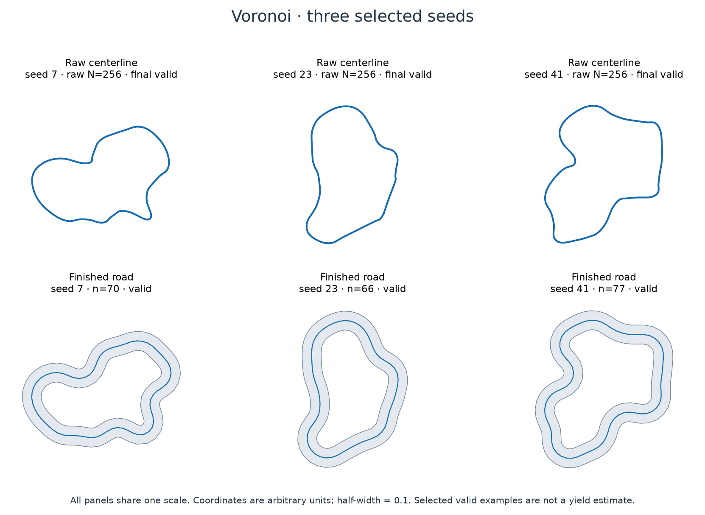
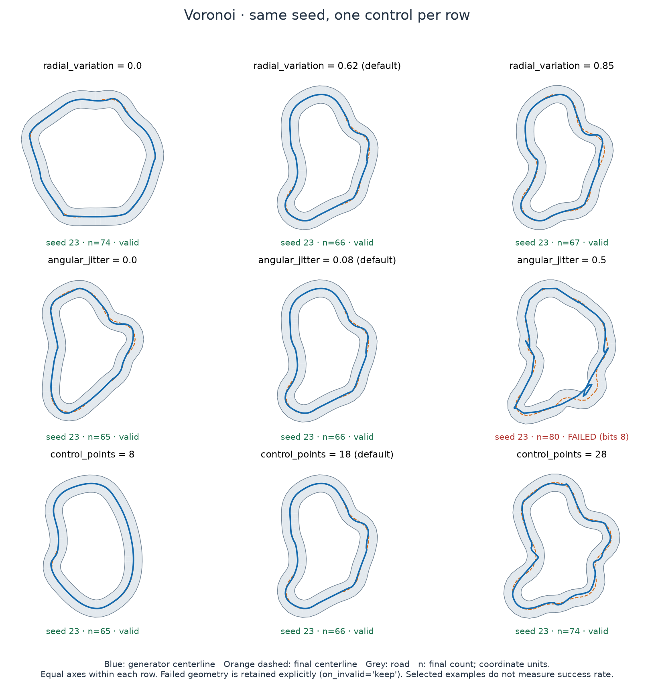
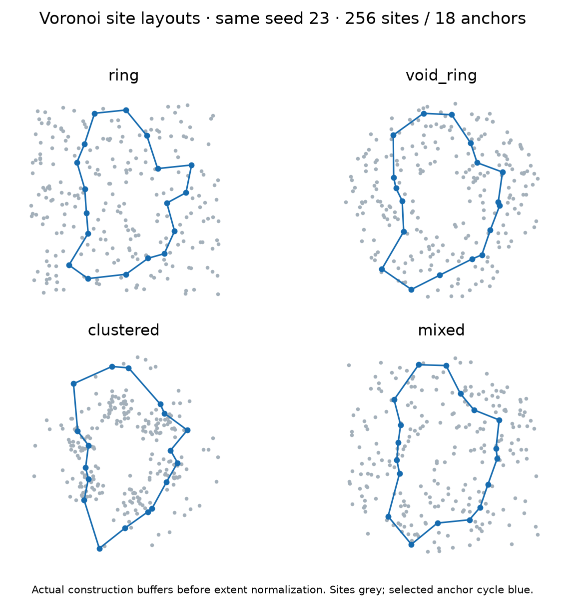
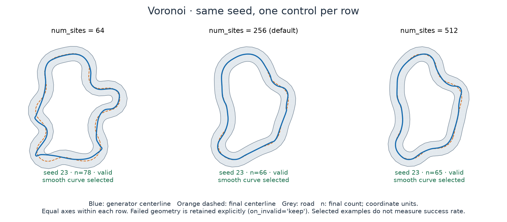
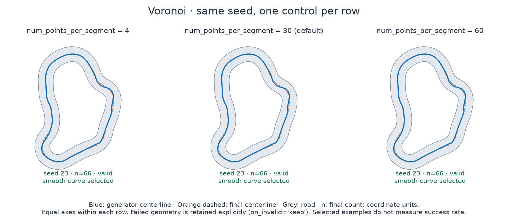
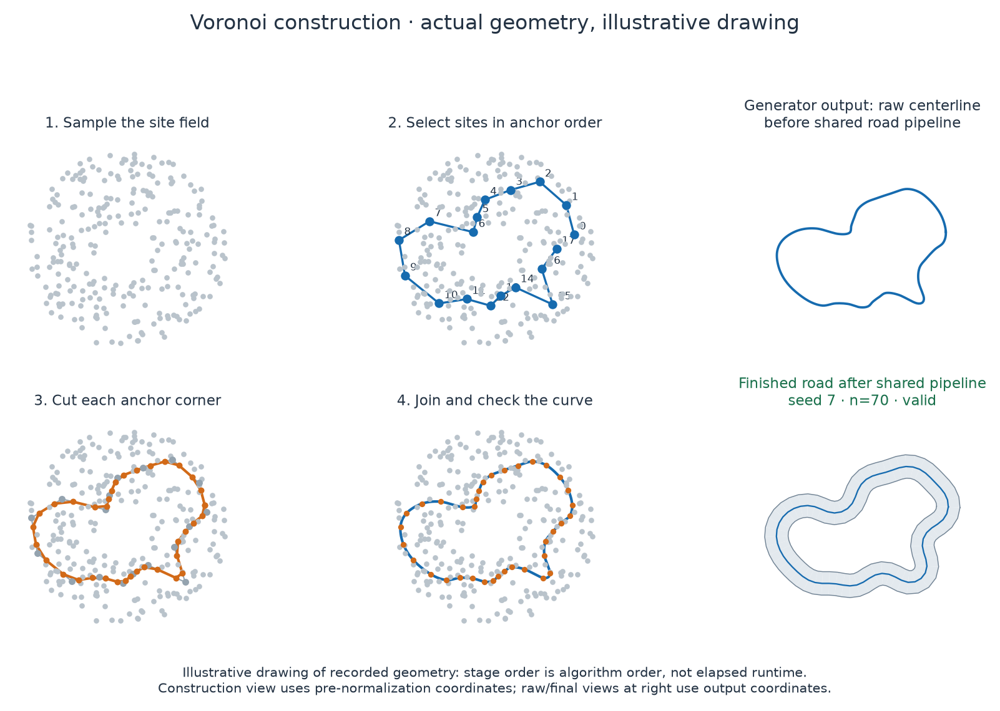

Voronoi: sites and anchors
==========================

Use ``voronoi`` for irregular loops selected from a seeded field of sites.
The generator chooses an angular anchor cycle using both angular and radial target
costs, rounds it, and produces a centerline. It does not trace Voronoi cell boundaries.

   Three selected valid seeds at default geometry, with equal axes. Blue upper panels show the generator output; lower panels show the final road. Counts exclude padding. These examples do not measure yield.

Try it
------

.. code-block:: python

   from track_gen import TrackGenerator
   from track_gen.pipeline import presets

   gen = TrackGenerator(presets.track(
       generator="voronoi", num_envs=4, device="cpu"), seeds=7)
   track = gen.generate()
   print(track.count.numpy(), track.valid.numpy())

.. snippet: after

   assert track.valid.numpy().any()

Change the targets
------------------

   Target changes select different sites from a fixed site field. The blue output is normalized before the common road pipeline. Defaults are marked; each row has equal axes.

Panels name the selected smooth curve or polygon fallback independently of final
road validity.

The radial profile modulates target radius using several harmonics. Selection chooses
the lowest-cost unused site for each angular sector, so a small parameter change can
leave an anchor unchanged or switch it to a different site. There is no promise of a
smooth monotonic response to a slider.

.. _voronoi-dynamic:

Controls and defaults
~~~~~~~~~~~~~~~~~~~~~

.. list-table:: Track generator controls
   :header-rows: 1
   :widths: 30 18 52

   * - Setting
     - Default / kind
     - Units, range and practical effect
   * - ``voronoi_radial_variation``
     - 0.62 / dynamic
     - Dimensionless target-radius modulation, [0, 0.85]. The selected layout also scales this modulation before clamping.
   * - ``voronoi_angular_jitter``
     - 0.08 / dynamic
     - Radians, [0, π]. Jitters sector targets; values approaching a sector width can change anchor order and introduce crossings.
   * - ``voronoi_control_points``
     - 18 / static
     - Selected anchor count, at least 6 for tracks. Independent of total site count; more anchors mean more rounded segments.
   * - ``voronoi_num_sites``
     - 256 / static
     - Site count, at least the anchor count. A denser candidate field increases selection work and changes the nearest available choices.
   * - ``voronoi_site_layout``
     - void_ring / static
     - One of ring, void_ring, clustered, mixed. Chooses the site distribution shown below.
   * - ``num_points_per_segment``
     - 30 / static
     - At least 2 dense samples per augmented segment, after one Chaikin subdivision. Controls discretization, not final bead spacing.
   * - ``size``
     - 1 / dynamic
     - XY extent multiplier, [0.1, 10], with absolute road width and spacing. See :ref:`tuning-size`.

   One seed, 256 grey sites and 18 blue selected anchors per panel, before extent normalization. Site-layout changes can also alter target-profile strength.

   The site count changes the candidate field; it does not set the number of gates or centerline anchors.

   These are current output curves generated from different dense spline resolutions; final spacing and capacity remain fixed.

When it fails
-------------

If the smooth centerline has a proper self-crossing, the generator falls back to a
straight polyline through its **Chaikin-augmented cycle**. That is the cycle after
corner cutting, not the original selected-site polygon. Angular target disorder or a
busy anchor cycle can still create difficult finite-width geometry. Reduce angular
jitter or anchor count, inspect ``fail_mask``, and distinguish clearance failures from
capacity truncation. The fallback is not a validity certificate.

Native gates are the original selected anchors. They accept at least 3 anchors and
do not use Chaikin or spline sampling. The radial/angular controls apply to their
selection; native gate size belongs to ``normalize.size``.

How it is constructed
---------------------

A seed constructs the site field and a rotated cycle of angular targets. For each
target, the generator minimizes normalized angular error plus radial error, with a
penalty for reusing a site. It applies one Chaikin corner-cutting pass to the chosen
cycle, then a closed Catmull–Rom curve and arc-resampling. Extent normalization puts
the output into the configured coordinate scale; the crossing fallback and shared
road pipeline complete the course.

   Four steps explain sampled sites, selected anchor order, Chaikin corner cuts and curve
   sampling. The raw generator centerline and finished road at right use output coordinates;
   construction panels use their original coordinates.

.. raw:: html

   <video controls preload="none" style="width:100%;max-width:100%" poster="../_images/generator-voronoi-construction.png" aria-label="Progressive drawing of sampled sites, selected anchor order, Chaikin corner cuts and curve sampling, from actual voronoi geometry.">
     <source src="../generator-voronoi-construction.mp4" type="video/mp4">
     Progressive drawing of sampled sites, selected anchor order, Chaikin corner cuts and curve sampling, from actual voronoi geometry.
   </video>

:download:`Download the animation <../assets/racing/generator-voronoi-construction.mp4>`.

**Text alternative:** The drawing reveals the actual site field, then numbers selected sites
in anchor order. Orange points show the recorded 25%/75% Chaikin corner cuts before the
curve or selected polygon fallback is drawn. The normalized raw centerline and finished road
remain visible at right.

The geometry comes from recorded construction buffers. Prefix drawing explains
algorithm order. Playback timing is illustrative, with no position morph
between stages or claim of measured runtime or iterative solver states. The view
stays fixed within each coordinate system.

Continue with :doc:`/how-it-works/pipeline`, :doc:`/configuration/tuning`,
:ref:`builtin-generator-params`, or :doc:`/tutorials/gate-sequences`.
