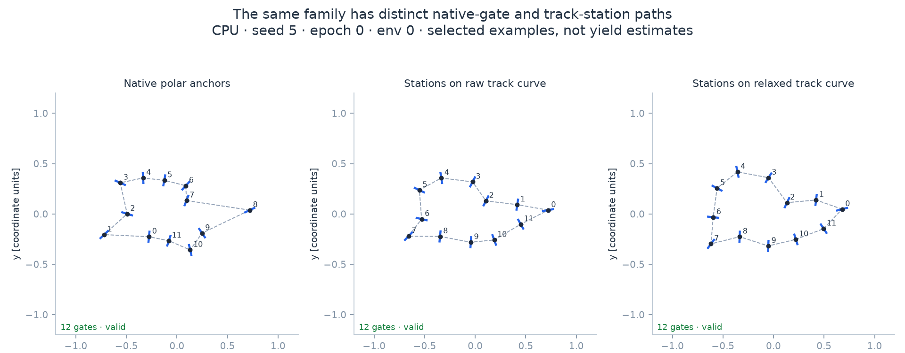

.. _quickstart-gates:

Create a gate course
====================

A ``GateGenerator`` produces ordered gate centers, directions and poses for drone racing.
It can use a generator's native anchors or place stations along a track centerline.

.. code-block:: python

   import numpy as np
   from track_gen import GateGenerator
   from track_gen.pipeline import presets

   gen = GateGenerator(
       presets.gates(num_envs=8, device="cuda:0", generator="polar",
                     gate_width=0.05),
       seeds=42,
   )
   gates = gen.generate()
   valid = gates.valid.numpy() != 0
   count = gates.count.numpy()
   position = gates.position.numpy().reshape(8, gen.max_gates, 3)
   orientation = gates.orientation.numpy().reshape(8, gen.max_gates, 4)

   for e in np.flatnonzero(valid):
       centers = position[e, :count[e]]
       poses = orientation[e, :count[e]]  # quaternions: x, y, z, w
       print(e, len(centers))

.. snippet: after

   assert valid.any()
   assert all(np.isfinite(position[e, :count[e]]).all() for e in np.flatnonzero(valid))

   Native anchors preserve the generator's anchor layout. Stations put gates along a
   route; :doc:`/tutorials/gate-sequences` shows the source choices.

Know what each dimension controls
---------------------------------

``gate_width`` is the full left-to-right bar width; ``0`` makes point gates.
``gate_radius`` controls plan-view separation between gate centers. They are different
settings, and neither is the radius of your drone. :ref:`gate-width-config` and the
:doc:`visual control guide </configuration/tuning>` show the geometry.

Wider bars or insufficient center separation can invalidate a course. Read ``valid``
before using gate rows. ``fail_mask`` identifies the failed checks, and the default
poison policy leaves ``count=0`` for a failed environment (:ref:`invalid-envs`).

Raise gates into 3D
-------------------

Choose an elevation profile and ``gate_align="full_tangent"`` when the gate plane should
tilt with the route. ``"yaw_only"`` keeps its normal horizontal. :doc:`/gates-3d` shows
poses, frames and the difference between equal XY and equal 3D station spacing.

For a simulator, :ref:`Course.gates <courses>` adds checkpoints, progress and collision.
Road out-of-bounds, planar post collision and 3D gate-frame collision answer different
questions; start with :ref:`collision-backends`.

Continue with :doc:`/tutorials/gate-sequences` for sources/settings, or
:ref:`importing-a-track` to put gates along your own route.
