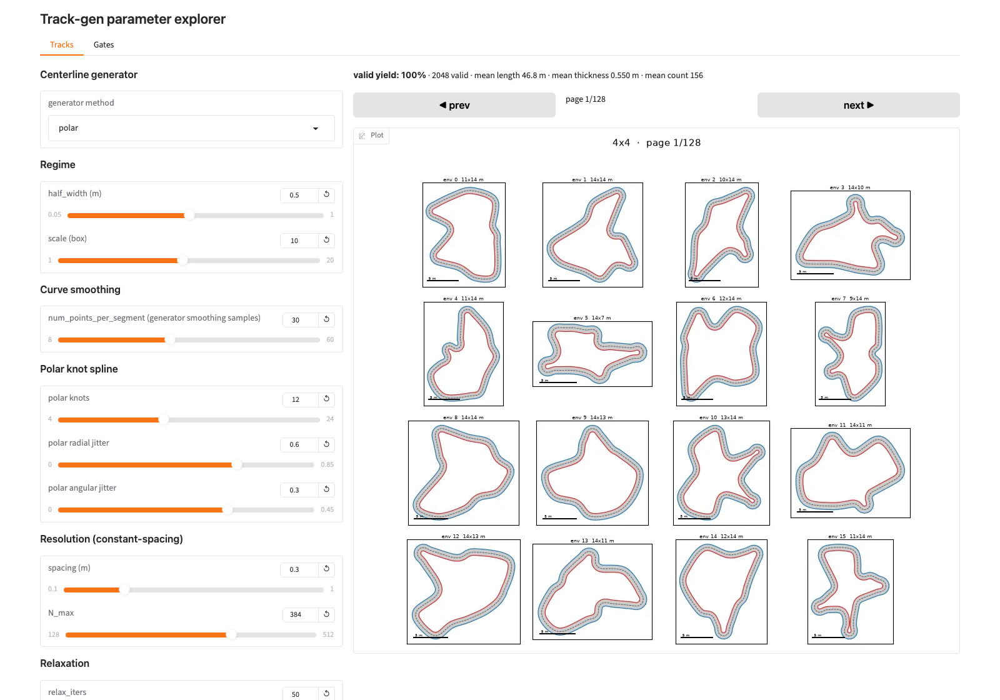

Parameter explorer (UI)
=======================

An interactive Gradio app to see how each parameter changes the tracks and gate sequences:
sliders for the generator, shape, resolution and relaxation knobs, a live grid of
generated results, and the share of the batch that is :term:`valid`.

   The **Tracks** tab: generator, shape, resolution and relaxation controls on the left,
   a paged grid of freshly generated tracks on the right, and the valid share, mean
   length, thickness and point count computed over the whole batch.

Launching
---------

The explorer lives in the repository (``viz/``), not in the installed package: run it from
a checkout (:ref:`installation`) with the ``ui`` and ``dev`` extras (it draws with
``matplotlib`` and reads results through ``torch``):

.. code-block:: bash

   uv pip install -e ".[ui,dev]"
   uv run python -m viz.param_explorer   # opens a local URL (default http://127.0.0.1:7860)

It runs on the ``cuda`` device when PyTorch sees a GPU, else on the ``cpu`` device.

Tracks tab
----------

The controls are grouped; the generator-specific groups show only for their generator:

- **Centerline generator**: the generator.
- **Regime**: ``half_width`` and ``scale`` (the size of the layout box).
- **Sampling (point-family)** and **Curve smoothing**: the corner count range,
  ``min_point_distance`` and the samples per segment of the point-based generators.
- **Bezier controls** (``rad``, ``edgy``, ``handle_clamp_frac``) and **Hull controls**
  (``hull_displacement``).
- **Polar knot spline**, **Voronoi graph cycle**, **Checkpoint steering** and
  **Repulsive growth**: the knobs of those generators.
- **Resolution (constant-spacing)**: :term:`spacing` and :term:`N_max`.
- **Relaxation** and **PBD separation**: the relaxation iterations, the constraint
  factors and margin, and the separation broadphase (refresh interval, cache slots, skin).
- **Batch**: the grid size, the :term:`seed`, the batch size, **reroll seed**,
  **Generate** and **auto-update**.

Every track is resampled to a constant ``spacing`` (about ``0.6 * half_width`` is a good
start), and ``N_max`` caps the points per track: a track that needs more is marked
invalid. ``handle_clamp_frac`` trades Bézier-handle overshoot (the main source of
self-crossings) against corner roundness.

**Batch size** generates that many tracks (256 to 8192); the valid share, mean length,
thickness and count shown above the grid are computed over the *whole batch*, so they are
honest statistics rather than the look of one page.

The grid shows one **page** of ``grid × grid`` tracks; **◀ prev / next ▶** pages through
the batch *without* regenerating. Invalid tracks get a red title.

**Auto-update** (on by default) regenerates as you change a control; for heavy settings
(a large batch with many relaxation iterations, or ``repulsive``) untick it and use
**Generate**. **Reroll seed** draws fresh seeds.

Gates tab
---------

A second tab generates gate sequences instead of tracks. Controls are grouped:

- **Gate generator**: the generator and its ``ordering`` (the choices follow the selected
  generator).
- **Gate layout**: ``gate_width`` (the full bar width) and ``scale`` (the size of the
  layout before the collision solve).
- **Gate collisions**: ``gate_radius``, ``gate_solve_iters`` and **show raw anchors**
  (skips the collision solve, to inspect the anchors before it). The solve aims at a
  spacing of ``2 * gate_radius`` between gate centers.
- **Generator-specific sampling**: the point-family (Bezier, Hull), Polar, Voronoi or
  Checkpoint controls of the selected generator.
- **Batch**: grid, seed and batch size; the stat line reports the valid share and the
  gate counts over the whole batch, and **◀ prev / next ▶** pages through it without
  regenerating.

Wide bars cross each other more often, and an :term:`env` whose bars cross is invalid:
watch the valid share as you widen ``gate_width`` (:ref:`gate-width-invalid-fraction`).

Plugin generators
-----------------

A generator from an installed plugin appears in the generator list of its tab, with a
section of controls built from its :term:`Params` (one control per field). Only the
generators registered when the app starts are listed: restart the app after installing a
plugin.
