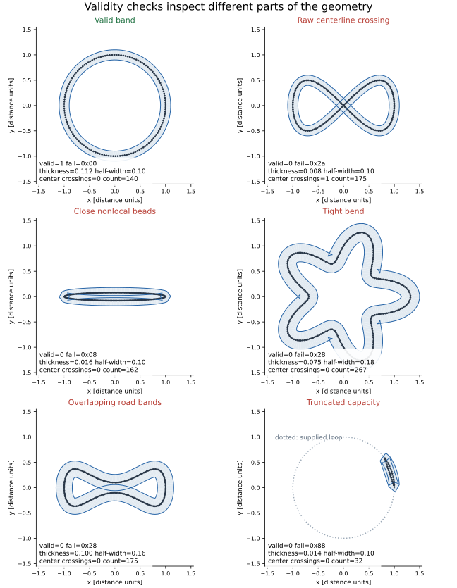
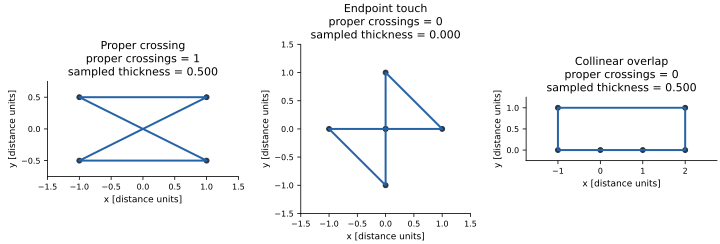

.. _geometry-validity:

Borders and validity
====================

Inflation offsets a sampled centerline into a road band, checks the result, then lifts
it to 3D. ``Track.valid`` tells you whether the configured generation checks accepted
that environment. Runtime :ref:`agent collision <collision-backends>` is a separate query.

         tight bend, overlapping bands and capacity truncation, each with measured
         validity, failure mask, sampled thickness, crossing count and real count.

   Synthetic counterexamples through the actual external-track pipeline, relaxation
   disabled and ``on_invalid="keep"``. Dots are real centerline samples; blue lines are
   the offset borders. Each panel reports its own half-width and sampling settings in
   the :download:`manifest <../assets/racing/geometry-manifest.json>`.
   Several checks may fail together. The pictures are selected explanations, not yield data.

Read the checks
---------------

The built-in ``validity.default`` stage writes ``valid`` and ``fail_mask``. Every failed
check sets its bit; ``valid == 1`` exactly when no check failed. All five
``ValidityParams`` settings below are **static**: choose them when building the pipeline.
Changing a checker threshold changes acceptance, without repairing the geometry.

.. list-table::
   :header-rows: 1
   :widths: 15 35 50

   * - Bit / value
     - Check
     - Setting and interpretation
   * - 0 / ``1``
     - Generator input accepted
     - Reads ``gen.valid``. For example, imported loops need a supported count and
       finite supplied channels. This flag alone does not establish road validity.
   * - 1 / ``2``
     - Turning magnitude near one full turn
     - ``turning_tol=0.1`` radians: ``abs(abs(turn)-2*pi) <= turning_tol``.
       A turning number alone is not a simplicity test.
   * - 2 / ``4``
     - Finite real centerline samples
     - Checks both XY coordinates, ignoring padding past ``count``.
   * - 3 / ``8``
     - Sampled thickness
     - ``relax_tol=0.02``: at constant half-width ``w``, require
       ``min(local_radius, nonlocal_bead_distance/2) >= (1-relax_tol)*w``.
   * - 4 / ``16``
     - Width floor
     - Every real half-width must be strictly greater than ``w_floor=0.001``
       distance units. NaN widths fail this comparison too.
   * - 5 / ``32``
     - Optional border self-crossings
     - ``validity_border_check=False`` by default. When enabled, count proper
       crossings within the inner loop and within the outer loop.
   * - 6 / ``64``
     - Segment grade
     - ``z_valid_grade=0`` disables it; a positive dimensionless limit checks
       ``abs(dz)/max(XY segment length, 1e-9)``.
   * - 7 / ``128``
     - Capacity not truncated
     - The constant-spacing resampler needed more than ``N_max`` points.
       Increase capacity or spacing; a clamped loop closes across the discarded arc.

See :ref:`pipeline-fail-bits` for the shared bit contract. Default
``on_invalid="poison"`` removes failed geometry from the returned rows; use ``keep``
explicitly when inspecting it, and always read ``valid`` and ``fail_mask`` first
(:ref:`invalid-envs`). The truncation panel writes the public raw input buffers
intentionally: the cold ``load_centerlines`` helper rejects insufficient capacity
before generation.

Repulsive disc and wall clearance
----------------------------------

Repulsive adds mandatory checks of its actual finished road band. Its generator
retains analytic disc centers/radii and the circular wall through private stage
metadata; sampled force rings alone do not certify clearance. The same effective
per-env size is used for the road and barrier geometry. These failure bits appear
only in Repulsive programs:

.. list-table::
   :header-rows: 1
   :widths: 20 25 55

   * - Bit / value
     - Name
     - Checked geometry
   * - 8 / ``256``
     - ``repulsive_disc``
     - Every finished road cell clears each sampled filled disc.
   * - 9 / ``512``
     - ``repulsive_wall``
     - The entire finished band remains inside its circular wall.

A cell joins the aligned inner and outer samples on one centerline segment.
Double-precision predicates check the convex hull of its four vertices. The hull
contains the occupied ruled strip and either triangle-strip diagonal, including
folded cells. This is conservative: a disc in an unused part of a concave hull
may be rejected. Checking cells separately leaves the global closed-loop hole
unfilled, so a disc there is allowed. The circular wall bounds a convex region;
containing every cell vertex contains its whole hull.

These checks run after resampling, relaxation and offset construction. Constant
width can reserve space during growth, but the actual finished band is the
authority, including for variable widths. The planner requires the final check,
refuses subsequent road-geometry changes and requires the lifted borders to be
the checked band. No new public result fields are needed.

Repulsive raw ``gen.valid`` separately requires finite feasible geometry at its
sampled target length. A successful raw curve can still fail the final checks;
a finite feasible curve can reach the normal budget without optimizer
stationarity. Optional freezing does not replace either validity decision.
See :ref:`repulsive-limits` for examples and tuning guidance. The generic sampled
self-thickness and border checks below retain their own limits.

Sampled thickness has limits
----------------------------

The scalar thickness diagnostic uses local three-point Menger radius and distances
between **vertices**, excluding an index neighbourhood
``band=max(1, round(2*w/mean_segment_length))``. Crossing segments can have well-separated
endpoints. Neither thickness nor turning is a universal proof that every segment of the
road is separated from every other one.

With a variable half-width channel, the checker uses an exclusion band derived from the
largest width, checks each local radius against its point's width, and checks nonlocal
pair distance against ``(1-relax_tol)*(w_i+w_j)``. This remains a sampled check.
The offset distance ``norm(outer-center) == half_width`` is a construction property;
it is not what the thickness diagnostic measures.

         report zero under TrackGen's self-intersection diagnostic.

   ``track_gen.ops.geometry.self_intersections`` counts proper crossings between
   nonadjacent edges. Endpoint touches and collinear overlaps do not count. A crossing
   must clear a scale-relative collinearity tolerance of ``1e-3 * segment_length**2``
   in each orientation test. Zero means zero crossings under that predicate, not an
   exact certificate of disjoint closed sets.

The coarse four-vertex crossing in the first panel has sampled thickness ``0.5``:
its endpoints are far apart even though the edges cross. This deliberately sparse
polygon is an ops-level counterexample, rather than a generated track accepted by
the complete pipeline. It shows why a sampled thickness value alone cannot certify
segment separation.

The optional border check adds this predicate on each border separately. It can reject
geometry that the sampled thickness check accepts. It does not compare inner segments
against outer segments, and does not detect every touch, collinear overlap or overlap
of road regions. Runtime exact-segment footprint queries use a different contact
predicate (:ref:`collision-accuracy`).

From centerline to band
-----------------------

The default tail runs in this order:

1. ``resample.uniform`` redistributes the relaxed centerline's real points along the
   closed loop (:doc:`resample`).
2. ``frames`` computes central-difference unit tangents, left normals, local Menger
   curvature, plan-view arclength and signed winding.
3. ``offset.default`` places candidates at ``center ± half_width*normal``. The candidate
   with larger absolute signed area becomes the outer border.
4. ``elevation`` supplies altitude, then ``validity.default`` checks the geometry.
5. ``lift`` writes the 3D result, with the same altitude at aligned center/inner/outer
   points. Road geometry checks remain planar except for the configured grade test.

Borders and centerline share indices: ``outer[e*N_max+i]``, ``center[e*N_max+i]`` and
``inner[e*N_max+i]`` belong to the same sample. ``Track.normal`` points left; use the
named borders to identify inside versus outside. Per-point arrays are flat and padded
past ``count[e]``; :ref:`results` covers layout and storage. ``generate()`` returns the
same borrowed result each time; retain an owned snapshot with ``Track.clone()``.
