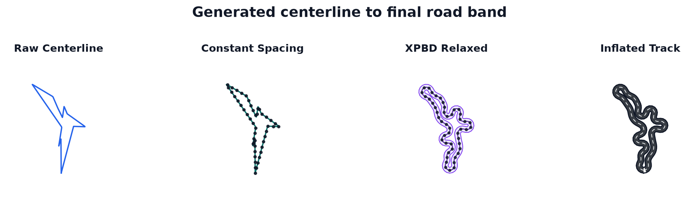

.. _pipeline-overview:

Pipeline — data-flow overview
==============================

The ``track_gen`` pipeline turns a batch of per-:term:`env` :term:`seeds <seed>` into a
batch of tracks, one per env, at every :term:`generation`. Its kernels are written
entirely in `NVIDIA Warp <https://github.com/NVIDIA/warp>`_ (the shared stages in
``track_gen/_src/warp_pipeline.py``, the relaxation solve in
``track_gen/_src/warp_relax.py``, the elevation profiles in
``track_gen/_src/warp_zprofile.py``). ``TrackGenerator`` runs them as an ordered list of
:term:`stages <stage>`, planned once at construction: :doc:`/how-it-works/pipeline-stages`
describes that list, the :term:`channels <channel>` each stage reads and writes, and the
``track_gen.pipeline`` API that builds it. This page is the bird's-eye view.

Goals
-----

1. **No torch/Warp mixing.** One implementation. Every pipeline stage is a Warp kernel.
   Runtime package imports do not depend on torch; tests and diagnostics may bridge via
   ``wp.from_torch`` / ``wp.to_torch`` at the boundary.
2. **One codebase, two devices.** Warp kernels run on the Warp ``cpu`` device (GPU-free,
   for tests/CI) and on ``cuda`` (production). The same code path serves both.
3. **Recordable in a CUDA graph.** Every stage declares a capture class. A ``STATIC``
   stage has a fixed launch sequence (fixed shapes, fixed iteration counts, no host-side
   branching on device data); a ``BOUNDED`` stage is an iteration with a static bound and
   an early stop decided on device. Both record into one replayable CUDA graph, the
   generator's own or yours (a :term:`capture`): every shipped stage is one of the two. A
   ``HOST`` stage (one that reads device data back, such as a plugin generator declared
   ``capturable=False``) runs eagerly between the graphs of the stages around it, and
   cannot be recorded into your graph (see :ref:`pipeline-segments` and
   :ref:`cuda-graph-host`).

Data flow
---------

.. code-block:: text

   seeds[E]
     │  GENERATOR  (the registered generator: "bezier", "hull", "polar", "voronoi",
     │    "checkpoint", "repulsive", or a plugin's; single pass, fixed shapes)
     ▼
   raw centerline [E * num_points]  (every env real) + gen.valid[E] (1 for the built-ins:
     │                                 geometric validity is decided after relaxation)
     │  RESAMPLE   constant spacing → count[e] = ⌊perimeter / spacing⌋ + 1, capped at N_max,
     │             + truncated[e] (1 where the cap applied: such envs fail validity)
     ▼
   beads [E * N_max]                (NaN-padded past each track's count[e])
     │  WIDTH      the per-point half-width (constant by default)
     │  RELAX      XPBD: separation + spacing + bending, fixed iterations, double-buffered,
     │             count-aware, Chebyshev-accelerated
     ▼
   relaxed beads [E * N_max]
     │  UNIFORM    re-uniformised resample ─► FRAMES (tangents, curvature, arc length)
     │             ─► OFFSET (the band) ─► ELEVATION ─► VALIDITY (fail bits) ─► LIFT (3D)
     ▼
   Track(outer, center, inner, tangent, normal, arclen, length, half_width, count, valid,
         fail_mask, truncated, winding, generation, attributes)

   Generation, constant-spacing resample, relaxation and the inflated band.

The RELAX stage, the XPBD constraint solve that makes the centerline inflatable, has its
own section: see :doc:`/relaxation/overview`.

.. seealso::

   :ref:`pipeline-stages-the-default-track-stages`: the same flow as the ten stages
   ``TrackGenerator`` runs (``generator``, ``resample``, ``width``, ``relax``,
   ``uniform``, ``frames``, ``offset``, ``elevation``, ``validity``, ``lift``), with
   their channels.

Registered centerline generators
--------------------------------

The centerline generator is pluggable. ``TrackGenerator`` resolves the generator name
(``presets.track(generator=...)``, ``config.generator``) through
``track_gen.plugin.registry`` (built-ins plus installed plugins, see
:doc:`/contributing/writing-a-generator`), validates its :term:`Params`, and builds it as
the pipeline's ``generator`` stage, which writes the ``raw.xy`` and ``gen.valid``
channels. The built-ins:

.. list-table::
   :header-rows: 1

   * - generator
     - module
     - representation
     - local handling / execution
   * - ``"bezier"``
     - ``warp_generate.py``
     - sampled grid corners → angle-sorted closed cubic Bezier
     - selected corner-polygon fallback for Bezier self-crossers
   * - ``"hull"``
     - ``warp_generate_hull.py``
     - angle-sorted point loop → displaced midpoints → closed Catmull-Rom
     - selected augmented-polygon fallback for Catmull-Rom self-crossers
   * - ``"polar"``
     - ``warp_generate_polar.py``
     - sorted polar control knots → periodic Catmull-Rom spline
     - no generator-local fallback; downstream relaxation/inflation gates final validity
   * - ``"voronoi"``
     - ``warp_generate_voronoi.py``
     - fixed site field → angular anchor cycle → smoothed graph-cycle loop
     - selected anchor-polygon fallback for smooth-loop self-crossers
   * - ``"checkpoint"``
     - ``warp_generate_checkpoint.py``
     - radial checkpoints → bounded-turn steering → additive heading-ramp closure
     - best-of-K candidate selection (default K=4); optional single-crossing clip fallback (off by default)
   * - ``"repulsive"``
     - ``warp_generate_repulsive.py``
     - obstacle-seeded disc → tangent-point/Sobolev growth
     - a ``BOUNDED`` stage: fixed host schedule, each env frozen on device once it
       converges; far slower than the others (:doc:`/generators/repulsive`)

``external`` is the seventh registered name: it ingests centerlines you provide instead
of drawing them (:ref:`ingesting-centerlines`).

Every built-in generator follows the same contract (:ref:`generator-stage-contract`):

- it allocates its fixed-shape, generator-private buffers once, when the pipeline is
  built;
- each generation it writes an ``[E * num_points]`` closed centerline into ``raw.xy`` and
  an ``[E]`` flag into ``gen.valid``;
- its hot path is pure Warp, allocation-free, deterministic in ``(seed, config)``, and
  recordable: no host-side retry loop, no host branch on generated data, no per-env
  Python branching (``repulsive`` included: its iteration stops early on device, see
  :ref:`cuda-graph-bounded`);
- ``gen.valid`` is ``1`` for every env. It is a stage flag, not the final quality
  decision: turning, thickness, NaNs, width floor, ``N_max`` truncation and optional
  border intersections are judged later by the ``validity`` stage, after the
  constant-spacing resample and XPBD relaxation (:ref:`pipeline-fail-bits`).

Per-generator algorithm details are in the catalogue, :doc:`/generators/overview`.

Determinism, yield, and FP tolerance
------------------------------------

**Determinism.** Warp's per-env RNG is deterministic, so a given seed buffer reproduces the
same tracks run-to-run on a device. The ``cpu`` and ``cuda`` RNG streams may differ: each
device is internally reproducible, and cross-device yields are compared statistically,
not per env. This holds for **all six** generators including ``repulsive`` (the
iterative optimizer): its growth gradient is hand-written analytic adjoints, a per-vertex
gather with no atomics, so it is byte-identical run-to-run on both ``cpu`` and ``cuda``,
per seed. As with every generator, cross-*device* output is statistically equivalent
(same yield and compactness band) but not bit-identical, since fp32 rounding differs
between CPU and CUDA. See ``track_gen/_src/warp_generate_repulsive.py``'s module
docstring for the full account.

**Yield.** Nearly every env is :term:`valid` at the defaults: the measured yield of each
generator is in :doc:`/generators/benchmarks`, and the relaxation pages give it per regime
(:doc:`/relaxation/convergence`). With a thin road (``half_width=0.03``) the default
``N_max = 384`` is too short for the longest loops, which then fail as truncated: size
``N_max`` for the longest track (:ref:`tuning-size`; :ref:`invalid-envs` explains how to
measure the invalid fraction). Two design choices give that yield:

- **Constant spacing makes relaxation lossless.** At a fixed 256 points the centerline is
  over-resolved relative to its half-width, so a fixed iteration count cannot drive the
  Jacobi solve to convergence (a yield ceiling of about 0.68 in the fat-band regime).
  Relaxing at about ``0.6 × half_width`` spacing (about 145 to 160 nodes per track instead
  of 256) lifts that regime to about 0.999, runs faster (fewer nodes), and keeps the solve
  recordable.
- **Single-pass centerline generation.** With relaxation lossless, the remaining
  failures are smooth-centerline self-crossers. Rather than an accept-first-valid
  regeneration loop, the ``bezier`` generator takes one corner draw per env and routes any
  track whose smooth Bezier centerline self-crosses to its provably simple corner polygon,
  which XPBD re-rounds. ``hull`` follows the same selected-polygon rescue for its
  Catmull-Rom self-crossers, ``voronoi`` falls back to its selected anchor polygon,
  ``checkpoint`` uses bounded best-of-K selection with an optional single-crossing clip
  fallback, and ``polar`` emits a closed radial spline with no generator-local fallback.
  ``max_regen_iters`` is therefore ignored by the pipeline and deprecated (a non-default
  value emits a ``DeprecationWarning``; see :ref:`deprecated-config-fields`).

**FP tolerance and hard thresholds.** Validity gates (``th_ok``, ``turn_ok``) are hard
comparisons; near a decision boundary the accepted ~1e-4 Warp-vs-torch drift can flip a
single env's bool. Tests keep their inputs away from those boundaries; the end-to-end yield
comparison uses an aggregate tolerance, not per-env equality.
