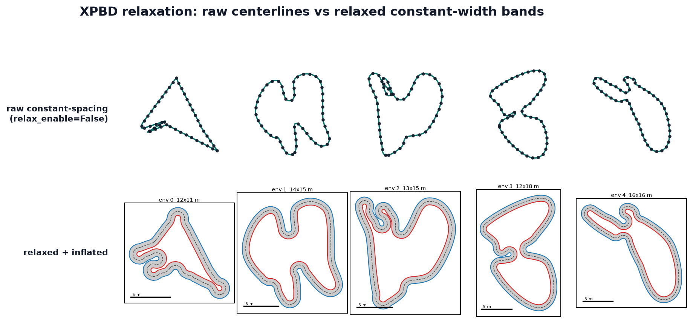

TrackGen
========

**GPU-batched generation of closed-loop race tracks and drone gate courses**: thousands
of smooth, validated tracks per call, expressed as NVIDIA Warp kernels and ready to drop
into a batched RL simulator.

.. admonition:: Coming from 0.1?

   Read :ref:`upgrading-0.2`. Most 0.1 code keeps running, but some results change
   without an error: start with its :ref:`triage table <upgrading-triage>`.

.. grid:: 3
   :gutter: 2

   .. grid-item::
      :columns: auto

      .. button-ref:: quickstart
         :ref-type: ref
         :color: primary

         Quickstart

   .. grid-item::
      :columns: auto

      .. button-ref:: getting-started/installation
         :ref-type: doc
         :color: primary
         :outline:

         Install

   .. grid-item::
      :columns: auto

      .. button-link:: https://github.com/AntoineRichard/TrackGen
         :color: secondary
         :outline:

         GitHub

.. figure:: assets/readme-pipeline-stages.png
   :alt: TrackGen pipeline stages
   :align: center

   The runtime pipeline turns a raw generated centerline into a constant-spacing path,
   relaxes it with XPBD, then inflates it into a constant-width road band.

Start here
----------

Pick the path that matches what you are building; each one is a reading order.

.. grid:: 1 2 2 2
   :gutter: 3

   .. grid-item-card:: Training an RL agent

      Tracks or gate courses in a batched simulator, recorded into your CUDA graph,
      with per-env resets.

      1. :ref:`quickstart`
      2. :ref:`courses`
      3. :ref:`cuda-graph-sim-loop`
      4. :ref:`rl-auto-reset`
      5. :ref:`collision-backends`
      6. :ref:`curricula-course`

   .. grid-item-card:: Building datasets of tracks or gates

      Batches of centerlines, track bands or gate sequences, with domain
      randomization and curricula.

      1. :ref:`quickstart`
      2. :ref:`generating`
      3. :ref:`results`
      4. :ref:`choosing-a-generator`
      5. :ref:`curricula`

   .. grid-item-card:: Writing a plugin

      Your own generator, gate generator, stage or runtime component, tested with
      ``track_gen.testing``.

      1. :ref:`writing-a-generator`
      2. :ref:`testing-a-plugin`
      3. :ref:`packaging-a-plugin`

   .. grid-item-card:: Upgrading from 0.1

      What changed since ``v0.1.0``, what changes silently, and what to retrain or
      rebaseline.

      1. :ref:`upgrading-0.2`
      2. :ref:`upgrading-procedure`
      3. :ref:`upgrading-triage`

Features
--------

.. grid:: 1 2 2 3
   :gutter: 3

   .. grid-item-card:: GPU-batched

      Generate ``E`` tracks in parallel per ``generate()`` call — the Warp ``cpu``
      device for tests/CI, ``cuda`` for production.

   .. grid-item-card:: Pure Warp pipeline

      Generation → constant-spacing resample → XPBD relaxation → inflation, every
      stage a Warp kernel over flat ``[E*N]`` arrays.

   .. grid-item-card:: Six generators, and yours

      Bezier, Hull, Polar, Voronoi, Checkpoint, and Repulsive, each with a distinct
      shape family; your own centerlines, or a generator plugin.

   .. grid-item-card:: CUDA-graph capture

      The whole pipeline runs as one CUDA graph: the generator's own, replayed on
      every call, or recorded into your sim graph next to the physics (all six
      generators).

   .. grid-item-card:: Gate sequences

      Drone-style gate courses (gate centres, orientations and bar widths) from the
      generators' anchors or along any track, via ``GateGenerator``.

   .. grid-item-card:: RL-ready runtime

      Out-of-bounds collision, checkpoint progress and rewards, prop
      instancing — and one Course object that bundles them.

Gallery
-------

.. figure:: assets/readme-generator-grid.png
   :alt: Six generators, one batch
   :align: center

   Six centerline generators, one batch — representative raw centerlines from each
   standard generator.

   Centerline self-collision relaxation — raw constant-spacing centerlines (top)
   versus the relaxed, inflated tracks (bottom).

.. figure:: assets/readme-gate-strip.png
   :alt: Gate self-collision relaxation — raw anchors versus separated gates
   :align: center

   Gate self-collision relaxation — raw anchors (top) versus separated gates
   (bottom).

Explore the docs
----------------

.. grid:: 1 2 2 3
   :gutter: 3

   .. grid-item-card:: Getting started
      :link: quickstart
      :link-type: ref

      Install the library, generate your first batch, and learn the terms.

   .. grid-item-card:: Generating tracks and gates
      :link: generating
      :link-type: ref

      Presets, specs and Params; seeds; reading results; invalid envs; curricula.

   .. grid-item-card:: Courses, simulators and RL
      :link: courses
      :link-type: ref

      One ``Course`` per batch: collision, checkpoints and progress, props, CUDA
      graphs in a sim loop, and RL auto-reset.

   .. grid-item-card:: Generators
      :link: generators-overview
      :link-type: ref

      The catalogue: how each centerline generator works, its knobs and its cost.

   .. grid-item-card:: Extending TrackGen
      :link: writing-a-generator
      :link-type: ref

      Write and test generators, gate generators, stages and components; package
      them as plugins.

   .. grid-item-card:: Reference
      :link: api-reference
      :link-type: ref

      The public modules, errors and environment variables, and every configuration
      field.

   .. grid-item-card:: How it works
      :link: pipeline-overview
      :link-type: ref

      The pipeline's data flow and stages, resampling, inflation, and CUDA-graph
      mechanics.

   .. grid-item-card:: Track relaxation
      :link: relaxation/overview
      :link-type: doc

      The XPBD stage that turns raw centerlines into inflatable, valid tracks.

   .. grid-item-card:: Gate relaxation
      :link: relaxation/gates
      :link-type: doc

      The per-env collision solve that separates overlapping gates into usable
      drone-course sequences.

.. toctree::
   :maxdepth: 1
   :caption: Getting started
   :hidden:

   getting-started/installation
   getting-started/quickstart
   getting-started/concepts
   getting-started/parameter-explorer

.. toctree::
   :maxdepth: 1
   :caption: Upgrading
   :hidden:

   upgrading/from-0.1

.. toctree::
   :maxdepth: 1
   :caption: Generating tracks and gates
   :hidden:

   user-guide/generating
   user-guide/results
   tutorials/batch-of-tracks
   tutorials/gate-sequences
   tracks-25d
   gates-3d
   tutorials/choosing-a-generator
   generators/overview
   user-guide/curricula
   configuration/tuning

.. toctree::
   :maxdepth: 1
   :caption: Courses, simulators and RL
   :hidden:

   utilities/course
   utilities/composing-a-course
   tutorials/cuda-graph-in-a-sim
   user-guide/rl-auto-reset
   utilities/overview

.. toctree::
   :maxdepth: 1
   :caption: Extending TrackGen
   :hidden:

   contributing/writing-a-generator
   contributing/writing-a-gate-generator
   contributing/writing-a-stage
   contributing/writing-a-component
   contributing/testing-a-plugin
   contributing/packaging-a-plugin
   contributing/plugin-abis

.. toctree::
   :maxdepth: 1
   :caption: Reference
   :hidden:

   reference/api
   configuration/reference

.. toctree::
   :maxdepth: 1
   :caption: Internals
   :hidden:

   how-it-works/pipeline
   how-it-works/pipeline-stages
   how-it-works/gate-pipeline
   how-it-works/cuda-graph
   how-it-works/resample
   how-it-works/inflation
   how-it-works/conventions
   relaxation/overview
   relaxation/gates

.. toctree::
   :maxdepth: 1
   :caption: Development
   :hidden:

   contributing/dev-setup
   contributing/rendering-assets

.. toctree::
   :maxdepth: 1
   :caption: Background
   :hidden:

   related-work/prior-art
   related-work/state-of-the-art
   appendix/future-generators
