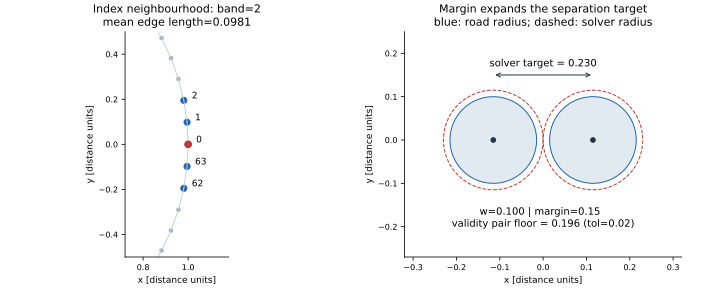

Track relaxation constraints
============================

The solver balances three corrections: push nonlocal beads apart, retain near-uniform
edge spacing, and round corners whose radius is too small. All corrections read the
previous sweep's state; :doc:`solver` covers execution and acceleration.

         separation. A pair diagram distinguishes road half-width, solver radius
         enlarged by margin, and the smaller validity acceptance threshold.

   Left: actual circle samples, with the auto-derived index band highlighted about
   bead 0. The band is measured in points, not Euclidean distance. Right: a schematic
   at ``half_width=0.1`` showing the exact default target formulas; it is not a solver
   snapshot.

Setup and targets
------------------

For each environment, the rest edge length is ``L0 = perimeter/count`` on the
constant-spacing centerline. At constant half-width ``w``, the auto exclusion band is
``max(1, round(2*w/L0))``. A pair participates in separation only when its circular
index distance is greater than this band. ``relax_band`` overrides the solver's band;
the later validity check still derives its own band from the final geometry.

The default margin ``m=0.15`` gives separation target ``2*w*(1+m)`` and bending target
radius ``w*(1+m)``. For variable width, use per-point solver radii
``r_i=w_i*(1+m)``: pair targets are ``r_i+r_j`` and local bending uses ``r_i``;
the auto band uses the largest half-width in the environment.

Nonlocal separation
~~~~~~~~~~~~~~~~~~~~

For a bead pair at distance ``d < target``, each bead receives half the missing
separation along the pair direction. Contributions are averaged over a bead's active
candidates and scaled by ``relax_sep_relax``. Exactly coincident pairs have no reliable
separation direction in the track solver; do not rely on it to untangle every degenerate
input. Candidate caching can omit pairs (:doc:`solver`).

Edge spacing
~~~~~~~~~~~~~

The two incident edges are corrected toward ``L0``. With outgoing edge vector
:math:`d_n=x_{i+1}-x_i`, incoming vector :math:`d_p=x_i-x_{i-1}` and lengths
:math:`\ell_n,\ell_p`, the correction before ``relax_spc_relax`` is

.. math::

   \tfrac14\left(\frac{\ell_n-L_0}{\ell_n}d_n
                  -\frac{\ell_p-L_0}{\ell_p}d_p\right).

Small denominator guards handle near-zero edges. Spacing works alongside the other
corrections; it does not hold every edge exactly at its rest length.

Bending guard
~~~~~~~~~~~~~~

The local three-point Menger radius estimates curvature. When it is below the target
radius, the bead moves toward its neighbours' midpoint by a fraction
``min(1, relax_bend_relax*(target_radius-radius)/target_radius)``. This clamp applies to
the bending term; separation, spacing and later acceleration also affect the final move.
A radius above the guard's threshold receives no bending correction, so mild curvature
noise can remain for the smoothing tail.

.. _relax-knobs:

Constraint settings
--------------------

These are all **static** ``XpbdParams`` fields: rebuild the generator to change them.
Distance quantities use the centerline's units; correction factors and margin are
dimensionless. Use nonnegative sweep budgets and positive target radii.

.. list-table::
   :header-rows: 1
   :widths: 28 18 54

   * - Setting
     - Default
     - Effect and tradeoff
   * - ``relax_iters``
     - ``50`` sweeps
     - Fixed main-solve budget. More sweeps cost more work and can still leave invalid
       output; compare actual fail bits on representative seeds.
   * - ``relax_band``
     - ``None`` (auto)
     - Integer neighbour exclusion half-window. Larger values omit more pairs; smaller
       values can make local neighbours fight the spacing and bending targets.
   * - ``relax_margin``
     - ``0.15``
     - Fraction added to solver radii. More margin asks for more room and changes the
       balance with spacing; it is not a validity tolerance.
   * - ``relax_sep_relax``
     - ``1.0``
     - Separation correction scale. Damping slows displacement; large corrections can
       overshoot when candidate contacts change.
   * - ``relax_spc_relax``
     - ``1.0``
     - Edge-spacing correction scale. Changes the balance between uniformity and the
       separation/bending corrections.
   * - ``relax_bend_relax``
     - ``1.5``
     - Bending correction scale before the per-term clamp. Stronger correction can
       round corners more abruptly.

Execution, cache, acceleration and smoothing settings are listed in :doc:`solver`.

.. _relax-gate-coupling:

Solver target versus validity threshold
---------------------------------------

At constant width, the default solver pair target is ``2.30*w``. The default
``relax_tol=0.02`` validity check accepts sampled nonlocal distances from ``1.96*w``.
The difference leaves room for imperfect convergence and later resampling. This is a
design margin, not a guarantee that every constraint will be met or that every segment
is disjoint. Validity also checks local radius and other failure conditions
(:ref:`geometry-validity`).

Do not reinterpret ``relax_tol`` as an extra solver sweep tolerance: it belongs to
``ValidityParams``. Widening ``relax_band`` changes what the solver pushes, while the
checker continues to use its auto-derived band. Inspect both the final geometry and
fail bits when tuning either side.
