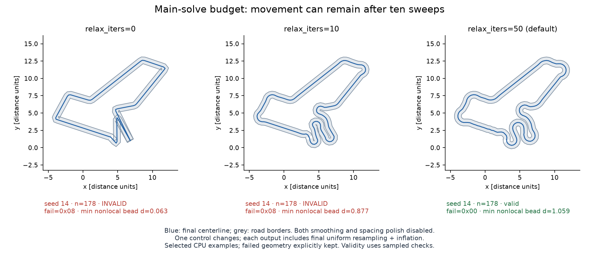

Read and tune convergence
=========================

Use a fixed set of seeds, inspect failure bits, and change one setting at a time.
A solver budget is a fixed amount of work; it is not a promise that every course
converges or remains valid after smoothing and resampling.

.. _relax-iteration-comparison:

         fail sampled thickness; the fifty-sweep road passes the configured checks.

   Only ``relax_iters`` changes. Both tail budgets are zero to isolate main-solve
   work, with half-width ``0.5``, scale ``10``, spacing ``0.30`` and capacity ``384``.
   The counts and axes stay fixed; the ten-sweep road has visibly moved but
   still fails sampled thickness. Fifty sweeps accept this selected result, without
   proving a general iteration budget or clearance guarantee.

Use :ref:`the margin comparison <relax-margin-comparison>` to distinguish requesting
more separation from running more sweeps, and
:ref:`the smoothing comparison <relax-smoothing-comparison>` to inspect the tail
separately. Reproduce these stills with
``python -m viz.render_relaxation_guide --out-dir DIR``; their
:download:`manifest <../assets/racing/relaxation-manifest.json>` records the explicit
``keep`` policy, seeds, settings, source and measured diagnostics.

.. raw:: html

   <video controls loop muted playsinline width="100%" poster="../_static/relaxation-iterations-poster.png" aria-label="Track relaxation through raw, solve, Taubin and spacing-polish phases">
     <source src="../_static/relaxation-iterations.mp4" type="video/mp4">
     
The selected raw tracks fail sampled thickness. Sweeps separate close arcs; smoothing and spacing polish follow.

   </video>

The clip uses seeds 14, 21 and 2 from a 24-environment Bezier batch, with half-width
0.5, scale 10, spacing 0.30 and capacity 384. All raw examples fail the sampled thickness
check; all three final examples pass the configured checks. The selection favours small
raw nonlocal-bead distances among final-valid environments, so it is **not a yield
estimate**. The validity gallery retains additional failure examples
(:ref:`geometry-validity`).

What a frame represents
------------------------

Every frame comes from actual current TrackGen output with ``on_invalid="keep"``.
Main frames use sweep budgets 0 through 50 with the smoothing tail disabled. The zero
frame skips relaxation. After the main solve, Taubin prefixes 1 through 5 run with no
spacing polish; only then do polish prefixes 1 through 10 run with all five Taubin
passes. No positions are interpolated between frames.

Changing the main budget preserves a solve prefix because the Chebyshev recurrence
and cache-refresh cadence depend on the sweep index, not total budget. The renderer
checks schedule prefixes and repeated raw output. Each displayed centerline and its
borders have then passed through the pipeline's final uniform resampling and inflation;
these dots are **not the internal solver bead buffers**. Thus the view explains the
result of each prefix, while avoiding a false claim of direct internal-state capture.

Viewpoints include all shown prefixes and stay fixed. Per-panel minimum nonlocal-bead
distance is measured on the displayed real samples, with the checker's auto-derived
index band. It is one diagnostic, not the full thickness test; local curvature, turning,
capacity and any other configured checks still matter.

The downloadable :download:`track manifest <../_static/relaxation-iterations-manifest.json>`
records source commit, configuration, selected seeds/environments, phases, count, valid,
fail mask and measured distances. Reproduce from the repository root:

.. code-block:: bash

   python -m viz.render_relaxation_video --device cpu --out-dir /tmp/track-clips
   python -m viz.render_relaxation_video --gates --device cpu --out-dir /tmp/gate-clips

The renderer uses ffmpeg on ``PATH``, ``--ffmpeg PATH``, or optional
``imageio_ffmpeg.get_ffmpeg_exe()``. It writes frame PNGs in a temporary directory,
encodes there, and copies the selected MP4/poster/manifest to the requested output.
Rendering tools are not needed to build the documentation.

Choose the next adjustment
---------------------------

.. list-table::
   :header-rows: 1
   :widths: 32 68

   * - Observation
     - Next check
   * - Thickness still fails after the main solve
     - Inspect close bead pairs and local corners. Increase ``relax_iters`` first;
       compare shape and fail bits on representative seeds. More work need not repair
       topological or degenerate inputs.
   * - A short cached run misses emerging contacts
     - Keep ``relax_sep_every`` below the solve budget, increase skin or slots where
       useful, or compare dense separation (``relax_sep_every=1``).
   * - Motion oscillates or the shape changes abruptly
     - Compare ``relax_accel="none"`` with the same budget; reduce aggressive correction
       factors before changing multiple acceleration settings.
   * - Main solve looks acceptable but final output fails
     - Compare tail-off, Taubin-only and polished outputs. Smoothing and resampling can
       change the smallest radius and separation; reduce tail budgets if appropriate.
   * - Capacity truncation bit is set
     - Increase ``N_max`` or spacing. Extra relaxation sweeps do not restore the dropped
       arc.

Cache refreshes use **zero-based** sweep indices. With ``relax_sep_every=20``, a
20-sweep solve builds at 0 only; a 21-sweep solve also refreshes at 20. The default
50-sweep solve refreshes at 0, 20 and 40. Between refreshes, cached candidates are
re-tested every sweep, but a newly approaching uncached pair receives no push.

Measure acceptance, real count, spacing variation and curvature on the current output,
with the same seeds and geometry settings. Measure runtime separately on the device,
batch and capture mode you intend to use. Selected CPU clips establish neither GPU
performance nor population-level yield.
