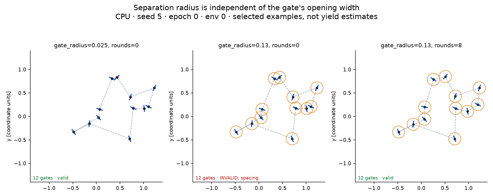

Separate crowded gates
=======================

Gate relaxation pushes nearby XY centers apart before altitude, tangents and frames
are built. Its center-separation radius is independent of the square opening's width;
the solve can fix a spacing failure while leaving a bar-crossing failure.

         with zero rounds, then larger disks after eight rounds; the spacing failure clears.

   Current seed 5, epoch 0, env 0. Orange circles have radius ``gate_radius``; blue
   bars have full width ``gate_width=.12``. At radius ``.13`` the unsolved centers fail
   spacing. Eight rounds separate this selected sample; this is not a yield estimate.
   Diagnostics explicitly use ``on_invalid="keep"``.

Try it
------

.. code-block:: python

   from track_gen import GateGenerator
   from track_gen.pipeline import presets

   gen = GateGenerator(presets.gates(
       num_envs=4, device="cpu", generator="bezier",
       gate_radius=0.13, gate_solve_iters=16, gate_width=0.12,
       on_invalid="keep",                    # retain failed candidates for inspection
   ), seeds=5)
   gates = gen.generate()
   fail = gates.fail_mask.numpy()
   spacing_bit = 1 << gates.fail_bits["spacing"]
   spacing_failed = (fail & spacing_bit) != 0

.. snippet: after

   import numpy as np
   count = gates.count.numpy()
   p = gates.position.numpy().reshape(4, gen.max_gates, 3)
   assert all(np.isfinite(p[e, :count[e]]).all() for e in range(4))
   assert (gates.valid.numpy() == (fail == 0)).all()

Default generation poisons failed rows: count zero, NaN geometry. ``keep`` makes a
failed candidate visible without changing ``valid`` or ``fail_mask``. Only use valid
rows in a simulator (:ref:`invalid-envs`).

Two static controls
--------------------

``gate_radius=.025`` is a distance in caller coordinate units, ``>=0``. Every real
pair of gates has the same XY target distance:

.. math::

   d_{\mathrm{target}} = 2\,\mathrm{gate\_radius}.

The default target is ``.05``. The circles are a **generation spacing model**, not
physical drone or frame collision geometry. ``gate_width=0`` makes point openings but
does not disable separation. Larger course ``size`` spreads centers before this solve
without changing radius or width.

``gate_solve_iters=8`` is the maximum number of rounds, ``>=0``. More rounds increase
the work budget and may resolve remaining crowded pairs. Zero rounds, or a radius
whose float32 ``2*r`` is zero, selects ``gate_relax.none`` and launches no solve.
Directly selecting ``gate_relax.spheres`` requires a positive float32 target and at
least one round; use ``none`` to skip it. Both settings require rebuilding.
The validity stage's radius must agree with the relaxation radius in a hand-built spec.

Watch actual rounds
--------------------

.. raw:: html

   <video controls loop muted playsinline width="100%" poster="../_static/relaxation-gates-iterations-poster.png" aria-label="Actual gate separation rounds, including one final spacing failure">
     <source src="../_static/relaxation-gates-iterations.mp4" type="video/mp4">
     Gate separation moves crowded centers outward over successive rounds.
   </video>

Native Bezier sequences, seed/env 3 (11 gates), 0 (13 gates) and 9 (10 gates), selected
from 24 candidates at epoch 0 for crowded raw anchors. Radius ``.13`` gives target
``.26``; full opening width is ``.16``. Each frame regenerates an actual round budget
from 0 through 16 with ``keep`` and a fixed viewpoint. The renderer checks that the raw
round-zero state repeats. The source uses a fixed pair schedule and a round-indexed
deterministic tie-break; per-round arithmetic does not depend on the total budget.
Together these justify interpreting the separately generated positions as prefixes of
the same solve. Tangents and gate frames are recomputed for each budget; the prefix
reasoning applies to the XY separation states.

**Text alternative:** overlapping gray spacing disks separate most visibly in the
early rounds, then the movement shrinks. The first two selected sequences pass validity
at round 16. The third looks settled but still fails ``spacing``: its smallest pair
distance is about ``.259996`` against the ``.26`` target. Visual stillness is not the
acceptance test. Altitude is absent here; dashed traversal chords are not collision bars.

Reproduce with ``python -m viz.render_relaxation_video --gates --device cpu --out-dir DIR``.
The clip's JSON provenance records candidate selection and per-round failure results.
No numerical result here describes the valid fraction of an arbitrary batch.

What one round does
--------------------

The solve is sequential **Gauss-Seidel within each env**, with one Warp thread per
sequence. The kernel copies the ordered XY input into its own output row, then scans
all pairs ``(i,j)`` with ``j>i`` over real count. If ``dist + 1e-8 < target``, it moves
both centers by half the deficit in opposite directions:

.. math::

   \delta = \tfrac12(d_{\mathrm{target}}-d)\,\hat n,
   \qquad p_i \leftarrow p_i-\delta,\quad p_j \leftarrow p_j+\delta.

Later pairs see earlier moves in the same round. A round that moves no pair exits
early. Finite budgets can leave a small spacing deficit; the final validity checker
uses its own float32 tolerance and decides whether the sequence is usable.

Coincident centers have no direction, so the kernel chooses one deterministically
from pair indices, env index and the current round. It consumes no RNG state. Ordered
pair traversal and this tie-break are why the same seeds, epoch and built pipeline
repeat on the same device/runtime. Changing ordering changes the solve's input and
possibly its trajectory.

Where it runs
--------------

.. code-block:: text

   native anchors or track stations
     -> order -> optional extent normalization -> gate_relax
     -> altitude -> 3D lift -> tangents -> gate frames -> validity

Stations from a relaxed track first run that track's own XY sub-pipeline. They still
run gate separation afterwards, so a nonzero radius can move gates off their original
stations. Separation may expand the final box beyond the requested normalized extent.
The ordered input remains accessible through ``gen.program.tap("gates.xy", after="order")``;
the normalized input, where present, is a later version (:ref:`pipeline-gate-stages`).

Gate and track relaxation solve different problems. Track XPBD uses bead-parallel
Jacobi sweeps, spacing and bend constraints plus a smoothing tail
(:doc:`solver`). Gate separation uses a center-pair loop with no track bend or spacing
rest-length constraint. It does not test or repair the interpolated ``CourseLine``
spline, and it does not model the 3D gate frame members.

Capture and storage
--------------------

``gate_relax.spheres`` is one launch with fixed env dimension and static round budget.
Its per-thread early exit stays inside the kernel; no host readback changes the launch
sequence. Output storage is allocated when built and reused. The solve writes its
own channel version, leaving the version it read untouched. Use the ordinary stream,
mask and CUDA-graph contracts (:doc:`/tutorials/cuda-graph-in-a-sim`).

For native controls, ordering and buffers, see :doc:`/tutorials/gate-sequences`.
For altitude, planes and physical frame collision, see :doc:`/gates-3d`.
