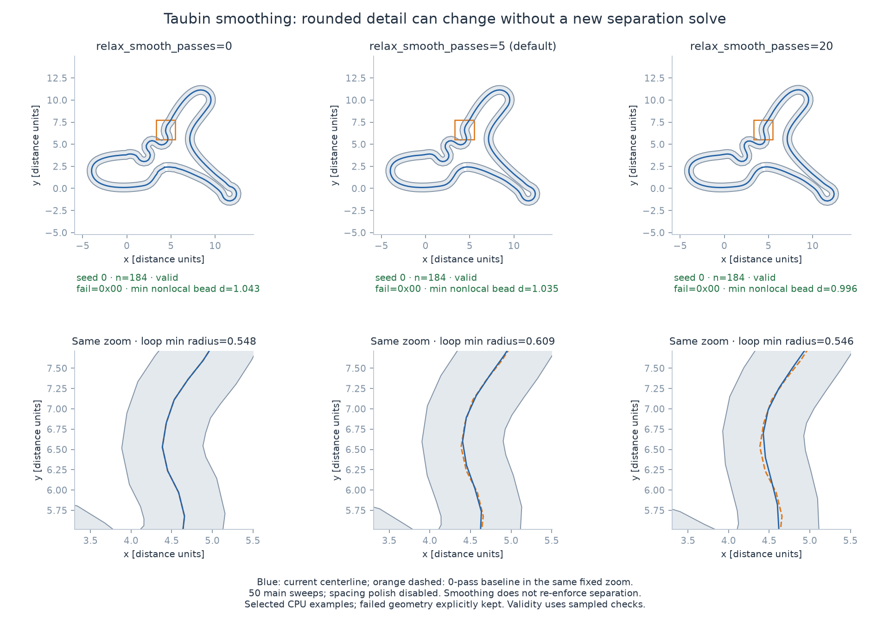

How the track solver runs
==========================

Each sweep reads a complete bead-position buffer and writes the three combined
:doc:`constraint corrections <constraints>` to another. The buffers swap after the
sweep. This Jacobi scheme gives every bead the same previous state, allowing the whole
batch to update in parallel. There is no dense ``E*N*N`` position tensor and no
per-constraint multiplier history.

The main budget, cache cadence, acceleration and tail budgets are static. Scratch
buffers are allocated at construction; launches run through the active ``LaunchContext``.
Their fixed sequence can be recorded in a CUDA graph. Sequential updates, such as the
gate solver's Gauss-Seidel loop, can also be captured; their dependency affects
parallelism rather than making capture impossible.

Which separation pairs are checked
----------------------------------

A dense sweep scans nonlocal pairs, with quadratic work in the real point count.
The default cache holds a directed fixed-size candidate list for each bead:

1. At zero-based sweep 0 and multiples of ``relax_sep_every``, build candidates within
   ``pair_target*(1+relax_sep_cache_skin)``. At variable width the pair target uses
   both beads' solver radii.
2. At every sweep, re-test cached candidates against the actual separation target.
3. If a list fills, additional candidates are omitted; an internal overflow counter
   records this. The cache is an execution approximation, not a complete neighbour list.

.. list-table::
   :header-rows: 1
   :widths: 30 18 52

   * - Static setting
     - Default / range
     - Effect and tradeoff
   * - ``relax_sep_every``
     - ``20`` sweeps, >= 1
     - Candidate refresh interval. Shorter intervals find emerging contacts sooner but
       do more broadphase work.
   * - ``relax_sep_cache_slots``
     - ``16`` per bead, >= 0
     - More slots use more scratch memory and reduce list overflow. Zero disables the
       cache; indices alone use ``E*N_max*slots*4`` bytes.
   * - ``relax_sep_cache_skin``
     - ``0.5``, >= 0
     - Fractional candidate-radius expansion. Larger skin retains potential contacts
       across more motion but can fill fixed-size lists sooner.

Caching is active only when ``slots>0`` and ``every>1``. Otherwise a dense separation
scan runs at sweep indices divisible by ``every``; spacing and bending run every sweep.
Thus ``slots=0, every>1`` skips separation between dense scans. ``every=1`` selects
dense separation every sweep, regardless of allocated cache slots.

Chebyshev acceleration
-----------------------

After the first ``relax_cheby_start=8`` plain sweeps, acceleration blends the Jacobi
output :math:`\hat{x}` with the current and previous iterates:

.. math::

   x_{new}=\omega_k\left[\gamma(\hat{x}-x_{cur})+(x_{cur}-x_{prev})\right]+x_{prev}.

The spectral-radius estimate :math:`\rho` sets a host-precomputed recurrence, starting
at the first accelerated sweep:

.. math::

   \omega_1=1,\qquad \omega_2=\frac{2}{2-\rho^2},\qquad
   \omega_{j+1}=\frac{4}{4-\rho^2\omega_j}.

The transition aliases the previous iterate to the current one; later sweeps rotate
three preallocated buffers. Earlier sweeps skip the blend. The schedule depends on the
sweep index, not the total requested budget; this matters for the actual-prefix
:doc:`animation <convergence>`.

.. list-table::
   :header-rows: 1
   :widths: 30 20 50

   * - Static setting
     - Default / range
     - Effect and tradeoff
   * - ``relax_accel``
     - ``"chebyshev"`` or ``"none"``
     - Enable extrapolation, or use plain Jacobi. Contact changes can make extrapolated
       trajectories oscillate; compare acceptance and shape on your workload.
   * - ``relax_cheby_rho``
     - ``0.98``, [0, 1)
     - Spectral-radius estimate controlling weights. Larger is not uniformly faster or
       more stable on changing contacts.
   * - ``relax_cheby_gamma``
     - ``0.9``, (0, 1]
     - Under-relaxation of the fresh Jacobi correction. Smaller values damp it.
   * - ``relax_cheby_start``
     - ``8``, integer >= 1
     - Number of initial plain sweeps; first blend is zero-based sweep index 8 at the
       default. Later starts let contacts settle before extrapolation.

This is the semi-iterative acceleration used for Jacobi position projection, related to
Macklin et al., *Unified Particle Physics for Real-Time Applications* (2014). The
configured spectral estimate does not prove convergence for this nonlinear contact set.

Smoothing and spacing polish
----------------------------

The main bending guard only acts below its target radius. An optional tail smooths the
remaining small kinks, then restores near-uniform spacing. One Taubin pass applies two
circular Laplacian steps:

.. math::

   x\mathrel{+}=0.5L(x),\qquad x\mathrel{+}=-0.53L(x),\qquad
   L(x_i)=\tfrac12(x_{i-1}+x_{i+1})-x_i.

The negative step counteracts the shrinkage of ordinary Laplacian smoothing. It does
not preserve every radius or clearance. The spacing-only polish then uses the ordinary
spacing correction with separation and bending disabled. The tail uses fixed launches
and the existing position buffers; it does not run Chebyshev acceleration.

.. _relax-smoothing-comparison:

         zoom showing the unsmoothed centerline as an orange dashed baseline.

   Only ``relax_smooth_passes`` changes after 50 main sweeps. Spacing polish is
   disabled in all three panels so its correction does not hide the smoothing
   effect. The fixed zoom shows small corners rounding; the orange dashed line
   retains the zero-pass centerline. Counts, validity and failure masks describe
   the returned, uniformly resampled road, not internal bead buffers.

All three selected seed-0 results pass the configured checks. Their minimum
nonlocal bead distance decreases from approximately ``1.043`` to ``0.996`` while
the smallest local radius first increases, then decreases. Smooth-looking output
does not imply improved separation or monotonic curvature. Measure final geometry
and failure bits when changing either tail budget; :ref:`geometry-validity` explains
what the sampled checks establish. The
:download:`comparison manifest <../assets/racing/relaxation-manifest.json>` records
the full settings and diagnostics.

.. list-table::
   :header-rows: 1
   :widths: 35 15 50

   * - Static setting
     - Default / range
     - Effect and tradeoff
   * - ``relax_smooth_passes``
     - ``5``, >= 0
     - Taubin passes, two half-steps each. More smoothing changes fine geometry and can
       reduce clearance or local radius.
   * - ``relax_smooth_spacing_iters``
     - ``10``, >= 0
     - Spacing-only sweeps after all Taubin passes. More work improves spacing only to
       the extent allowed by the changing geometry; it does not enforce separation.

Set both counts to zero to disable the tail. Final uniform resampling and validity run
after it, so judge the returned ``Track`` rather than assuming smooth output is valid.
