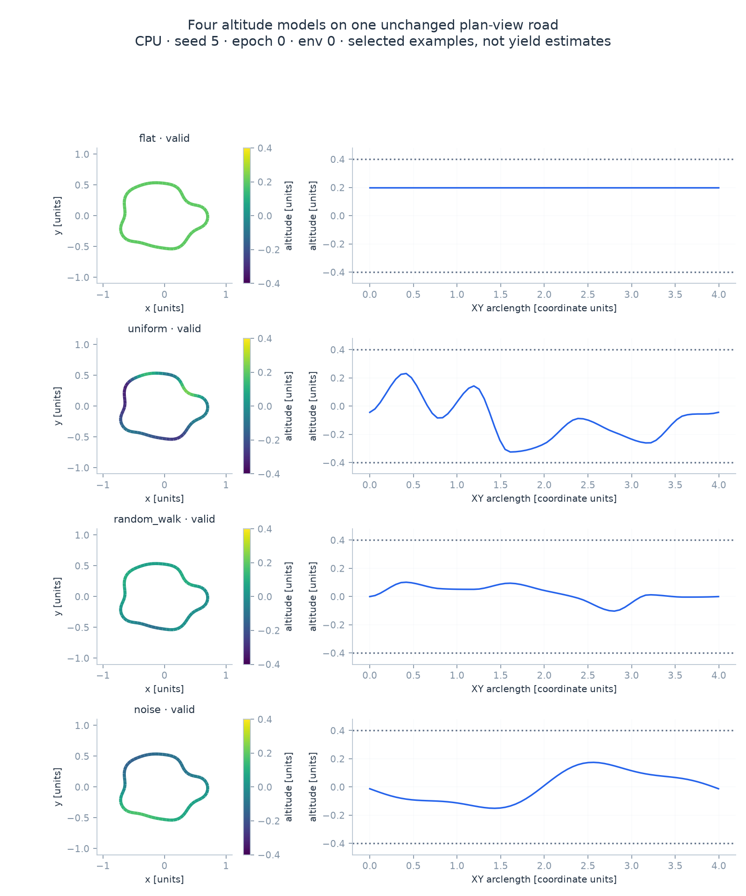
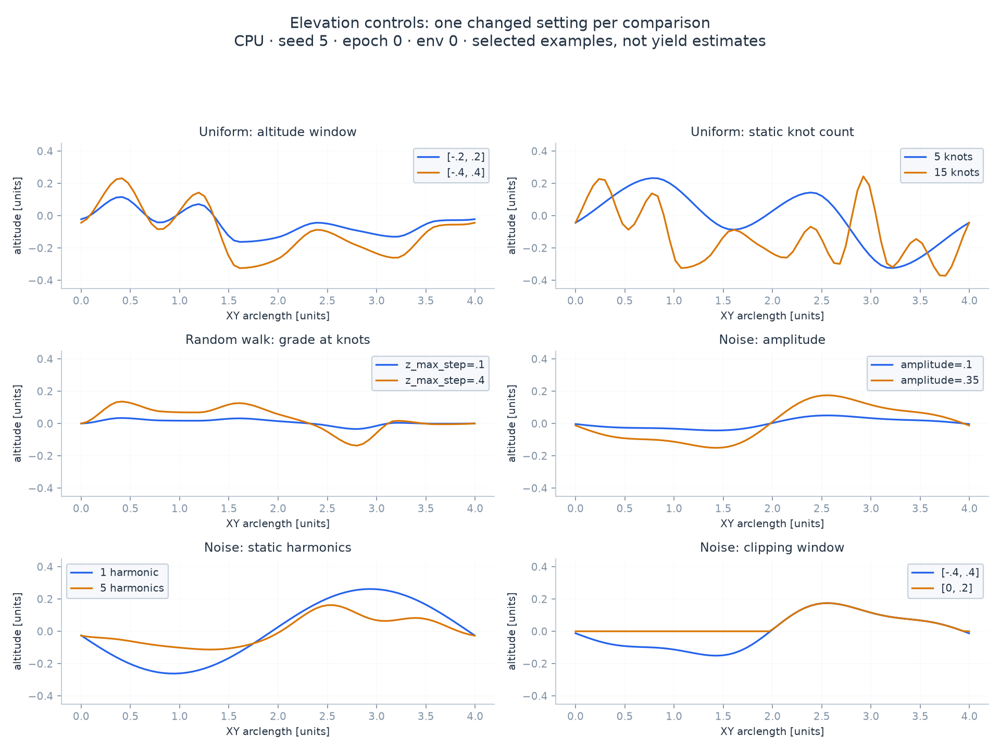

.. _course-elevation:

Add elevation to a road
======================

A TrackGen road is a ribbon with level cross-sections: XY layout and width are solved
first, then the same altitude lifts the center, inner and outer point at each index.
Choose rolling terrain without changing the plan-view layout.

         each with a colored plan view and altitude against XY arclength.

   Current output, seed 5, epoch 0, env 0. Every row has identical XY geometry.
   The non-flat profiles use ``[-.4, .4]``; flat is at ``z_base=.2``. Altitude and
   XY axes use caller coordinate units. These examples are selected, not yield data.

Try it
------

.. code-block:: python

   import numpy as np
   from track_gen import TrackGenerator
   from track_gen.pipeline import presets

   E, N = 4, 384
   spec = presets.track(
       num_envs=E, device="cpu", n_max=N,
       elevation=("noise", {"z_min": -0.3, "z_max": 0.3,
                            "z_noise_amplitude": 0.2}),
   )
   gen = TrackGenerator(spec, seeds=5)
   track = gen.generate()
   center = track.center.numpy().reshape(E, N, 3)
   count = track.count.numpy()
   valid = track.valid.numpy() != 0
   hills = [center[e, :count[e], 2] for e in range(E) if valid[e]]

.. snippet: after

   assert hills and all(np.isfinite(z).all() for z in hills)
   assert all((z >= -.3).all() and (z <= .3).all() for z in hills)

Change the altitude model
-------------------------

``presets.track(elevation=...)`` accepts a stage name, ``(name, params)`` or StageRef.
A flat ``TrackGenConfig`` uses ``z_profile`` and its ``z_*`` shortcuts instead.
Distances are in your coordinate units; a grade is ``abs(dz) / XY distance``.

.. list-table:: Profiles and controls
   :header-rows: 1
   :widths: 19 43 38

   * - Profile
     - What changes
     - Defaults / kind
   * - ``"flat"``
     - Constant altitude, no knots. Set ``presets.track(z_base=...)`` on the flat lift.
     - ``z_base=0`` static distance. The track's ``elevation.flat.z_base`` must stay 0.
   * - ``"uniform"``
     - Independent uniform heights at arc-spaced knots, interpolated around the loop.
     - ``z_min=0``, ``z_max=0`` dynamic distances;
       ``z_control_points=10`` static knot count, ``>=3``.
   * - ``"random_walk"``
     - Correlated knot heights, bridge closure and bounds. Step size is proportional
       to XY distance between knots, rather than an absolute altitude jump.
     - ``z_base=0`` static distance; dynamic ``z_min=0``, ``z_max=0`` distances,
       ``z_max_step=0`` nonnegative grade; static ``z_control_points=10`` (``>=3``).
   * - ``"noise"``
     - Periodic harmonics around a baseline, clipped to the altitude window.
     - Static ``z_base=0`` distance, ``z_noise_harmonics=3`` count (``>=1``);
       dynamic ``z_min=0``, ``z_max=0``, ``z_noise_amplitude=0`` distances (amplitude ``>=0``).

         noise amplitude, harmonic count and clipping bounds.

   Each pair changes only the labeled control. A wider window permits larger hills;
   more knots or harmonics can add detail. A positive-only clipping window flattens
   negative noise. A closed window (``z_min == z_max``) makes amplitude and walk-step
   controls inert; the default window is ``[0,0]``.

Uniform and random-walk tracks use periodic monotone-cubic interpolation with limited
knot tangents. This keeps each segment within its adjacent knot heights and closes the
seam. Increasing raw or output resolution samples that model more finely; it does not
add altitude knots. A knot count near or above the final point count loses this smooth
terrain interpretation. Noise uses normalized arclength and no altitude knots.

.. _tracks-25d-per-env:

Live altitude controls and grade checks
---------------------------------------

The table's dynamic fields are per-env float32 arrays in ``gen.params["elevation"]``.
Static baseline, knot count and harmonic count require rebuilding. For example:

.. code-block:: python

   gen.params["elevation"].set("z_noise_amplitude", 0.1)
   gentler = gen.generate()              # same epoch, lower live amplitude
   randomized = TrackGenerator(presets.track(
       num_envs=E, device="cpu",
       elevation=("noise", {"z_min": -0.3, "z_max": 0.3}),
       randomize={"elevation.z_noise_amplitude": (0.05, 0.25)},
   ), seeds=5)

The configured window requires ``z_min <= z_max``. Randomized bounds that can cross
are rejected at planning; raw live writes need care (:ref:`tuning-per-env`).
Negative scalar amplitudes/step caps raise; negative raw-array values clamp to zero.
NaNs can fail validity.

``z_max_step`` shapes the walk **at its knots**. Bridge closure and interpolation
mean it is not a guarantee for every final segment. ``z_valid_grade=0`` disables
the final check; a positive static value rejects any adjacent pair, including the
closing pair, whose realized ``abs(dz) / XY distance`` exceeds it (fail bit ``grade``).
Select it through ``checks=(("default", {"z_valid_grade": .5}),)`` or a config field.
It changes acceptance, not the generated heights.

``generator.size`` and static ``scale`` change XY extent while altitude stays absolute.
For the same uniform/noise profile, spreading the road reduces grades; scale altitude
with XY size when you want comparable hill steepness. A walk's cap already uses grade,
but the altitude window still bounds its movement. Capacity and simulator utility
resolution must accommodate the largest course (:ref:`tuning-size-utilities`).

.. _tracks-25d-provided:

Use supplied altitude
----------------------

An imported or plugin generator can write ``raw.z`` and declare ``provides={"z"}``.
The pipeline then omits elevation; resampling carries the channel to final points,
and relaxation preserves bead identity. The elevated lift uses those heights and
recomputes 3D tangents and length. Non-flat ``elevation`` or a nonzero flat ``z_base``
is rejected when altitude is supplied. ``external`` selects this contract with
``generator_params={"with_z": True}`` (:ref:`ingesting-centerlines`).

Geometry and simulator semantics
--------------------------------

The pipeline runs XY generation, constant-spacing sampling, width and relaxation,
uniform resampling, planar frames and offsets, then elevation, validity and lift.
With flat height the lift keeps the planar tangent/arclength tables; a non-flat profile
recomputes them from 3D centerline geometry.

- ``Track.center``, ``outer`` and ``inner`` are flat ``vec3f`` arrays. Reshape as
  ``[E, N_max, 3]`` and use each env's real ``count``. Invalid output is poisoned by
  default; padding is not usable geometry (:doc:`/user-guide/results`).
- Center/inner/outer at one index share Z. The recovered half-width
  ``norm(outer[i] - center[i])`` is still the planar half-width. There is no banking.
- ``Track.length`` / ``arclen`` and the elevated tangent describe the 3D polyline.
  ``Track.normal`` remains the planar left-normal, with zero Z; it is not a 3D
  surface normal. Props/checkpoints sample true 3D boundary distance.
- Road :doc:`collision </utilities/collision>` remains an XY out-of-bounds query.
  It does not test vertical separation from the ribbon, and elevated crossings
  do not become overpasses: XY generation/validity still governs the road layout.
- Localization curvature uses planar turn angles with 3D chord lengths; it is not
  a full spatial-curve curvature measure. Grade changes can affect reported curvature
  and its speed-profile limit (:doc:`/utilities/localize`).

Heightfield for external physics
--------------------------------

.. code-block:: python

   from track_gen import tools
   from track_gen.course import Course

   course = Course.track(spec, checkpoint_spacing=0.6, seeds=5,
                         extra=[tools.HeightFieldBake(64)])
   hf = course.heightfield.bake()
   grid = hf.height.numpy().reshape(E, 64, 64)

.. snippet: after

   assert hf.res == 64 and grid.shape == (E, 64, 64)

Each texel takes the altitude of the nearest centerline cross-section in XY. Off-road
texels continue the nearest edge height; this is a nearest-section approximation,
not a continuously triangulated banked surface. Invalid/degenerate envs bake NaN and
a placeholder box ``[-1,1]^2``. The per-env ``lo`` / ``hi`` box includes padding
(default 10% of its larger road extent); texel centers are
``lo + ((x,y) + .5) / res * (hi-lo)`` in row-major ``(y,x)`` storage.

Larger XY size enlarges texels at fixed resolution; choose resolution for the largest
size (:ref:`collision-resolution-check`). Utility ring capacity also needs a 3D length
bound. Dynamic altitude bounds alone declare none: positive ``z_valid_grade`` supplies
a conservative climb bound; otherwise ``Course`` sizes checkpoints from its construction
batch and ``tools.Checkpoints`` / ``tools.Props`` need an explicit capacity
(:ref:`course-checkpoint-capacity`).

For altitude on gates and frame orientation, continue to :doc:`/gates-3d`.
