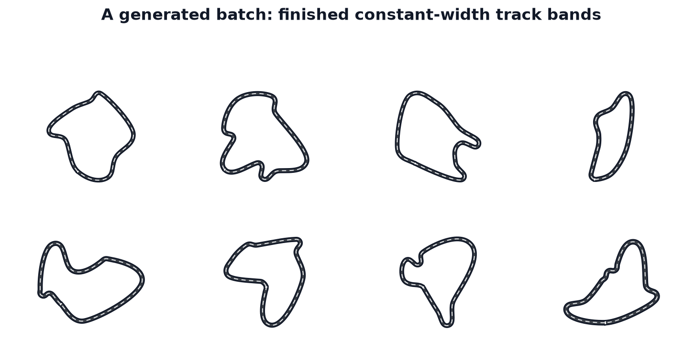

Generating a Batch of Tracks
============================

``TrackGenerator`` produces a whole batch of closed, constant-width racing tracks, one
per :term:`env`: a centerline generator draws a centerline per env from its
:term:`seed`, the pipeline resamples it at a constant arc :term:`spacing`, relaxes it so
the road band does not overlap itself, and inflates it into a road band. This tutorial
walks the end-to-end workflow (build a generator from a :term:`preset`, read the output
arrays, work with the real points of each env, check which envs are valid) and then
drives an agent against the finished tracks with a ``Course``.

Prerequisites
-------------

Install TrackGen (:doc:`/getting-started/installation`). The examples run on ``cpu`` as
well as on ``cuda``; the PyTorch section needs ``torch``.

Building the Generator
----------------------

``presets.track`` returns the :term:`spec` of a track pipeline; ``TrackGenerator`` builds
it. ``num_envs`` (the batch size :term:`E`) and ``device`` (``"cpu"`` or ``"cuda:0"``)
are required. ``half_width`` is the road half-width in world units and defaults to
``0.1``. The examples below use a thinner ``half_width=0.03`` road, whose finer default
spacing needs more points per track, so they also raise ``n_max`` (:term:`N_max`, the
per-env point capacity) to 512 (see `Choosing spacing and N_max`_).

.. code-block:: python

   from track_gen import TrackGenerator
   from track_gen.pipeline import presets

   E, device = 64, "cuda:0"  # or "cpu"
   spec = presets.track(num_envs=E, device=device, half_width=0.03, n_max=512)
   generator = TrackGenerator(spec, seeds=0)    # env e gets seed 0 + e

``seeds=k`` gives env ``e`` the seed ``k + e``; an ``[E]`` ``int32`` ``wp.array`` or a
``PerEnvSeededRNG`` sets each env's seed yourself (:ref:`generating-seeds`). A
``TrackGenConfig`` builds the same generator (:ref:`generating-ways`).

Generating the Track Batch
--------------------------

.. code-block:: python

   track = generator.generate()                 # the batch construction already built
   track = generator.generate(advance=True)     # a new batch: every env's next epoch

Construction allocates every buffer once (the generator's scratch, the seed buffers and
the persistent ``Track``) and runs the pipeline once, so the ``Track`` already holds a
batch. ``generate()`` rebuilds the batch of the current seeds and
:term:`epochs <epoch>`; ``generate(advance=True)`` advances every env's epoch first, so
each env gets a new track. On ``cuda``, the first call records the pipeline into the
generator's own CUDA graph and every call replays it. ``generate()`` waits for its stream
to finish by default; pass ``sync=False`` to return at once (:ref:`generating-calls`).

.. note::

   ``TrackGenerator`` is **fixed-batch**: every generation produces exactly
   ``num_envs`` tracks, and the result keeps the same arrays at the same addresses, so a
   CUDA graph recorded against it stays valid. To renew only some envs, pass a mask:
   ``generate(advance=True, mask=done)`` (:ref:`rl-masked-regeneration`).

Reading the Output Fields
-------------------------

``track`` is a ``Track`` whose fields are flat Warp arrays (:doc:`/user-guide/results`).
``.numpy()`` copies one to the host; reshape the per-point fields to ``[E, N_max, 3]``:

.. code-block:: python

   N = generator.n_max
   center = track.center.numpy().reshape(E, N, 3)   # vec3f: x, y, z
   outer = track.outer.numpy().reshape(E, N, 3)
   inner = track.inner.numpy().reshape(E, N, 3)
   valid = track.valid.numpy() != 0                 # [E] bool
   count = track.count.numpy()                      # [E] real points per env

The full field table (shapes after the reshape; on the device every per-point field is a
flat ``[E * N_max]`` array):

.. list-table::
   :header-rows: 1

   * - Field
     - Shape
     - Meaning
   * - ``outer``, ``center``, ``inner``
     - ``[E, N_max, 3]`` (``vec3f``)
     - Border / centerline / border points. All three are index-aligned: the same
       cross-section normal passes through ``outer[e, i]``, ``center[e, i]``, and
       ``inner[e, i]``. ``z`` is ``0`` on a flat track (:doc:`/tracks-25d`).
   * - ``tangent``, ``normal``
     - ``[E, N_max, 3]`` (``vec3f``)
     - Unit tangent and left-normal along the centerline.
   * - ``arclen``, ``half_width``
     - ``[E, N_max]`` (``float32``)
     - Cumulative arc length (0 at index 0), and the road half-width at each point.
   * - ``length``, ``winding``
     - ``[E]`` (``float32``)
     - Closed-loop perimeter, and the turning number of the loop.
   * - ``count``
     - ``[E]`` (``int32``)
     - Real point count per track. Slots at index ``i >= count[e]`` are NaN-padded.
   * - ``valid``
     - ``[E]`` (``int32``)
     - ``1`` when the track passed every check, ``0`` for an :term:`invalid env`
       (`Valid and invalid envs`_).
   * - ``fail_mask``
     - ``[E]`` (``int32``)
     - Why a track is invalid: one bit per failed check (:term:`fail bits`;
       ``track.fail_bits`` names them); ``valid == (fail_mask == 0)``.
   * - ``truncated``
     - ``[E]`` (``int32``)
     - ``1`` when the track needed more than ``N_max`` points: its tail was dropped and
       the track is invalid. Raise ``n_max`` (or ``spacing``) if any are set.
   * - ``generation``
     - ``[E]`` (``int32``)
     - The epoch each track was generated at: ``0`` until you advance it, then ``k``
       after the ``k``-th advance (:ref:`generating-seeds`).

Slicing Real Points
-------------------

TrackGen emits each track at a constant arc spacing rather than a fixed point count. The
per-track point count is ``count[e] = floor(perimeter / spacing) + 1``, capped at
``N_max``, and the slots beyond ``count[e]`` are NaN. To work only with the real points
of an env:

.. code-block:: python

   if valid[0]:
       n0 = int(count[0])
       center_env0 = center[0, :n0]   # shape [n0, 3]
       outer_env0 = outer[0, :n0]
       inner_env0 = inner[0, :n0]

Valid and invalid envs
----------------------

Every track is checked after it is built: a track whose band overlaps itself, that does
not form one simple loop, or that was truncated at ``N_max`` gets ``valid = 0``
(:term:`valid`). The
generator never retries: an invalid env keeps its index in the batch until a later
generation gives it a new epoch. Check the fraction after construction, and skip or
regenerate the invalid envs:

.. code-block:: python

   print(f"{(~valid).mean():.1%} invalid")
   loops = [center[e, :count[e]] for e in range(E) if valid[e]]

.. snippet: after

   import numpy as np
   assert len(loops) == int(valid.sum())
   assert (count[~valid] == 0).all()
   assert np.isnan(center[~valid]).all()

Historical measurements before the 0.3 seed switch found few invalid envs at these
settings, with truncation rising at the default ``n_max=384``. Measure the current
batch rather than relying on the old percentages. The fraction grows with settings
that truncate the loop or thin the course. :ref:`invalid-envs` lists the checks, the measured
rates and the knobs that lower them.

Track Figure
------------

         outer/inner borders and dashed centerlines.

   The end product of ``generate()``: finished constant-width road bands, each a
   filled band between the ``outer`` and ``inner`` borders with the ``center``
   line dashed through it. Every band came from one deterministic batch at the
   tutorial's ``half_width=0.03`` geometry.

Choosing ``spacing`` and ``N_max``
----------------------------------

The default ``spacing`` (``None``) is ``0.6 * half_width``. ``n_max`` is the per-track
point capacity: size it so that ``n_max >= max(perimeter) / spacing + 1`` and no track
is truncated (truncated tracks are flagged in ``Track.truncated`` and invalid). The
default ``half_width=0.1`` leaves ample headroom, but the default ``n_max=384`` truncates
about 3 % of a ``half_width=0.03`` batch, hence ``n_max=512`` here. A smaller
``spacing`` yields a denser, smoother polyline at the cost of more points per track (and
a larger required ``n_max``); a larger ``spacing`` is cheaper but coarser. See
:doc:`/configuration/tuning` for the coupling rules and :doc:`/how-it-works/resample`
for the constant-spacing contract in depth.

Relaxing the Centerline
-----------------------

Between the constant-spacing resample and the inflation, the pipeline runs an XPBD
relaxation that opens self-approaches and rounds under-radius corners so the
constant-width band does not overlap itself. It is on by default (``relax="auto"``:
``relax.xpbd`` for the built-in generators); its knobs are the parameters of the
``relax`` stage (``relax=("xpbd", {"relax_iters": 80})``), and ``relax=None`` turns it
off. The defaults are tuned; reach for these knobs only to trade yield against per-batch
cost.

.. seealso::

   :doc:`/relaxation/overview` documents the relaxation stage — why a raw
   centerline is not inflatable, the thickness check that decides ``valid``, and
   every ``relax_*`` knob with its effect on yield and cost.

Device Choice (cpu / cuda)
--------------------------

The same API runs on both devices; only the ``device`` string changes. On ``cpu`` every
``generate()`` runs the pipeline eagerly. On ``cuda`` the first call records the
pipeline into the generator's own CUDA graph and later calls are fast replays, the
natural choice for a batched RL loop. Called while you :term:`capture` a CUDA graph of
your own, ``generate()`` is recorded into YOUR graph instead. See
:doc:`/tutorials/cuda-graph-in-a-sim` for recording into your graph, and
:doc:`/generators/overview` for per-generator costs.

Buffer Reuse and Snapshots
--------------------------

The same ``Track`` instance and its Warp arrays are **reused** on every generation. To
keep the tracks of one episode while generating a fresh batch, take a snapshot:

.. code-block:: python

   snapshot = track.clone()   # an independent copy: allocates and blocks, off the hot path

``clone()`` allocates on every call; on a hot path, copy into a result you allocated once
(``snap = Track.alloc(track.layout)`` then ``snap.copy_from(track)``,
:ref:`results-views`). ``.numpy()`` copies to the host, so the arrays above are already
independent of the next generation.

Using PyTorch
-------------

``wp.to_torch`` returns a **zero-copy** PyTorch view of a Warp array, on the same
device: no host round trip. Reshape it like the NumPy arrays above. The view aliases the
generator's buffer, so the next generation rewrites it; call ``.clone()`` on the torch
side to keep it:

.. code-block:: python

   import torch
   import warp as wp

   center_t = wp.to_torch(track.center).view(E, N, 3)       # shares the Track's memory
   valid_t = wp.to_torch(track.valid).bool()
   kept = center_t[valid_t].clone()                          # [n_valid, N, 3], your copy

:mod:`track_gen.interop.torch` covers streams and CUDA graphs with torch
(:doc:`/tutorials/cuda-graph-in-a-sim`).

Driving Against the Track: a Course for RL
------------------------------------------

Generation gives you the geometry; an RL or controller loop also needs to know, each
step, *is the agent still on the track?* and *how far along has it got?* A
:term:`course` (:doc:`/utilities/course`) bundles generation with the out-of-bounds
collision checker and the checkpoint and progress tracker in one object, so you never
wire those together by hand. Its lifecycle is **construct → bind → step / reset /
regenerate**: the course is ready at construction.

Build a course from the same preset, ``bind`` the sim's own state buffers (they are read
in place every step), then in the step loop read ``contacts.oob`` for the out-of-bounds
flag, the progress ``events`` for checkpoint rewards, and ``valid`` to leave out the envs
whose track is invalid:

.. code-block:: python

   import numpy as np
   import warp as wp

   from track_gen.course import Course
   from track_gen.pipeline import presets

   E, device = 64, "cuda:0"  # or "cpu"

   course = Course.track(presets.track(num_envs=E, device=device, half_width=0.03,
                                       n_max=512),
                         checkpoint_spacing=0.6,
                         collision="segments",       # "segments" (exact) or "sdf"; None: no OOB check
                         seeds=7)

   # Bind the sim's own buffers: position (vec3f) drives progress; orientation
   # (quatf) + half_extents (vec2f, planar box) are the oriented collision box.
   # The sim writes these in place each step.
   position = wp.zeros(E, dtype=wp.vec3f, device=device)
   orientation = wp.full(E, wp.quat_identity(), dtype=wp.quatf, device=device)
   half_extents = wp.full(E, wp.vec2f(0.02, 0.02), dtype=wp.vec2f, device=device)
   course.bind(position=position, orientation=orientation, half_extents=half_extents)

   regen = course.inputs["regen_mask"]      # stable [E] int32 mask for regenerate(mask=)

   for step in range(40):
       # sim.step() writes `position` (and `orientation`) in place here.

       res = course.step()                       # events + contacts + valid, no args
       valid = res.valid.numpy() != 0            # read it first: a regeneration rewrites it
       oob = res.contacts.oob.numpy()            # [E] int32: 1 == out of the drivable band
       passed = res.events.passed.numpy()        # [E] int32: crossed a checkpoint this step
       dist = res.events.dist_to_next.numpy()    # [E] float32: distance to next checkpoint

       # Gate on `valid` with a select, never a multiply: NaN * 0 is NaN.
       reward = np.where(valid, 10.0 * passed - 5.0 * oob, 0.0)   # pass bonus, OOB penalty
       obs_d = np.where(valid, dist, 0.0)                         # NaN-free observation
       done = (oob != 0) | ~valid                                 # done |= 1 - valid

       if done.any():
           regen.assign(done.astype(np.int32))
           course.regenerate(mask=regen, advance=True)   # NEW courses for the done envs
           # ...and respawn those envs' agents on their new course in your sim.

   # Per-env respawn on the SAME course (a valid env that crashed): clear its progress.
   respawn = np.zeros(E, np.int32)
   respawn[0] = 1
   course.reset(wp.array(respawn, dtype=wp.int32, device=device))

   # New courses for everyone, from new seeds: whole-batch regeneration + progress reset.
   course.generate(seeds=123)

.. snippet: after

   assert np.isfinite(reward).all() and np.isfinite(obs_d).all()

``contacts.oob`` is the reward and termination signal (``res.contacts`` is a
``BoxContact`` that also carries the signed ``distance``, the ``nearest`` boundary point
and the inward ``normal`` for a contact response). ``res.events`` gives the progress
signals: ``passed`` for a pass bonus, ``dist_to_next`` for a negative-delta-distance
shaping term, and ``progress`` for the total checkpoints cleared since the last reset.
(The agents of this example all sit at the origin, off every track, so every env is done
at every step.)

``res.valid`` is the generator's ``[E]`` validity. An invalid env reads like an env with
no track: ``oob = 1`` and NaN ``distance`` / ``nearest`` / ``normal``, frozen progress
(``passed = 0``, ``dist_to_next = 0``), no checkpoints. Left ungated, it would be
penalised and ended at every step, and ``reset`` would respawn it on the same invalid
track forever: end it and regenerate it with ``advance=True``, as above
(:ref:`rl-valid-recipe`). ``regenerate(mask=...)`` recomputes the whole batch on every
eager call, even with no env masked, so only call it when one is; recorded into a CUDA
graph with conditional nodes, an all-zero mask is skipped on device (:ref:`rl-cost`).

The checkpoint ring holds ``max_checkpoints`` slots per env, by default enough for the
longest track the generator can produce (at these settings
``ceil(1.5 * 512 * 0.018 / 0.6) = 24``; see :ref:`course-checkpoint-capacity`). Pass
``max_checkpoints`` to ``Course.track`` to choose the shape yourself.

Collision backend
~~~~~~~~~~~~~~~~~

Track mode accepts ``collision="segments"`` (an exact boundary scan: no precompute,
reads regenerated tracks automatically), ``"sdf"`` (baked signed-distance grids: cheap
queries after a per-regeneration bake, worth it when a batch serves many queries between
regenerations), or ``None`` (progress only, no out-of-bounds check). Gate courses use
gate-post or frame collision instead (:doc:`/tutorials/gate-sequences`). See
:ref:`collision-backends` for the trade-offs, accuracy and cost, and
:doc:`/utilities/progress` for the checkpoint and reward contract.

CUDA-graph composability
~~~~~~~~~~~~~~~~~~~~~~~~

``step()`` and ``reset()`` never wait on the host, so the whole step (progress update
plus collision query) records into your own sim graph alongside the physics, with no flag
to set. ``course.regenerate()`` records into the same graph too, so new courses and the
steps that drive them can replay as one unit. Keep writing into the SAME bound buffers
after capture (rebinding leaves the captured graph reading the old pointers, and emits a
``RebindAfterCaptureWarning``). See :doc:`/tutorials/cuda-graph-in-a-sim` for the
capture-and-replay pattern and :doc:`/user-guide/rl-auto-reset` for per-env auto-reset.

Putting It All Together
-----------------------

.. snippet: group=together

.. code-block:: python

   import numpy as np
   from track_gen import TrackGenerator
   from track_gen.pipeline import presets

   E, device = 64, "cuda:0"  # or "cpu"
   generator = TrackGenerator(presets.track(num_envs=E, device=device, half_width=0.03,
                                            n_max=512), seeds=0)
   track = generator.generate()

   N = generator.n_max
   center = track.center.numpy().reshape(E, N, 3)
   valid = track.valid.numpy() != 0
   count = track.count.numpy()
   print(f"{valid.mean():.1%} valid")

   # Real points of env 0
   n0 = int(count[0])
   print(f"env 0: {n0} real points, valid={bool(valid[0])}")
   print("centerline:", center[0, :n0])
