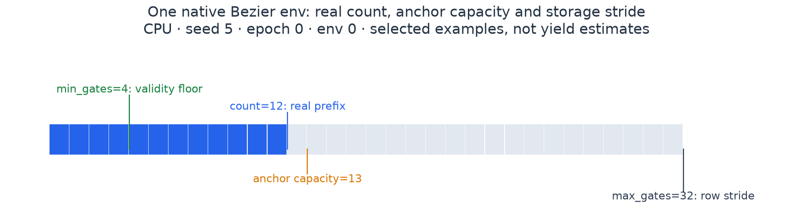
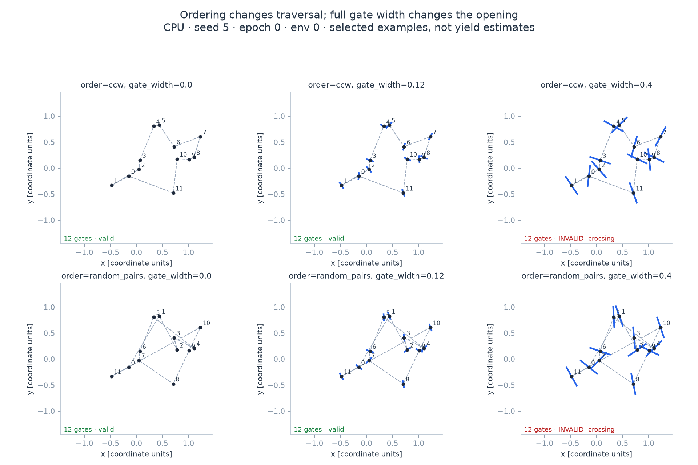

Gate sources and placement
==========================

Use ``GateGenerator`` for ordered 3D gate centers, square openings and poses. Native
gate generators place anchors directly; track-station sources place gates along a
curve. Choose an opening width before connecting progress or collision to a simulator.

.. figure:: ../assets/racing/controls-gate-sources.png
   :alt: Native polar anchors, stations on its raw track curve and stations on its
         relaxed track curve, with ordered gates numbered.

   Three distinct construction paths at seed 5, epoch 0, env 0. Native polar gates
   use their control anchors, while station paths use a track curve. Shared family
   names do not imply identical coordinates. Selected examples do not measure yield.

Try it
------

.. code-block:: python

   import numpy as np
   from track_gen import GateGenerator
   from track_gen.pipeline import presets

   E = 4
   generator = GateGenerator(presets.gates(
       num_envs=E, device="cpu", generator="polar",
       gate_width=0.1, max_gates=32,
   ), seeds=5)
   gates = generator.generate()
   G = generator.max_gates
   position = gates.position.numpy().reshape(E, G, 3)
   count = gates.count.numpy()
   valid = gates.valid.numpy() != 0
   courses = [position[e, :count[e]] for e in range(E) if valid[e]]

.. snippet: after

   assert courses and all(np.isfinite(p).all() for p in courses)
   assert (count[~valid] == 0).all()

The default ``on_invalid="poison"`` gives failed envs zero count and NaN geometry.
Read ``valid`` before using a row and guard zero count before wrapping indices.
Use ``on_invalid="keep"`` explicitly to inspect failed geometry; it remains invalid.

Choose anchors or stations
--------------------------

``presets.gates(source="auto")`` chooses native anchors if the named
``gate_generator`` exists, otherwise stations on a track generator. The native families
are Bezier, hull, polar, Voronoi and checkpoint. Repulsive has no native gate path.

.. list-table:: Construction paths
   :header-rows: 1
   :widths: 24 48 28

   * - ``source``
     - Geometry and useful controls
     - Counts
   * - ``"anchors"``
     - Native gate-generator Params; skips track sampling, XPBD and inflation.
       Bezier/hull use their point cloud, not Bezier handles or hull displacement.
     - Generator decides the real count and anchor capacity.
   * - ``"stations"``
     - Equal arc stations on a raw track curve; reads ``num_points`` and ``n_max``.
     - ``gates=12`` by default, static, ``>=3``.
   * - ``"relaxed_stations"``
     - Runs the track resample/width/relax sub-pipeline before stations; reads
       ``half_width``, ``spacing``, ``relax`` and ``width`` too. No road is inflated.
     - Same station-count control.

.. code-block:: python

   stations = GateGenerator(presets.gates(
       num_envs=E, device="cpu", generator="bezier",
       source="relaxed_stations", gates=12, gate_width=0.1,
   ), seeds=5).generate()

.. snippet: after

   ok = stations.valid.numpy() != 0
   assert ok.any() and (stations.count.numpy()[ok] == 12).all()

Passing a track-only control that the selected source does not read raises
``ValueError``. ``gates=`` is for stations and is refused for native anchors.
Stations default to ``order="raw"`` to preserve curve traversal. For XY versus XYZ
spacing and altitude placement, use :ref:`gates-3d-stations`.

Count, capacity and stride
--------------------------

These three quantities serve different purposes:

         capacity 13 and storage stride 32; remaining slots are padding.

   One actual env, seed 5, epoch 0. The anchor capacity limits how many gates can
   be produced; row stride limits how many can be stored. The validity floor
   accepts or rejects the resulting count.

- **Real count** is ``gates.count[e]``. Only that prefix contains real gates.
- **Anchor capacity** is the generator's maximum reachable count, or the station count.
  Native Bezier/hull use ``max_num_points=13`` (their ``min_num_points=9`` is static);
  polar uses ``polar_num_knots=12``, Voronoi ``voronoi_control_points=18`` and checkpoint
  ``checkpoint_count=12``. Raising ``max_gates`` does not create extra anchors.
- **Stride** is ``max_gates``: slots reserved per env. Its preset default is 32 for
  anchors or the resolved station count for stations. ``GateGenConfig`` defaults to 32.

The static validity floor ``min_gates=4`` (``>=2``) and stride must fit the generator's
capacity: ``min_gates <= capacity <= max_gates``. Build-time checks reject impossible
combinations (:ref:`gate-capacity-config`). Padding at indices ``>=count[e]`` is NaN.
This is the same count-versus-capacity contract illustrated in
:doc:`/configuration/tuning`.

Order, width and radius
-----------------------

         at point, narrow and wide openings; wide bars fail crossing validity.

   ``order`` changes traversal and frames. ``gate_width`` changes the full opening
   without moving centers. Wide bars in this selected sample cross and are labeled
   invalid; every diagnostic candidate uses explicit ``keep``.

.. list-table:: Gate controls
   :header-rows: 1
   :widths: 28 28 44

   * - Setting / default
     - Kind / units
     - Effect and tradeoff
   * - ``order=None`` (config: ``gate_ordering``)
     - Static / registered name
     - Resolves to the generator's preference (``ccw`` for the five native built-ins,
       ``raw`` for stations). Changes the sequence's route.
   * - ``gate_width=0``
     - Dynamic / full distance, ``>=0``
     - ``half_size=.5*gate_width``. Larger openings are easier to pass but can cause
       crossing gate bars. Zero creates point gates, unsuitable for ``Course.gates``.
   * - ``gate_radius=.025``
     - Static / XY distance, ``>=0``
     - Center-separation radius; target is ``2*radius`` for every pair, independent
       of opening width. Larger radius asks the solve for more room.
   * - ``gate_solve_iters=8``
     - Static / rounds, ``>=0``
     - Bounds the separation solve; zero skips it. Zero radius also skips it.
       More rounds may resolve spacing failures but cannot guarantee noncrossing bars.
   * - ``gate_align="yaw_only"``
     - Static / alignment name
     - Level frame or ``"full_tangent"`` plane perpendicular to the 3D route
       (:doc:`/gates-3d`).

``ccw`` sorts centroid angles; its current convention is clockwise in standard y-up
XY coordinates. Bezier/hull accept ``ccw`` and ``random_pairs`` but refuse ``raw``.
Polar/Voronoi/checkpoint accept ``ccw`` and ``raw`` but refuse ``random_pairs``.
Other registered orders are accepted unless excluded by the generator. An unknown or
unsupported order raises when built (:ref:`pipeline-ordering-registry`).

.. _gate-width-per-env:

Live width and size
--------------------

.. code-block:: python

   generator.params["gate_frames"].set("gate_width", 0.08)
   narrower = generator.generate()       # no rebuild; same seed and epoch
   drawn = GateGenerator(presets.gates(
       num_envs=E, device="cpu", generator="polar",
       size=2, randomize={"gate_frames.gate_width": (0.05, 0.2)},
   ), seeds=5)

.. snippet: after

   hs = narrower.half_size.numpy().reshape(E, G)
   ok = narrower.valid.numpy() != 0
   assert ok.any() and np.allclose(hs[ok, 0], .04)

``gate_frames.gate_width`` is a live per-env float32 array. Negative scalar setters
raise; negative raw-array values clamp to zero. A randomizer owns and redraws its
target on every generation (:doc:`/user-guide/curricula`).

Course ``size=1`` is dynamic in ``[.1,10]``. Bezier/hull native gates and track-station
sources use ``generator.size``; polar/Voronoi/checkpoint native gates use
``normalize.size``. ``size`` and static ``scale=1`` spread XY positions without
scaling opening width, separation radius or altitude. They are separate from gate
count. Increasing extent can make wide gates easier to separate, but always check
validity over your actual seed and curriculum range.

.. _gate-width-invalid-fraction:

When a course fails
-------------------

``gates.fail_bits`` maps check names to **bit indices**: a failure is present when
``fail_mask[e] & (1 << gates.fail_bits[name])`` is nonzero. Checks cover count,
finite fields, tangent, pairwise XY spacing, projected bar crossing and optional grade.
Any real gate with nonzero ``half_size`` enables the crossing check for that env;
point bars do not properly cross. The check detects proper XY intersections, not
endpoint touch or collinear overlap (:doc:`/utilities/collision`).

Measure the current valid fraction with ``gates.valid.numpy().mean()``. For crossings,
try a smaller width, larger extent or different ordering. For spacing, inspect radius
and solve budget (:doc:`/relaxation/gates`). A failed env needs a new course or changed
settings; resetting an agent on the same invalid geometry does not fix it.

Read the result
---------------

All per-gate arrays are flat ``[E*G]`` on device. After reshaping:

.. list-table:: GateSequence fields
   :header-rows: 1

   * - Field
     - Host shape
     - Meaning
   * - ``position``, ``tangent``
     - ``[E,G,3]``
     - Center and unit 3D route tangent.
   * - ``orientation``
     - ``[E,G,4]``
     - Quaternion ``(x,y,z,w)``, local x forward, y left, z up.
   * - ``forward``
     - ``[E,G,3]``
     - Physical gate-plane normal; may differ from the route tangent in yaw-only mode.
   * - ``half_size``
     - ``[E,G]``
     - Square-opening half-extent.
   * - ``left``, ``right``
     - ``[E,G,3]``
     - ``position ± half_size * left_axis``.
   * - ``count``, ``valid``, ``fail_mask``, ``generation``
     - ``[E]``
     - Real gates, acceptance, failure bits and generated epoch.

Construction allocates and warms the pipeline once. ``generate()`` reuses the same
result and arrays; ``advance=True`` advances selected epochs, while a fixed epoch
repeats deterministic output. Use ``snapshot = gates.clone()`` to retain an independent
copy off the hot path. Streams, masks, borrowed views and capture follow the
:doc:`generation </user-guide/generating>` and :doc:`result </user-guide/results>`
contracts.

Connect progress and collision
------------------------------

A ``Course`` turns gates into checkpoints and a closed 3D localization spline.
Its lifecycle is construct → bind → step / reset / regenerate. Bind the simulator's
stable buffers; each step reads them in place.

.. snippet: group=course

.. code-block:: python

   import numpy as np
   import warp as wp
   from track_gen import tools
   from track_gen.course import Course
   from track_gen.pipeline import presets

   E, device = 4, "cpu"
   course = Course.gates(presets.gates(
       num_envs=E, device=device, generator="polar", gate_width=0.1,
   ), collision=tools.FrameCollision(0.01, 0.01, 0.01), seeds=5)
   position = wp.zeros(E, dtype=wp.vec3f, device=device)
   course.bind(position=position)
   res = course.step()
   valid = res.valid.numpy() != 0
   reward = np.where(valid, 10 * res.events.passed.numpy()
                     - 5 * res.contacts.hit.numpy(), 0)
   obs_s = np.where(valid, res.frame.s.numpy(), 0)

.. snippet: after

   assert valid.any() and np.isfinite(reward).all() and np.isfinite(obs_s).all()

Pass detection tests the agent's swept motion segment against the **physical gate
plane**, within both opening dimensions. ``collision=None`` enables progress only;
``collision=<positive post radius>`` checks endpoint discs against an oriented XY box;
``tools.FrameCollision`` tests an agent sphere against four oriented 3D frame members.
These are different collision models (:doc:`/gates-3d`).

``reset(mask)`` clears progress on the same course. ``regenerate(mask, advance=True)``
creates new selected courses and resets their progress. Invalid courses report frozen
progress and a NaN frame (segment ``-1``); use a select such as ``np.where``, since
``NaN * 0`` remains NaN. Keep bound pointers stable during CUDA capture and replay.
The complete simulator/reset recipe is in :doc:`/utilities/course`,
:doc:`/user-guide/rl-auto-reset` and :doc:`/tutorials/cuda-graph-in-a-sim`.
