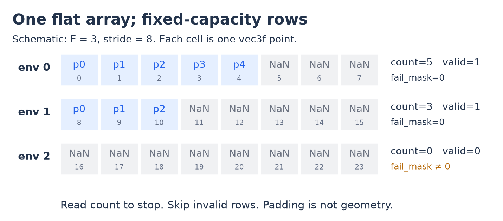
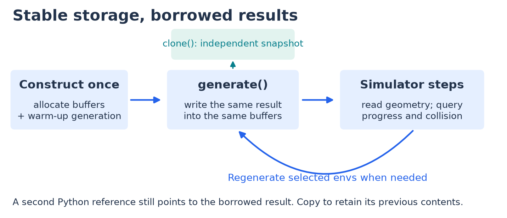

.. _results:

Read the generated data
=======================

A result is a set of fixed-capacity Warp arrays plus metadata. A ``Track`` describes a
road; a ``GateSequence`` describes ordered gates; a ``Centerline`` describes a route
without road borders. Read **validity first, then the real count, then geometry**.

   Schematic storage: env ``e`` starts at ``e * stride``. The first ``count[e]`` slots
   are real; capacity is not the number of points you should consume.

Read one batch
--------------

.. code-block:: python

   import numpy as np
   from track_gen import TrackGenerator
   from track_gen.pipeline import presets

   E = 8
   gen = TrackGenerator(presets.track(num_envs=E, device="cuda:0"), seeds=42)
   track = gen.generate()
   xyz = track.center.numpy().reshape(E, gen.n_max, 3)
   valid = track.valid.numpy() != 0
   count = track.count.numpy()
   loops = [xyz[e, :count[e]] for e in np.flatnonzero(valid)]

.. snippet: after

   assert valid.any()
   assert all(len(loop) >= 3 and np.isfinite(loop).all() for loop in loops)

``.numpy()`` copies to the host and waits for the device. Use it for inspection/export;
inside a captured simulator step, read Warp arrays directly from your kernels.
``wp.to_torch`` provides device views when torch integration is needed
(:doc:`/tutorials/batch-of-tracks`).

.. list-table:: What to read
   :header-rows: 1
   :widths: 24 40 36

   * - Result
     - Per-point fields, flat ``[E * stride]``
     - Per-environment fields, ``[E]``
   * - ``Track``
     - ``center``, ``outer``, ``inner``, ``tangent``, ``normal``, ``arclen``, ``half_width``
     - ``count``, ``valid``, ``length``, ``winding``, ``generation``, ``fail_mask``, ``truncated``
   * - ``GateSequence``
     - ``position``, ``orientation``, ``tangent``, ``forward``, ``left``, ``right``, ``half_size``
     - ``count``, ``valid``, ``generation``, ``fail_mask``
   * - ``Centerline``
     - Route points, frames and arclength
     - Count, validity and length; see :ref:`results-protocols` for capabilities

The coordinate dimension is part of each Warp element: a flat ``vec3f`` field becomes
``[E, stride, 3]`` in NumPy. Gate quaternions become ``[E, stride, 4]`` in **x, y, z, w**
order. ``Track`` stride is ``gen.n_max``; gate stride is ``gen.max_gates``.

Keep what you need
------------------

   ``generate()`` returns the same object and storage each time. Stable addresses make
   graph capture possible, but a retained Python reference is not a snapshot.

.. code-block:: python

   retained = track.clone()          # cold-path allocation and copy
   track = gen.generate(advance=True)
   # retained keeps its previous geometry; track now contains the new batch.

Use ``view(e0, e1)`` for a zero-copy range of environments. For an allocation-free device
snapshot, allocate once with ``Track.alloc(track.layout)`` and call
``copy_from(track)`` when needed. Exact copying, aliasing, stream and ``out=`` rules are
in :ref:`results-views` and :ref:`results-out`.

Handle failed environments
---------------------------

An environment is valid when its configured checks pass; this is a generation decision,
separate from runtime agent collision. Failed environments stay at their indices and do
not affect their neighbors. With the default ``on_invalid="poison"``, they have
``count=0`` and NaN geometry, while ``fail_mask`` preserves the cause.

``result.fail_bits`` maps each check name to its bit position. :ref:`invalid-envs`
lists the checks, explains the optional border check and shows diagnostic
``on_invalid="keep"``. Regenerate selected failed rows with a mask
(:ref:`generating-seeds`), and gate simulator rewards/observations on validity
(:ref:`rl-valid-recipe`).

Go deeper
---------

- :ref:`result-contracts`: complete layout, schemas, padding, protocols and failure-bit tables.
- :ref:`results-validate`: validate hand-built arrays and layouts.
- :ref:`results-disjoint`: caller-owned batches, aliases and mixed outputs.
- :ref:`reference-results`: API signatures and methods.
