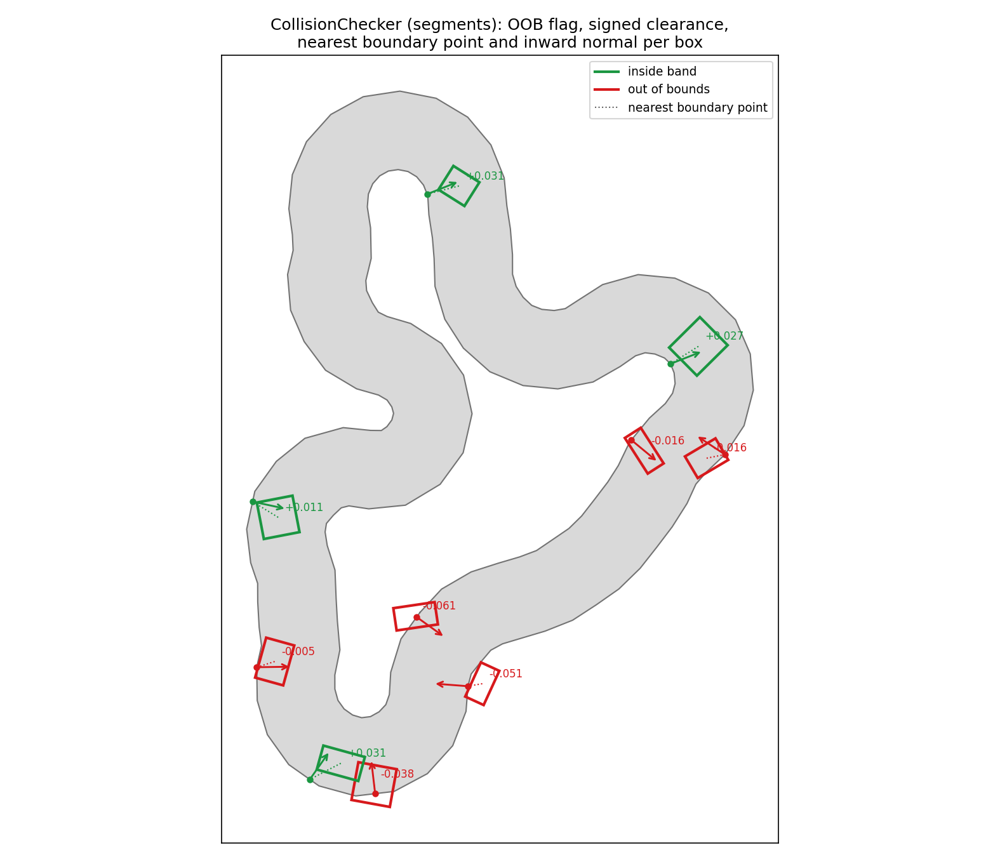
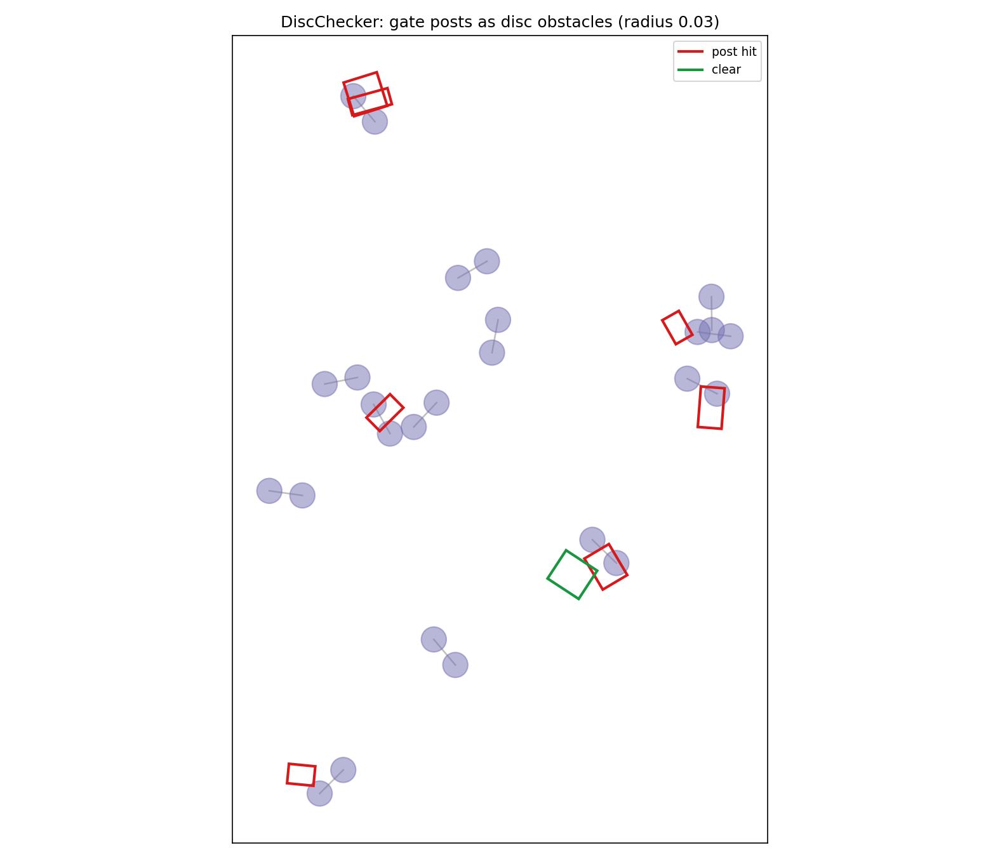

Out-of-bounds & obstacle collision
==================================

``track_gen.collision`` answers two questions every batched sim asks: *did
the agent leave the drivable band?* and *did it hit a point obstacle?*

Out-of-bounds checking
----------------------

``track_gen.collision.CollisionChecker`` answers, per oriented box, whether
it left the drivable band — with signed clearance, nearest boundary point,
and inward normal. Two backends: the exact ``segments`` scan (default; no
precompute, reads regenerated tracks automatically) and baked ``sdf`` grids
(cheap queries after a per-regeneration ``bake()``; distances accurate to
about one grid cell). See Performance below for measured numbers; the rule
of thumb: ``segments`` unless a track batch serves hundreds of queries
between regenerations.

         bounds, each with its signed clearance, nearest boundary point,
         and inward normal drawn.

   The full per-box contact report: OOB flag (color), signed clearance
   (label), nearest boundary point (dotted) and inward normal (arrow).

``CollisionChecker(track, ...)`` takes any ``HasBand`` source (a ``Track``, a
``track.view(e0, e1)``, or an object with ``center``, ``outer``, ``inner``, ``count``
and ``valid``) and checks the members it reads, ``center``, ``outer``, ``inner`` and
``count``, plus ``valid`` when present, at construction (:ref:`utilities-sources`). A
``Centerline`` has no band and is refused with a ``TypeError``. ``checker.method`` reads
the backend (``"segments"`` or ``"sdf"``), and ``checker.result`` the ``BoxContact``
every ``query()`` returns.

**Invalid envs.** Since 0.2.0.dev6 an env with ``valid[e] == 0`` reads like an env with no
track, with both backends: every active box gets ``oob = 1``, NaN ``distance`` /
``nearest`` / ``normal`` and ``boundary = -1`` (it used to get the answer on the failed
geometry). The SDF bake writes NaN texels and a ``(-1, -1)``-``(1, 1)`` box for it, whose
queries reach the same answer. Inactive box slots (a NaN position) keep ``oob = 0``.
An RL loop that penalises ``oob`` or ends episodes on it must gate on ``valid``
(:ref:`utilities-invalid-envs`).

What the ``sdf`` query computes
~~~~~~~~~~~~~~~~~~~~~~~~~~~~~~~

``bake()`` stores, per env, the signed distance to the band boundary at the
texel centres of an ``R × R`` grid (``R = sdf_resolution``; positive on the
road). A query reads the grid through bilinear interpolation, clamped to the
edge texels, and reports the minimum of that interpolated field over the box
**outline** and its centre:

- Inside one grid cell the field along a box side is a quadratic, so the
  query splits each side at the grid lines it crosses (at most ``2R + 1``
  pieces) and minimises every piece in closed form. The result is the exact
  minimum of the interpolated field on the outline, not a sampled one.
- ``distance`` is that minimum and ``oob = 1`` exactly when it is negative.
  An edge that crosses a box side between four on-road corners, typically
  the inner edge of a tight bend, therefore reads OOB, with ``distance``
  close to minus the intrusion depth.
- ``nearest`` and ``normal`` are taken at the point where the minimum is
  reached: ``normal`` is the normalised central-difference gradient of the
  field there (one cell each way), ``nearest`` is that point moved by
  ``-distance`` along it, and ``boundary`` is the baked boundary id at
  ``nearest``.
- Past the grid edge the field clamps to the edge texels, which are
  negative, so a box reaching beyond the grid reads OOB; its ``distance`` is
  the edge texel's, not the true depth.
- A box whose corners are not finite (NaN or inf half-extents, yaw or
  position, or corners that overflow float32) reads ``oob = 1`` with NaN
  ``distance``, ``nearest`` and ``normal`` and ``boundary = -1``, like an
  env with a degenerate track; the grid is not read.

The query is only as good as the grid: a feature narrower than about one
cell (a strip of off-road between two parts of the track, a sharp corner)
can vanish from the interpolated field, and a boundary loop lying entirely
inside a box, away from its outline and centre, is not seen.

.. _collision-resolution-check:

Grid resolution and course size
~~~~~~~~~~~~~~~~~~~~~~~~~~~~~~~

The grid covers each env's own bounding box, so a larger course (a per-env ``size``,
:ref:`tuning-size`) gets larger cells while the road keeps its width: with ``bezier`` at
``R = 128``, 12.3 / 6.7 / 4.5 cells across the road at size 1 / 2 / 3, and OOB flags
agreeing with ``segments`` on 99.93 / 99.80 / 99.68 % of the boxes. Under a size
curriculum, accuracy therefore varies per env with the difficulty. Keep
``sdf_resolution >= R_ref * size_hi`` (``R_ref`` the resolution accurate enough at size
1; the memory grows as ``size_hi^2``: the ~670 MB of 128² grids at ``E = 8192`` become
~6 GB at ``size_hi = 3``), or use ``segments``, which is exact at every size.

The components check it for you: ``tools.BandCollision(method="sdf", size_hi=...)`` and
``tools.HeightFieldBake(resolution, size_hi=...)`` emit a ``UserWarning`` at ``attach``
when ``resolution < ceil(reference_resolution * size_hi)`` (``reference_resolution``
defaults to 128, the resolution the accuracy figures here were measured at), naming the
resolution that keeps the accuracy and its memory. To accept a coarser grid on purpose,
pass a lower ``reference_resolution``; ``size_hi <= 1`` and ``method="segments"`` never
warn. ``Course`` declares no ``size_hi`` in 0.2.0.dev6.

Performance
-----------

Measured with ``benchmarks/benchmark_collision.py`` on an RTX 5090
(warp-lang 1.18, E = 8192 generated tracks × 8 boxes = 65,536 box queries
per call, default ``TrackGenConfig``; graph replay is GPU time from events):

.. list-table::
   :header-rows: 1
   :widths: 22 20 20 38

   * - backend
     - eager / query
     - graph replay / query
     - precompute per regeneration
   * - ``segments`` (exact)
     - ~0.34 ms
     - ~0.28 ms
     - none
   * - ``sdf`` (128² grids)
     - ~0.045 ms
     - ~0.041 ms
     - ~45 ms ``bake()`` + ~670 MB

Accuracy of ``sdf`` against the exact backend on the same workload (median
cell 16 mm): the signed-distance error is 0.22 mm on average (p99 4.4 mm,
about 0.3 cells); OOB flags agree on 99.91% of boxes. SDF normals are noisy
near the middle of the band (medial axis) and at sharp features — prefer
``segments`` when normals or nearest points drive a contact response.

The racing near-edge mode (``--racing``) places a 0.46 × 0.34 m car box
near the edges of bezier tracks at ``scale=17`` with a 1 m road, on 256²
grids (cells about 120 mm). There, one ``sdf`` query takes ~23 µs per graph
replay for 4096 worlds × 1 box and ~45 µs for 4096 × 16 (``segments``:
~0.85 ms). On 100 worlds × 1024 boxes its OOB flags agree with the exact
backend on 99.949% of boxes: 32 misses (at most 22 mm deep) and 20 false
positives (at most 5 mm from the edge). The query returns the exact
outline minimum of the interpolated field on every one of them; they come
from the grid's resolution.

Rule of thumb: ``segments`` is the default — exact, no memory, no rebake,
and already ~5 ns per box. Switch to ``sdf`` when a track batch serves more
than roughly 200 queries between regenerations and only the OOB flag and
approximate clearance are consumed (e.g. RL reward shaping).

Reproduce::

   python -m benchmarks.benchmark_collision --E 8192
   python -m benchmarks.benchmark_collision --racing
   python -m benchmarks.benchmark_collision --racing --E 100 --B 1024 --no-timing

Disc obstacles (gate posts, cones)
----------------------------------

``track_gen.collision.DiscChecker`` checks oriented boxes against disc
obstacles. Gate posts are two lines of code:

.. code-block:: python

   import numpy as np, warp as wp
   from track_gen.collision import DiscChecker

   dev = seq.left.device                       # bind posts on the same device
   posts = np.empty((E, 2 * G, 3), np.float32)
   posts[:, 0::2] = seq.left.numpy().reshape(E, G, 3)
   posts[:, 1::2] = seq.right.numpy().reshape(E, G, 3)
   checker = DiscChecker(wp.array(posts.reshape(-1, 3), dtype=wp.vec3f,
                                  device=dev),
                         radius=0.03, max_boxes=1, num_envs=E)

NaN padding in the gate arrays carries over and NaN discs are skipped, so no
per-env count bookkeeping is needed. ``DiscChecker`` takes raw disc arrays, not a result
object, so no source check or topology applies to it. A hit reports the deepest disc; for
interleaved posts, ``gate = disc // 2``.

Two optional per-env arrays narrow the scan: ``count=`` (``[E]`` int32, the real discs
of each env: only those are scanned) and, since 0.2.0.dev6, ``valid=`` (``[E]`` int32,
checked at construction and read in place): an env with ``valid[e] == 0`` reports no hit
(``hit = 0``, ``disc = -1``, ``depth = 0``, NaN ``nearest``). For gate posts pass the
sequence's ``valid`` (and ``2 * count``, as a ``Course`` does).

``posts`` is a host-side snapshot taken via ``.numpy()`` — it does NOT alias
``seq.left``/``seq.right``, so a later regeneration is invisible to it;
rebuild ``posts`` (repeat this recipe) after every ``generate()``. The
``Course`` facade's built-in ``post_radius`` option does this rebuild
device-side, automatically, on every ``generate()``, and so does the
``tools.DiscCollision(radius)`` component in its posts mode (it reads the gates, builds
the posts and their count on device in ``on_generate``, and passes the gates' ``valid``).

   Gate posts as discs; the same checker makes cones physical.

API: :class:`track_gen.collision.CollisionChecker`,
:class:`track_gen.collision.DiscChecker` — see the
:doc:`API reference </reference/api>`.
