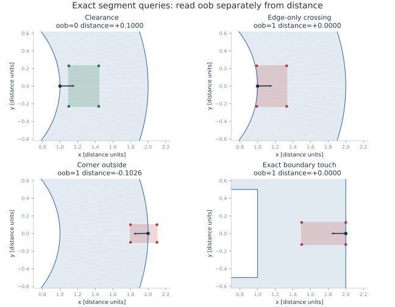
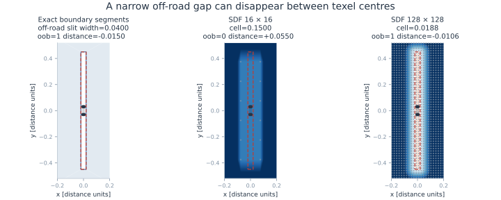
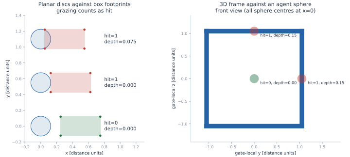

.. _collision-backends:

Collision for a simulator
=========================

Choose the geometry you want to test: a road uses a planar vehicle footprint, posts
use planar discs, and 3D gate frames use a sphere around the agent. These queries report
runtime contact; :ref:`generation validity <geometry-validity>` decides whether a course
was accepted before an episode starts.

         an outside corner and an exact boundary touch. Crossing and touching can
         report out of bounds with zero clearance.

   Synthetic road fixtures; labels are actual ``CollisionChecker(method="segments")``
   results. Black dots and arrows mark the reported boundary point and inward normal.
   In the edge-only example every box corner is on the road, but the middle of a side
   crosses the inner boundary. ``oob`` still catches it.

Choose a query
--------------

.. list-table::
   :header-rows: 1
   :widths: 25 35 40

   * - Geometry
     - Standalone utility
     - Course component
   * - Road, exact segment test
     - ``CollisionChecker(track, max_boxes, method="segments")``
     - ``tools.BandCollision("segments")``; ``Course.track(..., collision="segments")``
   * - Road, baked distance grid
     - ``CollisionChecker(track, max_boxes, method="sdf", sdf_resolution=128)``
     - ``tools.BandCollision("sdf")``; ``collision="sdf"``
   * - Posts or cones
     - ``DiscChecker(discs, radius, max_boxes, num_envs=E)``
     - ``tools.DiscCollision(radius)``; a numeric gates-course ``collision=radius``
   * - 3D square gate frame
     - Built by the component
     - ``tools.FrameCollision(radius, frame_thickness, frame_depth)``

The road and disc queries project position to XY and extract yaw from orientation.
They ignore altitude separation, including on elevated roads. A bridge needs a collision
model in the simulator that distinguishes its levels. Frame collision uses the complete
gate orientation and the agent's 3D position.

Query a road
------------

.. code-block:: python

   import warp as wp
   from track_gen import TrackGenConfig, TrackGenerator
   from track_gen.collision import CollisionChecker

   E, device = 4, "cuda:0"                  # "cpu" also works
   gen = TrackGenerator(TrackGenConfig(num_envs=E, device=device), seeds=42)
   track = gen.generate()
   checker = CollisionChecker(track, max_boxes=1)
   position = wp.zeros(E, dtype=wp.vec3f, device=device)
   orientation = wp.full(E, wp.quat_identity(), dtype=wp.quatf, device=device)
   half_extents = wp.full(E, wp.vec2f(0.02, 0.01), dtype=wp.vec2f, device=device)
   contact = checker.query(position, orientation, half_extents)
   usable = track.valid.numpy() != 0
   oob = contact.oob.numpy() != 0
   terminate = usable & oob

.. snippet: after

   assert contact.oob.shape == (E,)
   assert contact.nearest.shape == (E,)
   assert terminate.shape == (E,)

``position``, ``orientation`` and planar ``half_extents`` have ``E*max_boxes`` slots,
ordered by environment then box. A NaN position marks an inactive slot: ``oob=0``, NaN
geometry and ``boundary=-1``. Bind stable buffers once with ``bind_inputs(...)`` and
call ``query()`` without arguments when recording a graph; write new poses in place.
The preallocated ``checker.result`` is overwritten by each query; use ``clone()`` to
retain it. See :ref:`utilities-sources` for custom ``HasBand`` sources and
:ref:`reference-runtime` for stream and ``ctx`` arguments.

An invalid environment reports ``oob=1`` with NaN ``distance``, ``nearest`` and ``normal``
and ``boundary=-1`` for active boxes, including when failed rows were retained with
``on_invalid="keep"``. Gate episode decisions on ``valid``
(:ref:`utilities-invalid-envs`, :ref:`rl-valid-recipe`).

.. _collision-accuracy:

What the contact numbers mean
------------------------------

``segments`` scans the actual polygonal borders. The out-of-bounds predicate combines
corner containment with inclusive segment-versus-solid-box contact. A segment that
only touches a box counts as contact, and a boundary loop entirely enclosed by a box
is also detected. This is exact for the supplied polygonal road model, subject to
float32 arithmetic; it does not certify that the road itself is a valid band.

Read ``oob`` separately from ``distance``:

- A clear box gets positive minimum box-to-boundary clearance.
- A box with off-road corners gets negative deepest **corner** distance to a boundary.
- An edge-only crossing, or a touch with no off-road corner, can get ``distance=0.0`` (possibly signed zero)
  and ``oob=1``. That distance is not physical penetration depth.
- ``nearest`` is the boundary point selected by the box-to-segment search. ``normal``
  is its segment normal oriented toward the aligned centerline. These outputs need
  not describe the deepest outside corner.

``boundary`` is ``0`` for inner and ``1`` for outer. At equal-distance ties, sharp
corners and the middle of a band, nearest points and normals can switch abruptly.

SDF: exact minimisation of an approximate field
~~~~~~~~~~~~~~~~~~~~~~~~~~~~~~~~~~~~~~~~~~~~~~~

``bake()`` stores signed distance at texel centres in an ``R*R`` grid per environment,
positive on the road. Call it after every regeneration; a course does that automatically.
The query finds the minimum of the **bilinearly interpolated field** over the box's
outline and centre. Each side is split at grid lines and the resulting quadratic pieces
are minimised in closed form. This sees intrusions between corners, without sampling
only a fixed set of points on a side.

``distance`` is that field minimum and ``oob == (distance < 0)``. This strict comparison
and grid approximation can disagree with the exact backend at a boundary touch.
A small boundary loop contained in the box, away from both its outline and centre,
can be missed. Outside the grid the field clamps to the edge texels: the distance is
then the edge value, not the true distance from a distant box.

``normal`` is a normalised central-difference gradient at the field's minimising point;
``nearest`` is that point minus ``distance*normal``. The boundary id is read near that
estimated point. These are approximations, especially near corners, small features and
the medial axis; use segment contacts when boundary geometry drives a response.

.. _collision-resolution-check:

Grid resolution and narrow gaps
~~~~~~~~~~~~~~~~~~~~~~~~~~~~~~~

         grid misses it; a 128-square grid detects it. Labels give queried distance
         and cell size.

   The same synthetic band and footprint at two resolutions. Dashed red is the actual
   inner boundary. The colour field is interpolated from actual baked texels; white
   contours show its zero level. A feature that no texel centre resolves can disappear.
   Query values and grid bounds are in the
   :download:`manifest <../assets/racing/geometry-manifest.json>`.

Cells span each environment's own bounding box plus padding. Larger courses at fixed
resolution have larger cells; road width need not increase with ``size``. Check flags,
clearances and normals on your own near-boundary workload across the full size range.
There is no universal resolution that preserves every narrow feature.

``sdf_resolution`` is static, at least 8 and defaults to 128. ``sdf_padding=None`` adds
10% of the largest XY extent per side; a positive value selects fixed distance-unit
padding. ``tools.BandCollision("sdf", size_hi="auto")`` checks construction-time size
bounds and warns when ``resolution < ceil(reference_resolution*size_hi)``
(``reference_resolution=128``). This is a sizing heuristic, not an accuracy guarantee.
It does not run again when a curriculum later expands its bounds; pass its final
``size_hi`` explicitly (:ref:`tuning-size-utilities`).

.. _collision-cost:

Query and bake cost
-------------------

An exact query scans both borders for each box. An SDF query visits cells crossed by
its outline, and every regeneration also needs a bake. SDF grids require approximately
``E*R**2*5`` bytes (float32 distance plus int8 boundary id), excluding bounds and contact
buffers. Measure your actual shape/count/query workload. With warmed costs ``t_seg``,
``t_sdf`` and ``t_bake``, a positive query-time saving amortises a bake after
``N_queries > t_bake/(t_seg-t_sdf)`` calls. More resolution increases memory and bake
work, and long box sides can cross more cells.

Discs and gate frames
---------------------

         penetrating hit. A front view of a 3D gate shows a clear opening and hits
         against a post and bar, with actual depths.

   Different collision models: a disc is tested against a planar solid box; a gate
   frame consists of four oriented 3D boxes tested against an agent sphere. Coordinates
   and depths share the same arbitrary distance unit.

.. snippet: group=discs

.. code-block:: python

   import warp as wp
   from track_gen.collision import DiscChecker

   device = "cuda:0"
   discs = wp.array([[0.0, 0.0, 0.0]], dtype=wp.vec3f, device=device)
   checker = DiscChecker(discs, radius=0.125, max_boxes=1, num_envs=1)
   position = wp.array([[0.3, 0.0, 0.0]], dtype=wp.vec3f, device=device)
   orientation = wp.full(1, wp.quat_identity(), dtype=wp.quatf, device=device)
   half_extents = wp.full(1, wp.vec2f(0.25, 0.12), dtype=wp.vec2f, device=device)
   contact = checker.query(position, orientation, half_extents)
   assert contact.hit.numpy()[0] == 1

Discs count grazing contact (``distance <= radius``); ``depth`` is nonnegative and zero
on a graze or no hit. The returned ``disc`` is the deepest hit's index, or ``-1``.
NaN disc positions are skipped. Optional per-env ``count`` and ``valid`` arrays narrow
the scan; invalid environments report no hit. Pass gate validity when constructing
posts yourself. A host ``.numpy()`` copy of posts must be rebuilt after regeneration;
``tools.DiscCollision(radius)`` rebuilds posts and ``2*count`` on device for you.

``tools.FrameCollision(radius, frame_thickness, frame_depth, window=4)`` uses square
gate openings from ``half_size`` and the full ``orientation``, including supplied roll.
Thickness and depth are full bar dimensions, in distance units; all three geometric
arguments must be positive. The agent is a sphere. The checker scans a fixed window
starting one gate before ``next_checkpoint``; it does not scan every gate in the course.
A frame hit requires strict penetration, with ``depth`` the maximum sphere-versus-bar
penetration across the window. Invalid environments report no hit. This is separate
from route crossings and gate-order validity.

``window`` is a static integer >= 1. Discs likewise require a positive shared radius;
``max_boxes`` sets a positive fixed query capacity rather than changing obstacle size.

API: :class:`track_gen.collision.CollisionChecker`,
:class:`track_gen.collision.DiscChecker`, :class:`track_gen.tools.BandCollision`,
:class:`track_gen.tools.DiscCollision`, :class:`track_gen.tools.FrameCollision`.
