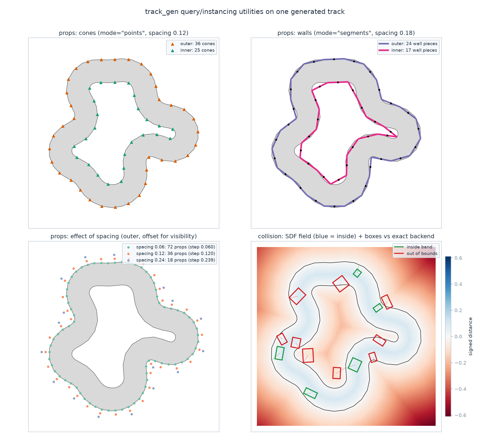

Runtime utilities
=================

Beyond generating tracks and gates, ``track_gen`` ships a family of
GPU-batched runtime utilities for the sim loop:

- :doc:`Out-of-bounds & obstacle collision </utilities/collision>` —
  oriented boxes vs the drivable band (exact or SDF backends) and vs disc
  obstacles such as gate posts.
- :doc:`Boundary props </utilities/props>` — cone lines and wall pieces
  along the boundaries, for rendering-only instancing.
- :doc:`Checkpoints & progress </utilities/progress>` — ordered course
  goals from gate sequences or subsampled track centerlines, with pass/lap
  events and reward-ready distances.
- :doc:`Track-frame localization </utilities/localize>` — arc-length ``s``
  and signed lateral offset ``n`` per env, plus centerline curvature and
  curvature-limited speed profiles.
- :doc:`The Course facade </utilities/course>` — one object bundling
  generation, collision, and progress per mode.

   Cones and walls placed by ``track_gen.props``, the effect of spacing,
   and ``track_gen.collision``'s SDF field with boxes classified by the
   exact backend.

Family conventions
------------------

Every utility follows the same contracts, so learning one teaches all:

- **Flat batched layouts** — arrays are flat ``[E * stride]`` Warp arrays,
  NaN-padded past each env's real count.
- **Preallocated in-place results** — per-step methods return the SAME
  result object every call, overwritten in place; call ``clone()`` for a
  snapshot.
- **Eager, NaN-proof validation** — shapes, dtypes, and devices are checked
  when you construct or bind, never in the hot path: the members of the source a
  utility reads, and the arrays you bind (see `What a utility reads`_).
- **Any source with the right members** — a utility takes a ``Track``, a
  ``GateSequence``, a ``Centerline``, an env-slice ``view()`` of one, or your own
  object with the members it reads (the capability protocols of
  :ref:`results-protocols`).
- **Input binding** — latch a tool onto your sim's stable pose buffers once
  (constructor kwargs or ``bind``/``bind_inputs``) and call
  ``update()``/``query()`` with no arguments thereafter.
- **Invalid envs read like poisoned ones** — for an env whose result has
  ``valid[e] == 0``, every utility writes what it writes for an env with no track: NaN
  geometry, no hit, ``oob = 1``, frozen progress (see `Invalid envs`_). Gate rewards and
  observations on ``valid``.
- **One launch context** — every hot method (``query``, ``update``, ``reset``,
  ``sample``, ``bake``, ``refresh``) takes ``stream=`` or a keyword-only ``ctx=``
  (a :class:`~track_gen.exec.LaunchContext` on the utility's device; both together raise
  ``TypeError``, another device ``ValueError``), and launches only there.
- **A stable result** — ``utility.result`` (read-only) is the preallocated result
  instance the hot method returns: ``BoxContact``, ``DiscContact``, ``FrameContact``,
  ``ProgressEvents``, ``TrackFrame``, ``CheckpointSet``, ``PropSet`` or ``HeightField``.
- **Components** — each utility has an adapter in ``track_gen.tools`` with one lifecycle
  (``attach``, ``bind``, ``on_generate``, ``step``, ``reset``), which ``Course`` drives
  (see `Components`_ and :doc:`/contributing/writing-a-component`).

.. _utilities-sources:

What a utility reads
--------------------

Each utility names the capability it needs as a protocol of ``track_gen.results``
(:ref:`results-protocols`) and, at construction, checks exactly the members it reads,
through :func:`~track_gen.results.check_source`: each must exist, be a contiguous 1-D
array of its schema dtype, ``[E * stride]`` per point or ``[E]`` per env, on one device.
The layout comes from the source's ``layout`` when it is a ``Layout``, else is inferred
from ``count`` and the first per-point member (an unrelated ``layout`` attribute of your
own object is ignored). Members the utility does not read are never looked at, so a
``Track`` with a placeholder ``winding`` works with a ``CollisionChecker``.

**The arrays are bound at construction.** A utility reads each member it checked once,
when it is built, and passes those arrays (stable pointers) to every call, eager or
recorded in your graph: reassigning a member of the source afterwards (or a proxy that
would compute a new array on each access) changes nothing, and nothing unchecked ever
reaches a kernel. Write new data INTO the source's arrays (a generator does), or build a
new utility for new arrays.

.. list-table::
   :header-rows: 1
   :widths: 26 14 36 24

   * - Utility
     - Protocol
     - Members checked (= read)
     - Optional reads (checked when present)
   * - ``CollisionChecker`` (both methods)
     - ``HasBand``
     - ``center``, ``outer``, ``inner``, ``count``
     - ``valid``
   * - ``PropSampler``
     - ``HasBand``
     - ``outer``, ``inner``, ``count``, ``valid``
     -
   * - ``CheckpointSampler``
     - ``HasBand``
     - ``center``, ``inner``, ``outer``, ``count``, ``valid``
     - ``generation``
   * - ``HeightFieldBaker``
     - ``HasBand``
     - ``outer``, ``center``, ``count``, ``valid``
     -
   * - ``TrackLocalizer``
     - ``HasCenterline``
     - ``center``, ``arclen``, ``length``, ``count``
     - ``valid``, ``generation``
   * - ``localize.curvature``
     - ``HasCenterline``
     - ``center``, ``count``
     - ``valid``
   * - ``localize.speed_profile``
     - ``HasCenterline``
     - ``center``, ``count``, ``arclen``, ``length``
     - ``valid``
   * - ``CheckpointSet.from_gates``
     - ``HasGateFrames``
     - ``position``, ``left``, ``right``, ``forward``, ``half_size``, ``count``
     - ``valid``, ``generation``
   * - ``CourseLine`` (internal to a gates-mode ``Course`` in 0.x)
     - ``HasGates``
     - ``position``, ``count``, ``valid``
     - ``generation``
   * - ``FrameChecker`` (internal to a gates-mode ``Course`` in 0.x)
     - ``HasGateFrames``
     - ``position``, ``orientation``, ``half_size``, ``count``, ``valid`` (its
       ``num_envs`` argument must equal the source's)
     -
   * - ``ProgressTracker``
     - ``HasCheckpoints``
     - a ``CheckpointSet``: ``position``, ``left``, ``right``, ``tangent``,
       ``up_half``, ``count``, with its own checks and messages, as before (a missing
       member raises ``AttributeError``, a malformed one an unprefixed ``ValueError``);
       ``tools.Progress`` checks them as below, at ``cc.add``
     - the set's ``valid``, ``generation`` (as below)
   * - ``DiscChecker``
     - none
     - raw disc arrays, checked as before
     - ``valid=`` (``[E]`` int32), when given

A source that lacks a member raises ``TypeError`` naming it, and a member of the wrong
shape, dtype or device ``ValueError``, prefixed by the utility (``ProgressTracker``'s
required members excepted, above):

.. code-block:: text

   TypeError: CollisionChecker needs a HasBand source (center, outer, inner, count;
     optional: valid): Centerline has no 'outer', 'inner'
   ValueError: CollisionChecker: Track.inner: expected a contiguous [3072] vec3f
     ([E*stride] = [8*384]) array on cpu, got shape (3064,) vec3f on cpu

These replace the earlier ``track batch layout invalid`` errors, which inferred the
stride from one field and could miss a mismatched one.

**Optional reads** are checked with the same rules and messages when the member is there
(so a malformed ``valid`` or ``generation`` raises at construction since 0.2.0.dev6; it
used to be ignored) and replaced by a fallback when it is ``None`` or missing: no
``valid`` means every env is valid, no ``generation`` means the utility never resets on
its own (`After regenerating`_). A ``Track``, ``GateSequence`` and ``Centerline`` from a
generator or a ``Course`` always carry both. A ``Centerline`` (for example
``course.course_line.centerline`` in gates mode) works with ``TrackLocalizer``,
``curvature`` and ``speed_profile``; the band utilities refuse it with the ``TypeError``
above.

**Views.** A utility built on ``track.view(e0, e1)`` reads that env range exactly as it
would read an owned copy of the same rows, and a utility built on a mixed batch's shared
result reads every env (:ref:`results-mixed-batches`).

**Topology.** Every utility that reads a result supports closed loops only (its
``topology`` class attribute is ``"closed"``) and refuses a source whose
``layout.closed`` is ``False`` (:ref:`results-topology`). ``DiscChecker`` reads raw
disc arrays and has no topology.

.. _utilities-invalid-envs:

Invalid envs
------------

A generator marks an env invalid (``valid[e] == 0``) when its course failed a check
(turning, thickness, truncation, ...; ``fail_mask`` says which). Since 0.2.0.dev6 one
rule holds for every utility: **an invalid env reads exactly like a poisoned one**, i.e.
like an env with ``count = 0`` and NaN geometry, whatever the generator's ``on_invalid``
(``Course`` and ``TrackGenConfig`` run on ``"keep"``, which keeps the failed geometry):

.. list-table::
   :header-rows: 1
   :widths: 28 46 26

   * - Utility
     - An invalid env reads
     - Before 0.2.0.dev6 (``on_invalid="keep"``)
   * - ``CollisionChecker`` (``segments``, ``sdf``)
     - ``oob = 1``, NaN ``distance`` / ``nearest`` / ``normal``, ``boundary = -1``;
       the SDF bake writes NaN and a ``(-1, -1)``-``(1, 1)`` box for the env
     - the answer on the invalid geometry
   * - ``DiscChecker`` (given ``valid=``; a ``Course``'s posts always)
     - ``hit = 0``, ``disc = -1``, ``depth = 0``, NaN ``nearest``
     - hits on the invalid gates' posts
   * - ``FrameChecker``
     - ``hit = 0``, ``depth = 0``
     - the same
   * - ``ProgressTracker``
     - frozen: ``next_checkpoint`` / ``laps`` / ``progress`` keep their values,
       ``passed = 0``, ``checkpoint_passed = -1``, ``wrong_way = 0``,
       ``wrong_checkpoint = -1``, ``dist_to_next = 0``; the previous position is
       re-armed (NaN), so no crossing is ever emitted against it
     - tracking on the invalid course
   * - ``TrackLocalizer``
     - NaN ``s`` / ``n`` / ``n_up``, ``segment = -1``, warm memory dropped
     - the projection on the invalid centerline
   * - ``CheckpointSampler``, ``PropSampler``
     - ``count = 0``, NaN slots, ``step`` NaN, ``truncated = 0``; the
       ``CheckpointSet``'s ``valid[e] = 0``
     - the invalid track's ring
   * - ``HeightFieldBaker``
     - NaN heights, ``lo = (-1, -1)``, ``hi = (1, 1)``
     - NaN heights, the real box
   * - ``CheckpointSet.from_gates``
     - a view: the gates' rows and count, ``valid`` (an alias) ``0``
     - the same
   * - ``CourseLine``
     - ``count = 0``, ``valid = 0``, NaN
     - the same
   * - ``curvature`` / ``speed_profile``
     - NaN rows
     - values

Inactive box slots (a NaN box position) keep their own answer (``oob = 0`` / ``hit = 0``),
checked before the env's validity.

``valid`` is the only invalid-env signal. ``ProgressEvents.dist_to_next`` is ``0`` for an
invalid env and NaN for a VALID env with no checkpoints (a hand-built ``CheckpointSet``
without ``valid``): code that detected an invalid env through ``isnan(dist_to_next)`` must
read ``valid`` instead.

**In an RL loop**, an invalid env is a dead env: ``oob`` is ``1`` and progress is frozen at
every step, and a respawn on the same course (``reset(mask)``) keeps it so. Gate rewards
and observations on ``valid`` with a **select** (``wp.where(valid[e] != 0, x, 0.0)``,
``torch.where``, ``np.where``), never a multiply (``NaN * 0`` is NaN, and one NaN env makes
a batch mean NaN), mark the env done (``done |= 1 - valid``), and give it a NEW course with
``regenerate(mask=done, advance=True)``. :doc:`/utilities/course` shows the loop.

CUDA graphs
-----------

All utilities preallocate their state and results once (stable pointers) and
never allocate in the hot path. Per-step inputs can be BOUND once instead of
passed per call — ``ProgressTracker(cps, position=buf)``,
``DiscChecker(..., position=..., orientation=..., half_extents=...)``, and
``CollisionChecker.bind_inputs(...)`` — after which ``update()``/``query()``
take no arguments and read the buffers in place. Under graph capture this is
the intended pattern: the sim writes its stable pose buffers, then replays
the captured update. (Per-call mode also works under capture, but the SAME
arrays must be passed at capture and every replay.)

No utility host-synchronizes or reads device data back in
``query()``/``update()``/``reset()``/``sample()``/``bake()``/``refresh()``:
each call only enqueues kernels on its stream (``ctx=``, else ``stream=``, else the
resolved stream: an enclosing ``LaunchContext.scope()``, torch's capture stream, Warp's
current stream). They therefore record into YOUR OWN CUDA graph as-is, with no flag to
set (the former ``track_gen.set_capturing`` is a deprecated no-op).
``localize.curvature`` and ``localize.speed_profile`` allocate their result unless you
pass ``out=`` (:doc:`/utilities/localize`); with it they record too.

**Rebinding after a capture.** A recorded graph keeps the arrays that were bound when it
was recorded. A utility that ran ``query()`` / ``update()`` while its stream (or a CPU
capture on its device) was capturing emits ``track_gen.exec.RebindAfterCaptureWarning``
(a ``UserWarning``) when a bound array is then replaced through ``bind`` /
``bind_inputs`` / ``bind_window`` (or ``Course.bind``): record the graph again after
rebinding. Rebinding the same arrays is silent. The warning fires once on that recipe
too; filter it (``warnings.simplefilter("ignore", RebindAfterCaptureWarning)``) when you
re-record on purpose.

Because the calls no longer block the host, results are ordered by the stream,
not by the call returning. Reading them with ``.numpy()``, from later Warp
launches, or from torch on its default stream is safe as before. A consumer on
a DIFFERENT stream (for example a torch side stream) must order itself
explicitly, e.g. with ``wp.synchronize_device()`` or a recorded ``wp.Event``.
Set ``TRACKGEN_DEBUG_SYNC=1`` to make every library call block on its stream
while debugging asynchronous CUDA errors. It is skipped while the stream (or a Warp
capture on the device) is capturing; do not combine it with a foreign capture on
another stream (e.g. a default ``torch.cuda.graph``), which it cannot detect.

.. _utilities-self-reset:

After regenerating
------------------

What needs refreshing after a regeneration when you wire the tools by hand is listed
below. ``Course`` does all of it for its own sub-tools; ``TrackLocalizer`` and
``PropSampler`` instances of your own stay yours to refresh.

.. list-table::
   :header-rows: 1
   :widths: 30 70

   * - Tool
     - After a regeneration
   * - ``CollisionChecker`` (``method="segments"``)
     - Nothing — reads the current ``Track`` buffers directly.
   * - ``CollisionChecker`` (``method="sdf"``)
     - Call ``bake()``.
   * - ``PropSampler``
     - Call ``sample()``.
   * - ``CheckpointSampler``
     - Call ``sample()``.
   * - ``ProgressTracker``
     - On a sampled set: call ``reset(mask)`` (the regenerated envs), or let it reset
       itself: the first ``update()`` after ``sample()`` resets every env whose
       ``generation`` changed. On a ``from_gates`` set: the same, from the gates'
       ``generation``.
   * - ``TrackLocalizer``
     - Call ``reset(mask)``, or let it reset itself: the first ``query()`` after the
       regeneration resets the warm memory of every env whose ``generation`` changed.
       Cold-scan localizers keep no memory. Recompute any ``curvature()`` /
       ``speed_profile()`` arrays (with ``out=``, in place).
   * - ``CheckpointSet.from_gates``
     - Nothing — aliases the ``GateSequence`` buffers automatically.
   * - ``Course``
     - ``generate()`` / ``regenerate()`` refresh its sub-tools and reset their runtime
       state (all envs, or the masked ones). Reset or resample any caller-owned
       ``TrackLocalizer`` and ``PropSampler`` instances yourself.

**Self-reset.** ``ProgressTracker`` and ``TrackLocalizer`` keep a ``seen_generation``
``[E]`` per env (a copy of the source's ``generation`` taken at construction) and compare
it with the source's ``generation`` at the top of every ``update()`` / ``query()``, on
device: when an env's ``generation`` changed, they first write exactly what ``reset(mask)``
writes for it. So a self-reset gives the same bytes as an explicit reset, alone or with
one, and works inside a recorded graph with no host involvement. The tracker reads the
``generation`` of its ``CheckpointSet``, which the sampler writes at ``sample()`` together
with the ring: an ``update()`` between the regeneration and the resample does not reset
against the old ring. A source without ``generation`` (a hand-built one) never
self-resets.

``generation`` is the env's **epoch**, not a counter of new courses. It changes for the
envs an advancing regeneration (``advance=True``) advances. A regeneration without
``advance`` changes nothing; a reseed changes it only when it zeroes a non-zero epoch
(``Course.generate(seeds=)``, ``SeedState.set``), not on a bare ``rng.set_seeds_warp``;
``reset_epoch()`` followed by the same number of advances between two updates leaves it
equal. If you reseed or roll epochs back, call ``reset(mask)`` (``Course`` always does).

.. _utilities-components:

Components
----------

``track_gen.tools`` wraps each utility in a component: one lifecycle (``attach`` once,
``bind``, then the hot ``on_generate(ctx, mask)`` / ``step(ctx)`` / ``reset(ctx, mask)``),
a declared read target and declared inputs, checked when it is attached through a
``ComponentContext``. ``Course`` builds and drives its sub-tools this way, and takes your
own components next to them (:doc:`/utilities/composing-a-course`);
:doc:`/contributing/writing-a-component` shows how to write one.

.. list-table::
   :header-rows: 1
   :widths: 22 20 32 26

   * - Adapter
     - Utility
     - Reads (``requires`` / ``optional``)
     - Inputs
   * - ``BandCollision``
     - ``CollisionChecker``
     - the result: ``HasBand`` / none
     - ``box_position`` (``position`` at one box), ``orientation``, ``half_extents``
   * - ``DiscCollision``
     - ``DiscChecker``
     - posts mode: the result, ``HasGateFrames`` / none; raw mode: nothing
     - as ``BandCollision``
   * - ``FrameCollision``
     - ``FrameChecker``
     - the result: ``HasGateFrames`` / none; the progress component's ``next_checkpoint``
     - ``position``
   * - ``Props``
     - ``PropSampler``
     - the result: ``HasBand`` / none
     - none
   * - ``Checkpoints``
     - ``CheckpointSampler``
     - the result: ``HasBand`` / ``HasGeneration``
     - none
   * - ``GateCheckpoints``
     - ``CheckpointSet.from_gates``
     - the result: ``HasGateFrames`` / ``HasGeneration``
     - none
   * - ``Progress``
     - ``ProgressTracker``
     - the checkpoints component: ``HasCheckpoints`` / ``HasValidity``, ``HasGeneration``
     - ``position``
   * - ``Localizer``
     - ``TrackLocalizer``
     - the result (or a component's): ``HasCenterline`` / ``HasValidity``,
       ``HasGeneration``
     - ``position``
   * - ``HeightFieldBake``
     - ``HeightFieldBaker``
     - the result: ``HasBand`` / none
     - none
   * - ``CenterlineFromGates``
     - ``CourseLine``
     - the result: ``HasGates`` / ``HasGeneration``
     - none

``adapter.utility`` is the legacy utility (every legacy name and method stays) and
``adapter.result`` its ``.result``. The adapters ``Props`` and ``Checkpoints`` size their
rings from the producer's plan (``ComponentContext.for_producer``), with no readback: see
:doc:`/utilities/props` and :doc:`/utilities/course`.
