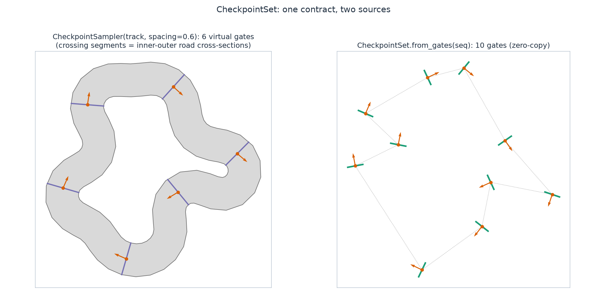
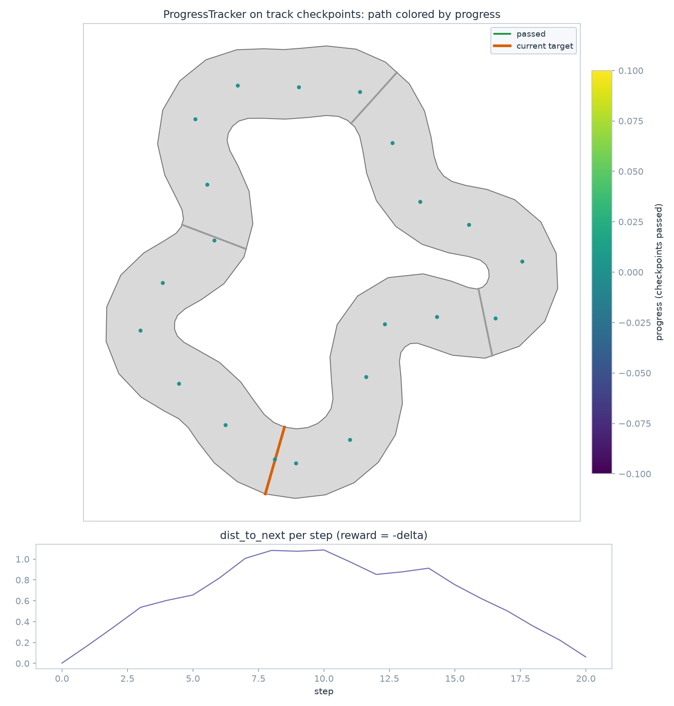

Checkpoints & progress
======================

Progress logic is identical for drone-racing gates and car-racing tracks:
discrete pass events plus a distance-to-next-goal signal. The utilities
split it into a shared goal contract and a stateful tracker.

Checkpoints: one contract, two sources
--------------------------------------

``track_gen.checkpoints.CheckpointSet`` is an ordered list of course goals
per :term:`env` — center ``position``, a physical crossing segment ``left <->
right``, and a forward ``tangent``:

.. code-block:: python

   from track_gen import GateGenerator, TrackGenerator
   from track_gen.checkpoints import CheckpointSampler, CheckpointSet
   from track_gen.pipeline import presets

   E, device = 64, "cuda:0"                     # or "cpu"
   gate_seq = GateGenerator(presets.gates(num_envs=E, device=device, gate_width=0.1)).generate()
   track = TrackGenerator(presets.track(num_envs=E, device=device)).generate()

   cps = CheckpointSet.from_gates(gate_seq)               # zero-copy gate view
   cps = CheckpointSampler(track, spacing=0.6).sample()   # virtual gates

``from_gates`` aliases the ``GateSequence`` buffers (regenerated gates are
seen automatically). ``CheckpointSampler`` subsamples the CENTERLINE at a
coarse spacing; because track polylines are index-aligned, each checkpoint's
crossing segment is the road cross-section between ``inner`` and ``outer``.

Both accept any source with the members they read, checked at construction
(:ref:`utilities-sources`): ``from_gates`` a ``HasGateFrames`` source (``position``,
``left``, ``right``, ``forward``, ``half_size``, ``count``; ``valid`` and ``generation``
when present), ``CheckpointSampler`` a ``HasBand`` one (``center``, ``inner``,
``outer``, ``count``, ``valid``; ``generation`` when present); env-slice views
(``seq.view(e0, e1)``, ``track.view(e0, e1)``) included. ``ProgressTracker`` takes any
``HasCheckpoints`` source (``position``, ``left``, ``right``, ``tangent``, ``up_half``,
``count``: a ``CheckpointSet``), and reads its ``valid`` / ``generation`` when present.

A ``CheckpointSet`` has two optional trailing fields, :term:`valid` and
:term:`generation` (``[E]`` int32; ``clone()`` copies them):

- the sampler's set **owns** them: ``sample()`` writes each env's ``valid`` and
  ``generation`` together with its ring, so ``(count, rows, valid, generation)`` always
  describe the same ring (an env of an invalid track gets ``count = 0``, NaN slots and
  ``valid = 0``);
- ``from_gates`` **aliases** the gates' arrays (the rows are the gates), or leaves them
  ``None`` for a source without them;
- a hand-built set may leave them ``None``: every env is valid and the tracker never
  resets on its own.

**Capacity.** ``CheckpointSampler(track, spacing)`` with ``max_checkpoints=None`` sizes
its ring once, at construction, from the batch it is given (``ceil(1.5 * longest valid
centerline / spacing)``, a readback). ``sampler.max_checkpoints`` reads it. The component
route needs no readback: ``tools.Checkpoints(spacing)`` attached through
``ComponentContext.for_producer(gen)`` (a :term:`component`) sizes it from the longest
track the generator can produce, which a :term:`course` does by default
(:ref:`course-checkpoint-capacity`).

   The same ``CheckpointSet`` contract from a subsampled track (left) and a
   gate sequence (right).

Progress tracking & rewards
---------------------------

``track_gen.progress.ProgressTracker`` consumes any ``CheckpointSet`` and
maintains per-env device state: previous position, next target, laps, total
progress. Each ``update()`` detects forward pass-through of the target's
crossing segment (swept-segment test), wrong-way and wrong-checkpoint
crossings, and reports ``dist_to_next`` — the distance to the next goal.
``robot_pos`` below is your sim's stable ``[E]`` position buffer, which ``sim_step``
(your physics) writes in place, and ``done_mask`` your ``[E]`` int32 mask of the envs
whose episode ended:

.. snippet: setup

   import numpy as np
   import warp as wp

   @wp.kernel
   def _walk_k(center: wp.array(dtype=wp.vec3f), count: wp.array(dtype=wp.int32),
               stride: int, t: wp.array(dtype=wp.int32), pos: wp.array(dtype=wp.vec3f)):
       e = wp.tid()
       n = count[e]
       if n > 0:
           pos[e] = center[e * stride + (t[0] * 3) % n]

   @wp.kernel
   def _tick_k(t: wp.array(dtype=wp.int32)):
       t[0] = t[0] + 1

   _t = wp.zeros(1, dtype=wp.int32, device=device)
   robot_pos = wp.zeros(E, dtype=wp.vec3f, device=device)
   done_mask = wp.zeros(E, dtype=wp.int32, device=device)

   def sim_step():
       wp.launch(_walk_k, E, [track.center, track.count, track.layout.stride, _t, robot_pos],
                 device=device)
       wp.launch(_tick_k, 1, [_t], device=device)

   sim_step()

.. code-block:: python

   import numpy as np
   from track_gen.progress import ProgressTracker

   tracker = ProgressTracker(cps, position=robot_pos)  # bind your sim's buffer once
   prev_d = None
   for _ in range(100):
       sim_step()                       # your physics: writes robot_pos in place
       ev = tracker.update()            # no args: bound mode
       valid = cps.valid.numpy() != 0   # the set's valid: what the tracker freezes on
       d = ev.dist_to_next.numpy().copy()     # a copy: on "cpu", .numpy() is a view
       reward = (prev_d - d) if prev_d is not None else np.zeros_like(d)   # -delta
       reward = reward + 10.0 * ev.passed.numpy()                          # pass bonus
       reward = np.where(valid, reward, 0.0)                               # a select: NaN-safe
       prev_d = d
   tracker.reset(done_mask)             # episodic resets, per env
   # `prev_d` above still holds the FINISHED episode's distance for envs
   # reset this step; mask it (e.g. zero the reward) before differencing.

.. snippet: after

   assert np.isfinite(reward).all()
   assert int(ev.laps.numpy().max()) >= 1 or int(ev.progress.numpy().max()) > 0

``reset(mask)`` arms a NaN previous-position sentinel, so the first step
after a reset (or a teleport respawn) can never emit a spurious crossing.
That sentinel protects the TRACKER's own crossing/wrong-way detection only —
the caller-side ``-delta distance`` reward term needs its own masking, since
``prev_d`` for a just-reset env is stale (from the episode that just ended)
and differencing it against the freshly reset ``dist_to_next`` is not a
meaningful reward.

**After regenerating** the course (gates or track), reset the regenerated envs:
``reset(mask)``, or let the tracker do it. It keeps a ``seen_generation`` per env and, at the top of every ``update()``, resets on device every
env whose set's ``generation`` changed, writing exactly what ``reset(mask)`` writes (the
same bytes with or without an explicit reset). On a sampled set that happens at the first
``update()`` after ``sample()``, never between the regeneration and the resample (the set's
``generation`` is written by ``sample()``); on a ``from_gates`` set, at the first
``update()`` after the regeneration. ``generation`` is the :term:`epoch`, so a regeneration
without ``advance``, a bare reseed, or ``reset_epoch()`` followed by as many advances
does not change it: call ``reset(mask)`` after those (:ref:`utilities-self-reset`).

**Invalid envs** (``valid[e] == 0`` on the set, an :term:`invalid env`): the tracker
freezes the env. It writes
``next_checkpoint`` / ``laps`` / ``progress`` from its state, ``passed = 0``,
``checkpoint_passed = -1``, ``wrong_way = 0``, ``wrong_checkpoint = -1`` and
``dist_to_next = 0``, and re-arms the NaN previous position, so an env that becomes valid
again (an un-advanced regeneration, a reseed at epoch 0, a ``copy_from`` of a valid
snapshot) cannot emit a crossing against a position from before. ``dist_to_next`` is
therefore ``0`` for an invalid env and NaN for a valid env with no checkpoints (a
hand-built set without ``valid``); ``valid`` is the only invalid-env signal
(:ref:`utilities-invalid-envs`).

   A scripted agent threading track checkpoints; the lower panel shows the
   ``dist_to_next`` sawtooth your negative-delta reward differentiates.

API: :class:`track_gen.checkpoints.CheckpointSet`,
:class:`track_gen.checkpoints.CheckpointSampler`,
:class:`track_gen.progress.ProgressTracker` (:ref:`reference-runtime`).
