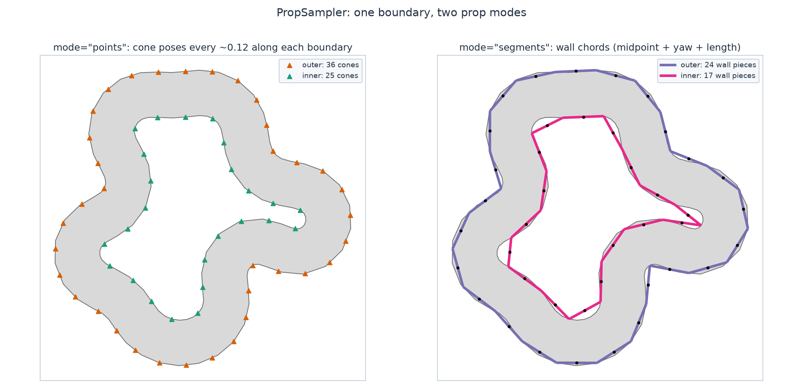

Boundary props
==============

``track_gen.props.PropSampler`` resamples a boundary at a set spacing into
instancing poses — cones (``mode="points"``) or wall pieces
(``mode="segments"``, chord midpoint + yaw + length).

         wall chords along both boundaries (segments mode).

   The two prop modes on one track: cone poses (left) and wall chords
   (right), sampled from the inner and outer boundary independently.

.. code-block:: python

   from track_gen import TrackGenerator
   from track_gen.pipeline import presets
   from track_gen.props import PropSampler

   E, device = 64, "cuda:0"                     # or "cpu"
   gen = TrackGenerator(presets.track(num_envs=E, device=device))
   track = gen.generate()

   cones = PropSampler(track, spacing=0.2, boundary="outer", mode="points").sample()
   walls = PropSampler(track, spacing=0.2, boundary="inner", mode="segments").sample()
   # cones.count[e] props per env, NaN-padded past it; call sample() after every generation

Both modes snap the requested spacing per :term:`env` —
``n = clamp(round(perimeter / spacing), 3, max_props)`` at effective step
``perimeter / n`` — so every closed ring places props with no seam gap or
doubled prop. ``PropSet.count``/``truncated``/``step`` report what was
actually placed; see the left panels of the overview figure on
:doc:`the utilities overview </utilities/overview>`.

``PropSampler(track, spacing)`` with ``max_props=None`` sizes the ring once, at
construction, from the batch it is given (a readback), and ``sampler.max_props`` reads it.
Tracks that grow later (a per-env :term:`size` curriculum) then get clipped rings
(``truncated``, at a coarser step). Size it with no readback, from the longest track the
generator can produce, through the :term:`component`:

.. code-block:: python

   from track_gen.tools import ComponentContext, Props

   cc = ComponentContext.for_producer(gen)        # the generator's layout and bounds
   props = cc.add(Props(0.2, boundary="outer"), track)
   ring = props.result                            # the PropSet; props.utility is the sampler
   props.on_generate(cc.ctx, None)                # after every generation

.. snippet: after

   assert props.utility.max_props == 173

``Props(prop_spacing)`` takes ``max_props = max(3, ceil(max_loop_length /
prop_spacing))``, with ``max_loop_length = 1.5 * N_max * spacing + dZ`` the longest track
the generator can produce (:term:`N_max` and the centerline's :term:`spacing`;
:ref:`course-checkpoint-capacity` explains the bound): 173 props at a prop spacing of 0.2
for the default track, which holds the boundary of every track that is not truncated, at
any size (:ref:`tuning-size-utilities`). A generator that declares no bound (an elevation
without declared height ranges, a variable width, a generator that provides its own
altitudes or half-widths) makes ``Props`` raise ``ValueError``: pass ``max_props``. A
:doc:`course </utilities/course>` takes a ``Props`` component in ``extra=[...]`` and
calls ``on_generate`` for you.

``PropSampler(track, ...)`` takes any ``HasBand`` source (a ``Track``, a
``track.view(e0, e1)``, or an object with the members) and checks what it reads,
``outer``, ``inner``, ``count`` and :term:`valid`, at construction (see
:ref:`utilities-sources`). An :term:`invalid env` (``valid[e] == 0``) gets no props:
``count = 0``, NaN poses, ``truncated = 0``, ``step`` NaN, as an env with no track
(:ref:`utilities-invalid-envs`).

Props are rendering-only by design. To make point props physical (cones a
vehicle can clip), feed their positions to
:class:`track_gen.collision.DiscChecker` — see
:doc:`collision </utilities/collision>`.

API: :class:`track_gen.props.PropSampler`, :class:`track_gen.props.PropSet`,
:class:`track_gen.tools.Props` (:ref:`reference-runtime`).
